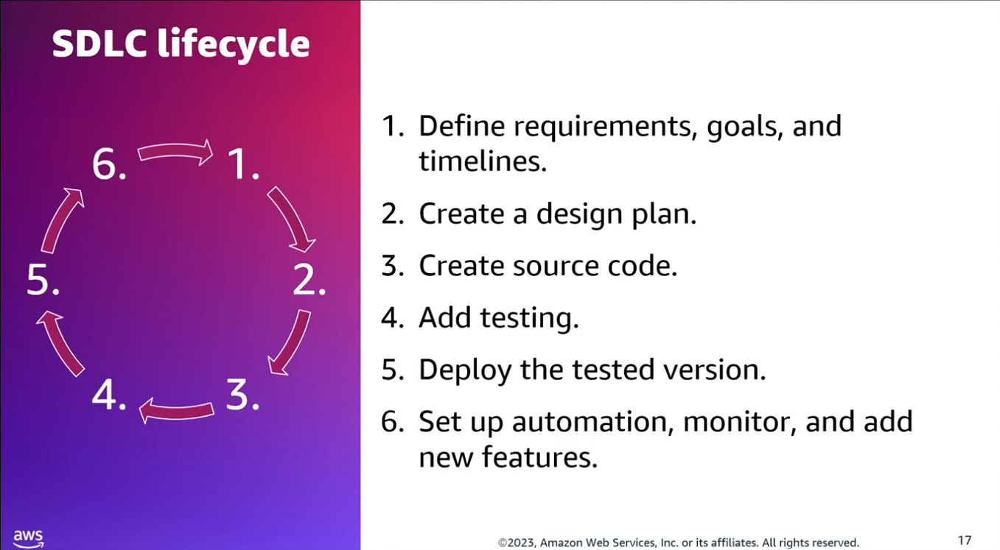
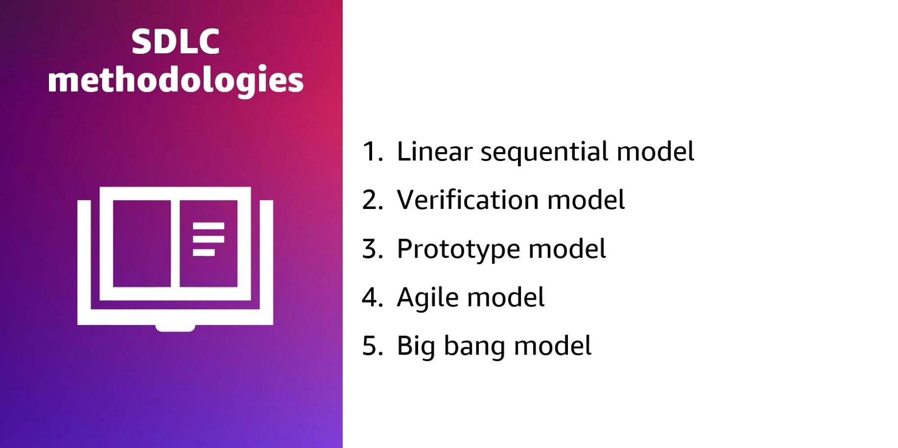
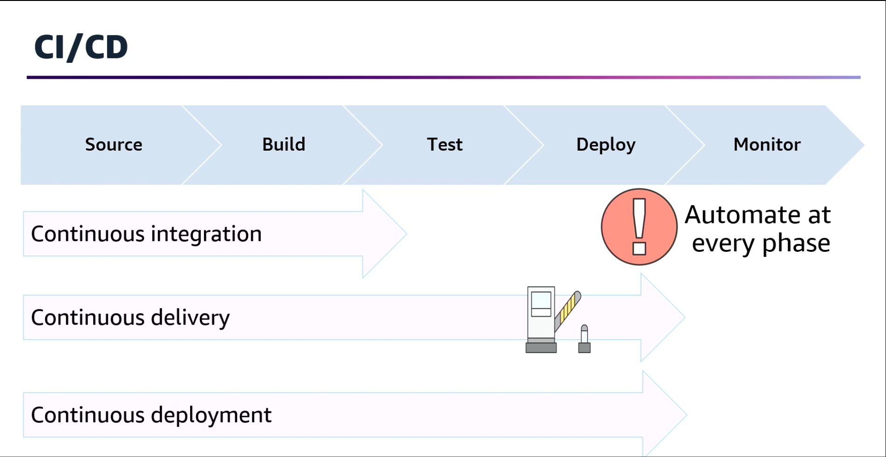
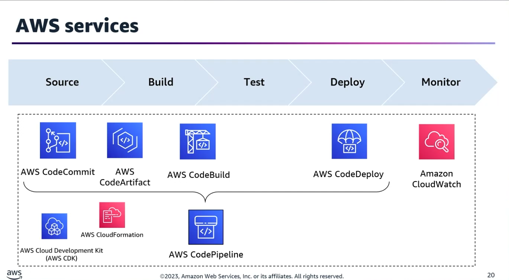
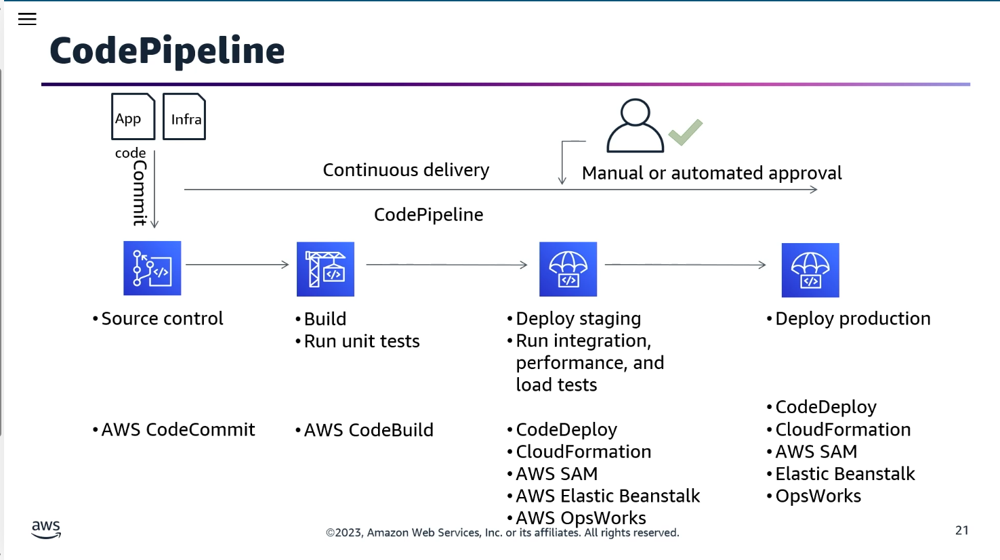
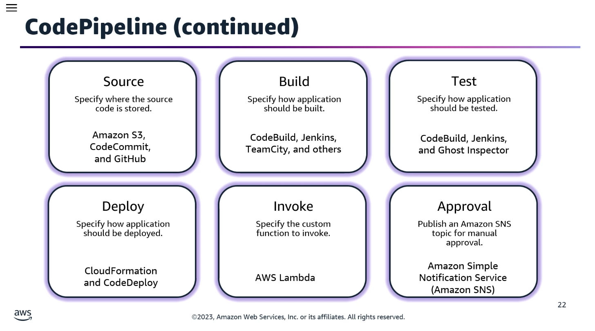
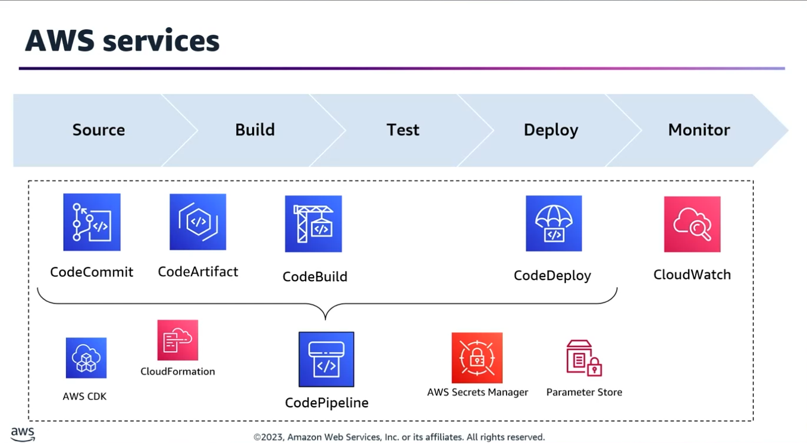
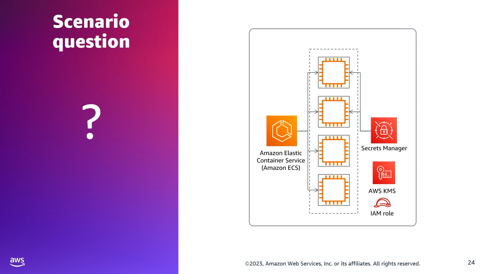
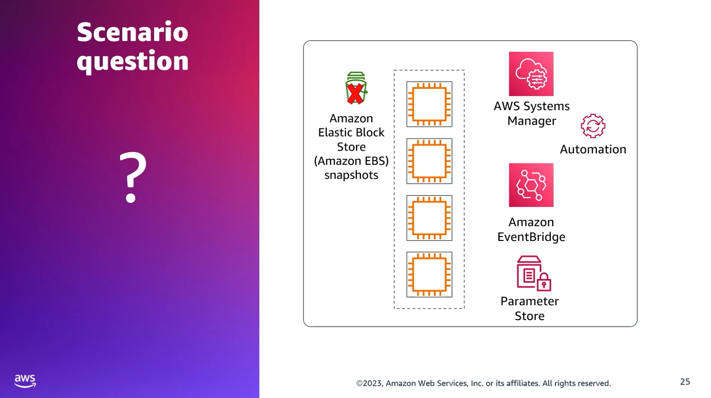

## Task Statement 1: Implement CI/CD pipelines. 

### 📌 1. SDLC Fundamentals & Methodologies

The Software Development Lifecycle (SDLC) is the structured process used by teams to design, develop, test, and maintain high-quality software.

#### ⏱️ The 6 Core Phases of SDLC

1. **Requirement Analysis:** Defining the goals, requirements, and timelines. Outputs the Software Requirement Specification (SRS) document, which must be approved by senior leadership.
2. **Design Plan:** Constructing the architecture, user interface, features, infrastructure requirements, and security frameworks.
3. **Source Code & Development:** The execution phase where the actual coding happens.
4. **Testing:** Evaluating the code for bugs and regressions before it is marked ready for production.
5. **Deployment:** Releasing the tested software into the production environment. (Requires deep knowledge of single/multi-account deployment patterns and strategies).
6. **Maintenance & Enhancement:** Remediating bugs, creating automation, setting up monitoring, upgrading versions, and adding new features.

#### ⚙️ Popular SDLC Models

Different methodologies prioritize different aspects of creation and measure success uniquely:
- **Linear Sequential (Waterfall):** Cascade-based, where each phase must finish before the next begins.
- **Verification and Validation (V-Model):** An extension of the waterfall model that pairs each development phase with a corresponding testing phase.
- **Prototype Model:** Creates a toy working model to evaluate user requirements before full-scale engineering.
- **Agile Model:** Iterative and incremental development focusing on speed, collaboration, and adaptability.
- **Big Bang Model:** High-risk model with little planning, focusing all resources on coding directly.

### 🚀 2. CI/CD: The Ultimate SDLC Enhancement

> ⚠️ Exam Watch: CI/CD is not a replacement for the SDLC. It is an automated enhancement that accelerates software delivery by integrating automation directly into the lifecycle stages. 

``` 
[ Source ] ──> [ Build ] ──> [ Test ] ──> [ Staging ] ──> [ Production ]
                                 │
                     (If any stage fails, build STOPS)
```
- **The Pipeline Concept:** Code is submitted at one end, processed through a series of logical stages (Source ➔ Build ➔ Test ➔ Staging ➔ Production), and emerges as production-ready software.
- **Failing Fast:** Each stage acts as a quality gate. If a problem is uncovered early, the pipeline immediately halts and alerts the team, preventing bugs from reaching customers.

#### 🔑 Defining the "Continuous" Trio

- **Continuous Integration (CI):** The practice of regularly checking code into a central repository, triggering automated builds and tests to verify the changes immediately.
- **Continuous Delivery (CDel):** Extends CI by automatically deploying code changes to production-like testing environments. It can extend to production but includes a manual intervention/approval step before hitting live customers.
- **Continuous Deployment (CDep):** Extends Continuous Delivery by removing manual gates entirely. Every change that passes all automated pipeline stages is automatically released directly to production without human intervention.

#### 🛠️ Infrastructure as Code (IaC) & Automation

- **Automation (via scripts, templates, and tools):** Ensures operations are fast, reliable, and repeatable.
- **In a successful DevOps environment, Infrastructure is Managed as Code (IaC):** To rapidly spin up, tear down, and tune test/production environments.

### ☁️ 3. AWS CI/CD Developer Tools Ecosystem

AWS offers a comprehensive suite of developer tools to orchestrate and accelerate release cycles:
- **AWS CodePipeline:** A continuous delivery service that models, visualizes, and automates release steps. It natively integrates with AWS services (like Amazon S3) or third-party products (like GitHub).
- **AWS CodeCommit:** A secure, highly scalable, managed source control service that hosts private Git repositories.
- **AWS CodeBuild:** A fully managed build service that compiles source code, runs unit tests, and produces ready-to-deploy software artifacts.
- **AWS CodeDeploy:** A deployment service that automates application deployments to Amazon EC2, AWS Fargate, AWS Lambda, or on-premises servers.
- **Amazon Elastic Container Registry (ECR):** A fully managed container registry for storing, managing, and deploying Docker container images.
- **AWS CodeArtifact:** A fully managed artifact repository service that makes it easy for organizations to securely store and share software packages.
- **AWS CodeStar:** A unified user interface that lets you easily manage your software development activities in one place.




#### 🛡️ Configuration & Secrets Management

Pipelines can integrate securely with:
- **AWS Secrets Manager:** For storing and automatically rotating highly sensitive credentials (e.g., database passwords).
- **AWS Systems Manager Parameter Store:** For managing non-secret configuration parameters and strings.

### 📐 4. Real-World Architecture & Exam Scenarios

#### Scenario A: Network Function Virtualization (NFV) Framework

- **Objective:** Create and automate a pipeline using AWS CDK and CloudFormation for a communication service provider framework.
- **Solution Architecture:**                                            
	1. Use AWS CDK and CloudFormation to build network prerequisites, deploy underlying infrastructure, establish network functions, and handle continuous updates in a test environment.
	2. Implement AWS CodePipeline to automate the build, test, and deployment phases.
	3. Use AWS CodeBuild to compile, build, and test containerized or virtual network functions (VNF).
	4. Perform pre-deployment validation, functional, integration, baseline, regression, reliability, and disaster recovery testing before seeking approval to deploy to the production environment.

#### Scenario B: Securing Database Credentials for an Amazon ECS Task

- **Objective:** Securely pass database credentials to an Amazon ECS container image via environment variables with auto-rotation and lifecycle management.
- **Solution Architecture:**
	1. Store the credentials inside AWS Secrets Manager and encrypt them using a customer-managed key in AWS KMS.
	2. Modify the Amazon ECS Task Execution IAM Role to grant secretsmanager:GetSecretValue and kms:Decrypt permissions.
	3. Inside the ECS Task Container Definition, map the environment variable utilizing the valueFrom attribute, passing the full Amazon Resource Name (ARN) of the Secrets Manager secret. ECS will automatically pull and inject it securely at runtime.

#### Scenario C: Automating and Sharing AMI Generations Across Pipelines

- **Objective:** Automatically create new application versions via Amazon Machine Images (AMIs) without manual EBS snapshots and share them across multiple pipelines.
- **Solution Architecture:**
	1. Integrate AWS Systems Manager (SSM) Automation to execute a document that builds and bakes the new AMI cleanly.
	2. Use Amazon EventBridge to detect pipeline code check-ins or triggers, which automatically kicks off the SSM Automation workflow.
	3. Create an AWS CodePipeline Custom Action to hook this step neatly into the delivery process.
	4. Save the newly generated AMI ID inside the AWS Systems Manager Parameter Store. Other decoupled build pipelines can now query this single Parameter Store parameter dynamically to use the latest AMI version.
