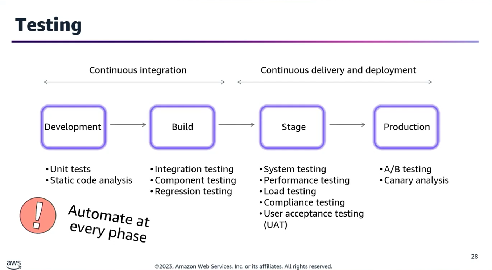
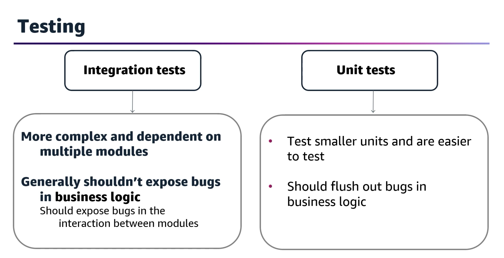
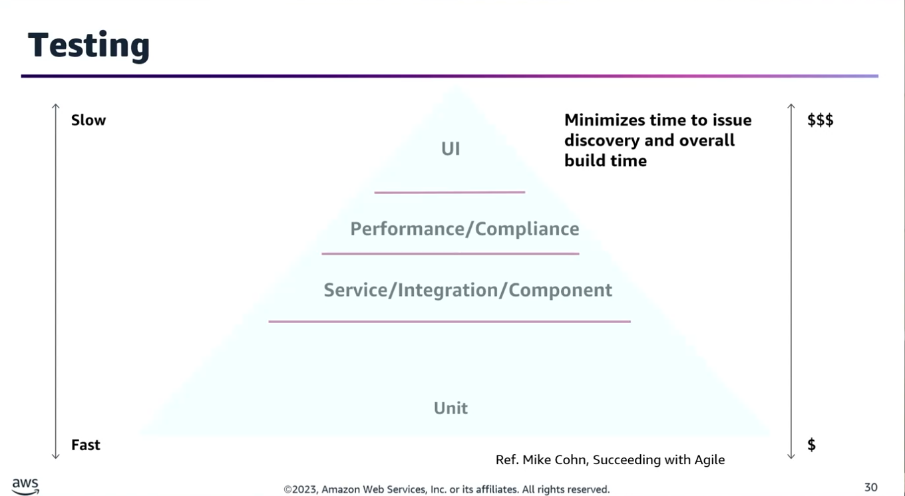
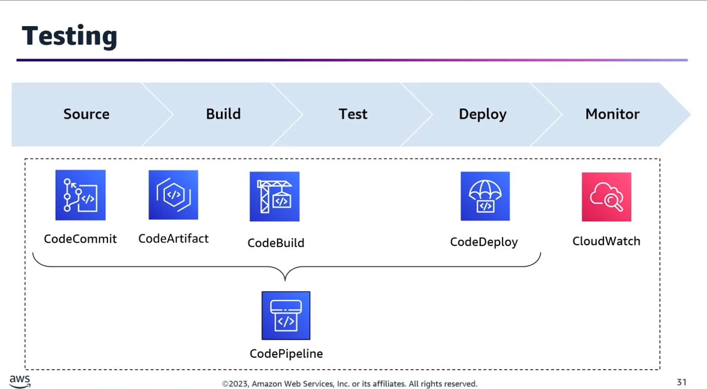
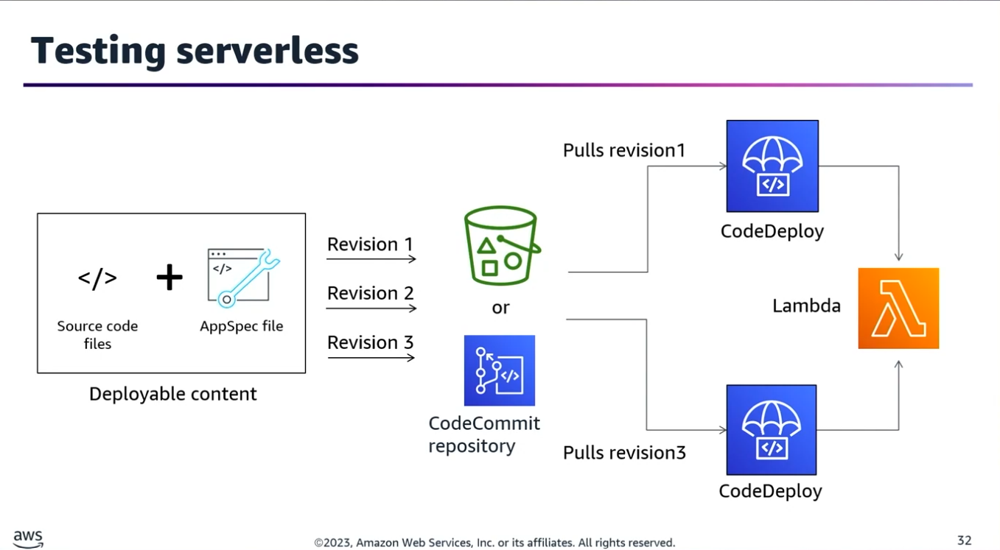
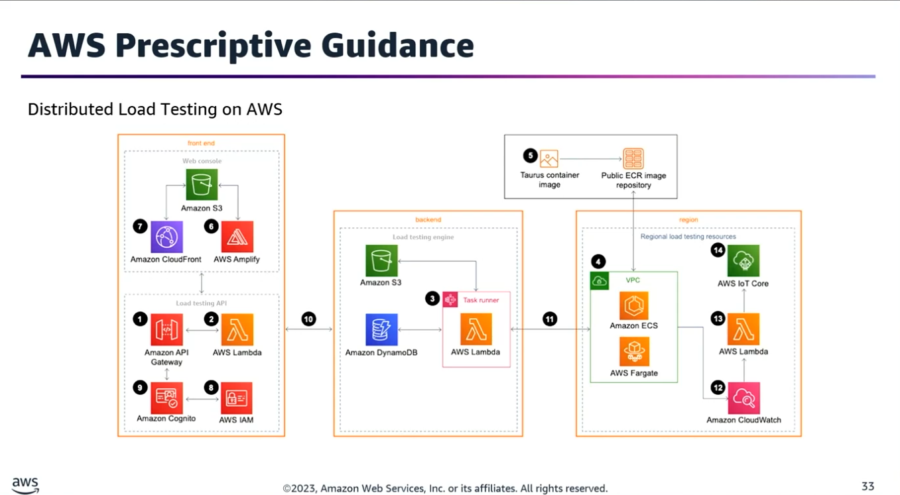
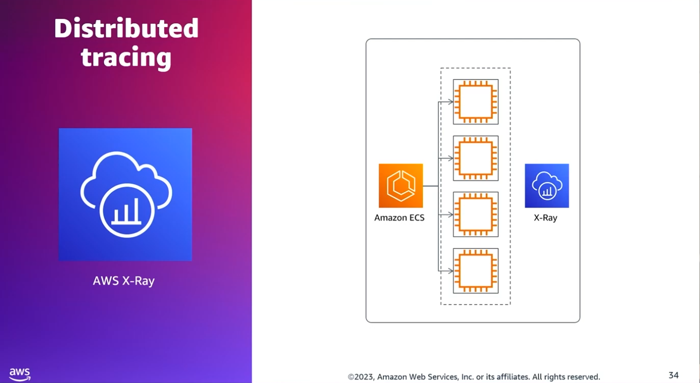
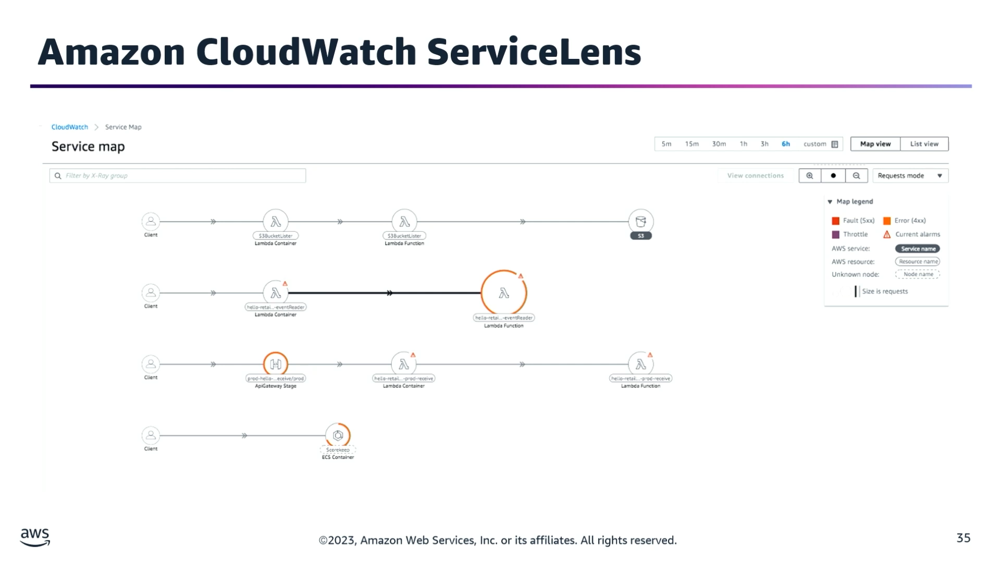
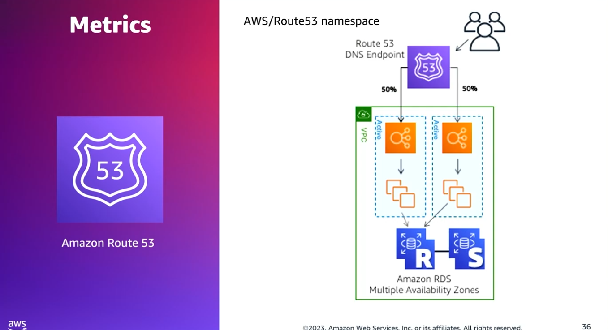
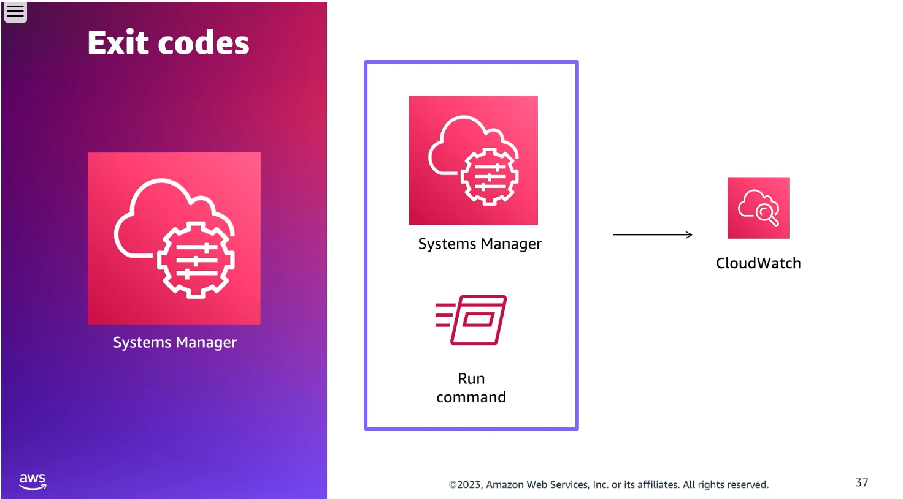

## Task Statement 2: Integrate automated testing into CI/CD pipelines. 

### 1. CI/CD Pipeline Fundamentals

- **Continuous Integration (CI):** Compiling and testing the code. Code quality testing begins the moment code is checked out from the source code repository.
- **Continuous Delivery (CD):** Producing a deployment-ready artifact from your code.
- **Continuous Deployment (CD):** Deploying the application automatically to production after passing all pipeline gates.
- **Pipeline Gates:** Each stage acts as a quality gate. Failures at an early stage halt progression, routing the code back to the previous lifecycle step for troubleshooting and version incrementing.

### 2. Software Testing Methodologies & Pipeline Placement

- **Unit Testing:** Validates individual units or the smallest units of functionality. Configured in the CI tool to run directly against the codebase to ensure fresh build environments can be created and code integrity is maintained as the codebase grows.
- **Integration Testing:** Verifies the interfaces between components against the software design. Must be a repeatable process to ensure system integrity. Best practice involves writing tests that mock AWS service behaviors (especially in serverless architectures).

- **Component Testing:** Tests message-passing systems and outcomes between various individual components.
- **Acceptance / Requirements Testing:** Executed after the code is packaged to ensure it meets requirements established in the design document.
- **System Testing:** Tests the system end-to-end to verify that the software satisfies overall technical requirements.
- **User Acceptance Testing (UAT):** Validates the end-to-end business flow from an end-user perspective.
- **Compliance Testing:** Evaluates whether code changes comply with specific defined standards, regulations, and specifications.

### 3. Performance Testing Under Workload

Used to investigate, measure, validate, and verify quality attributes including scalability, reliability, and resource usage.
- **Load Tests:** Tests application behavior under an expected specific workload.
- **Stress Tests:** Evaluates system stability by pushing it beyond normal operational capacity.
- **Spike Tests:** Tests the system's reaction to sudden, massive bursts of traffic/workload.
- **AWS Solution:** Use Distributed Load Testing on AWS to automate software testing at scale. It simulates thousands of connected users generating transactional records at a constant pace without provisioning servers and supports multi-Region testing.

### 4. Pull Request (PR) & Merge Automation

To prevent breaking changes and ensure high code quality before code merges:
1. **Validate PRs:** Trigger automated builds and tests on development branches using AWS CodeCommit, AWS CodeBuild, and AWS Lambda before merging is permitted.
2. **Pipeline Delivery:** Use AWS CodePipeline to visualize the pipeline and automatically build/deploy the approved, merged changes.

### 5. Multi-Environment Safeguard Architecture (Test vs. Prod)

When migrating an application to AWS with a test and production environment, implement these safe deployment steps in CodePipeline:
- **Step 1:** Add a CodeBuild test action for both unit and functional testing right after the source/build stage.
- **Step 2:** Use a CodeDeploy action to deploy the latest revision to a pre-production test environment.
- **Step 3:** Introduce a Manual Approval action in the pipeline to halt progression until staging tests are verified.
- **Step 4:** Configure a final CodeDeploy action to push the validated code to the production environment.

### 🛠️ Application Observability & Health Monitoring

#### Scenario 1. Distributed Tracing with AWS X-Ray

Used to instrument applications, detect high-latency occurrences, map out microservice paths, and resolve intermittent availability issues.
- **Architecture:** The X-Ray SDK does not send trace data directly to the AWS X-Ray API. Instead, it offloads data to an intermediate X-Ray daemon.
- **Docker/ECS Implementation:**
	- Create a Docker image running the X-Ray daemon and upload it to a repository (e.g., Amazon ECR).
	- Deploy the daemon container to your Amazon ECS cluster.
- **Task Definition Specifications:**
	- Port Mapping: The X-Ray daemon listens for raw segment traffic on UDP port 2000.
	- Network Mode: Uses the default bridge network mode for communication between the application container and the daemon container.

#### Scenario 2. Advanced CloudWatch Monitoring

- **Amazon CloudWatch Synthetics:** Uses modular "canaries" to actively monitor sites, API endpoints, and web workflows.
- **Amazon CloudWatch ServiceLens:** Integrates infrastructure monitoring, transaction monitoring, and end-user monitoring into an end-to-end contextualized visualization layer.
- **Amazon Route 53 Health Checks:** Monitored via explicit Route 53 metrics and dimensions published directly into the CloudWatch AWS namespace.

#### Scenario 3. Command & Systems Management

- **AWS Systems Manager (SSM) Run Command:** Used to manage how commands are executed across fleets and explicitly handles execution via exit codes.
- **Metrics:** Systems Manager automatically publishes command execution status metrics directly to CloudWatch.
