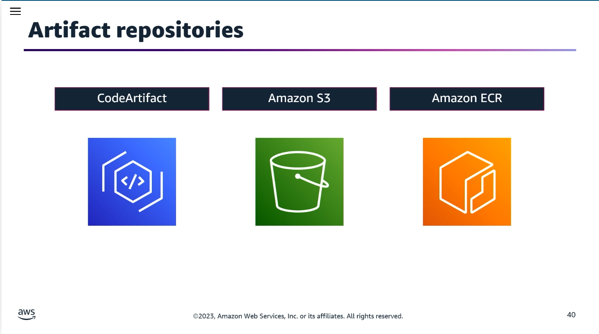
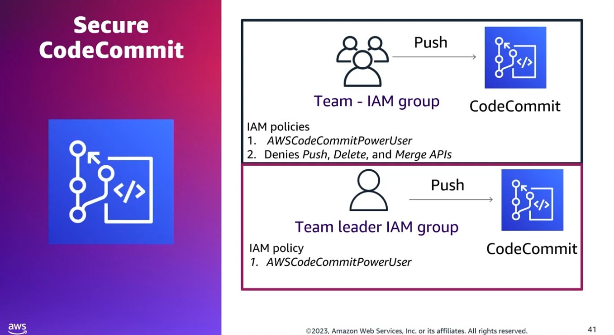
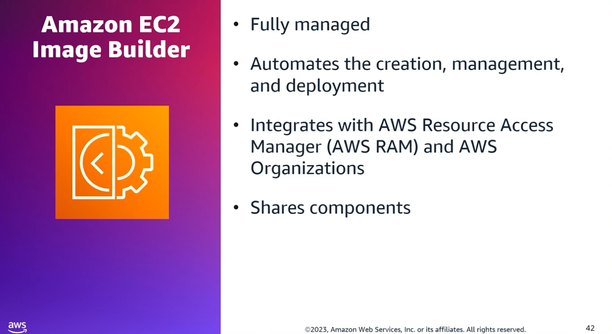
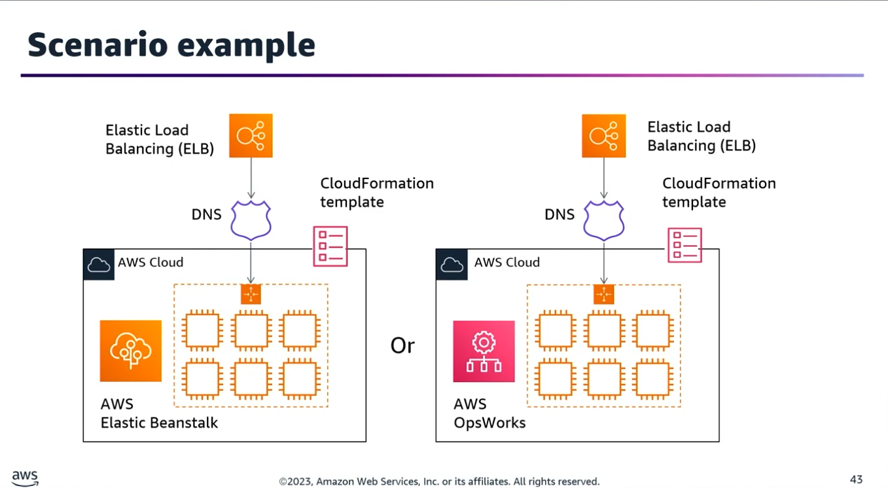
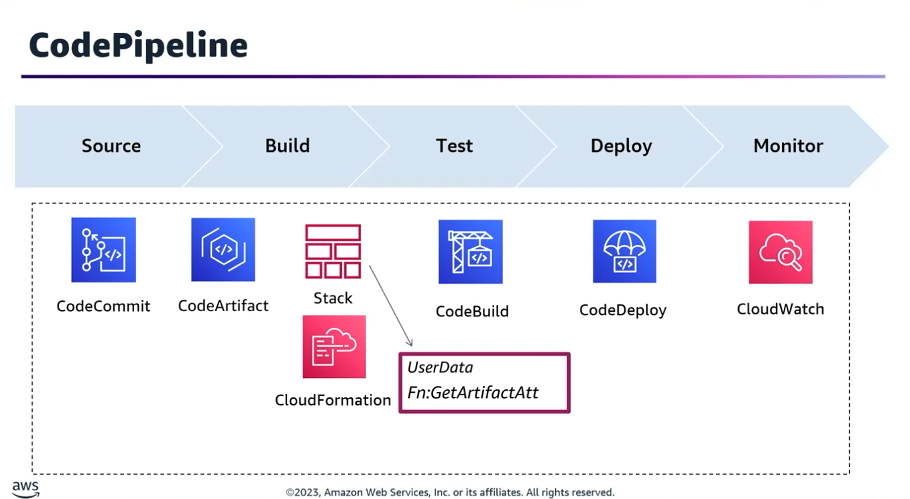
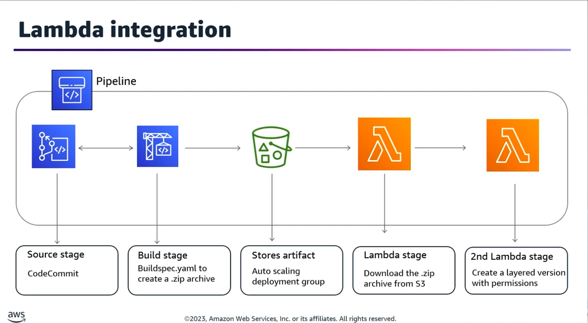
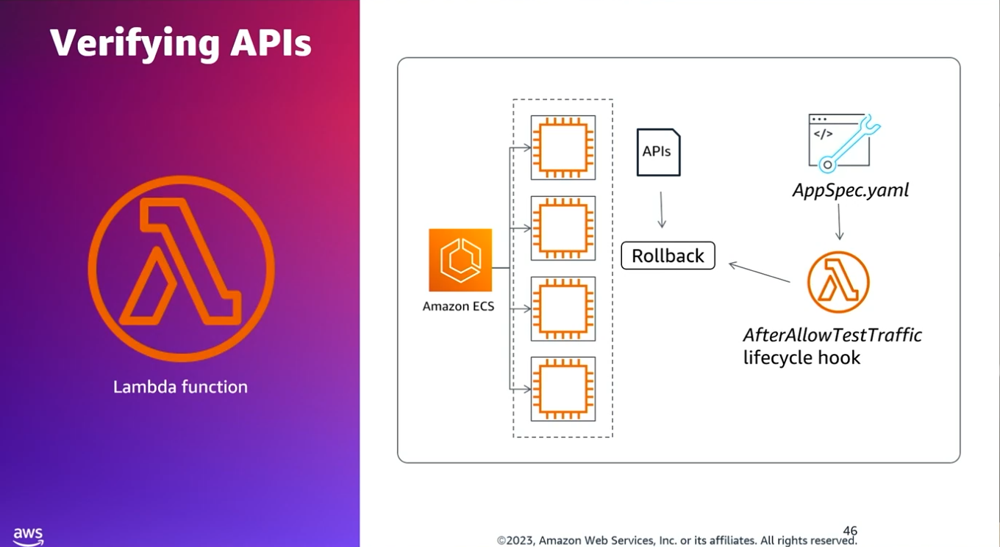
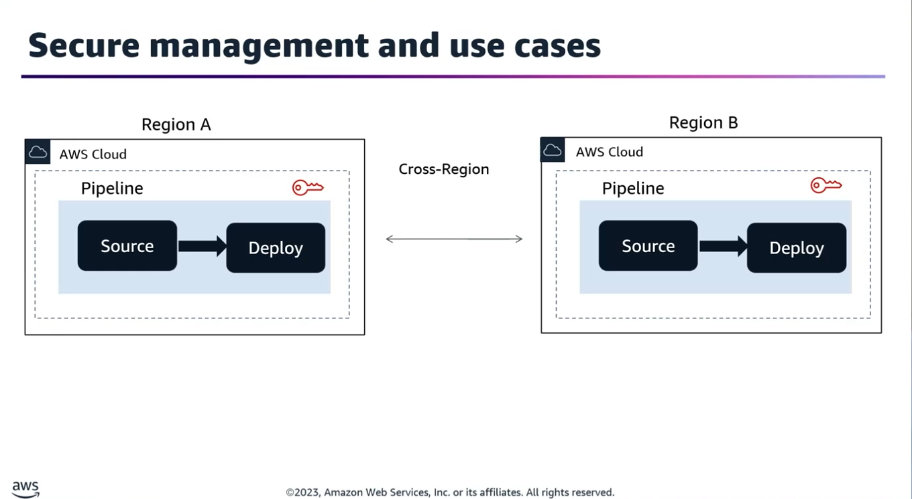

## Task Statement 3: Build and manage artifacts.

### 1. Creating & Configuring Artifact Repositories

Artifacts must be stored securely and centrally. Core AWS services utilized for this include:
- **AWS CodeArtifact:** Managed artifact repository service for software packages (e.g., npm, pip, Maven, NuGet).
- **Amazon S3:** General-purpose object storage commonly used for storing zipped build artifacts and pipeline data.
- **Amazon ECR (Elastic Container Registry):** Fully managed Docker container registry used to store, manage, and deploy container images.

#### 🔒 Securing Branch Commits (CodeCommit Branch Protection)

**Scenario:** You need to protect the main branch from direct changes by regular team members while giving them full access to development and staging branches. The team lead must retain full access.

- **IAM Group 1 (Entire Team):**
	- **Attach the managed policy:** AWSCodeCommitPowerUser.
	- **Attach an additional inline/customer-managed policy** that explicitly applies a Deny effect to the following actions when the resource specifies the main branch:
		- codecommit:GitPush
		- codecommit:DeleteBranch
		- codecommit:MergeBranchesByFastForward / MergeBranchesBySquash / MergeBranchesByThreeWay
- **IAM Group 2 (Team Leader):**
	- Attach only the AWSCodeCommitPowerUser policy (allowing full push/merge capabilities across all branches).

### 2. Automating Image Build Processes (EC2 Image Builder)

EC2 Image Builder automates the creation, management, and deployment of customized, secure, and up-to-date server (AMI) and container images.

#### 🌐 Cross-Account Sharing

Integrates with AWS Resource Access Manager (RAM) to share resources globally across AWS accounts or within an AWS Organization.
- **Sharable Resources:** Components, Images, Image Recipes, and Container Recipes.

#### 🔑 Key Concepts & Lifecycle

- **Managed Image:** The final, secured, and validated AMI or container image output.
- **Image Recipe / Container Recipe:** A blueprint defining the source base image, components to install, and test configurations.
- **Base Image:** The starting operating system image (e.g., Amazon Linux 2, Ubuntu, Windows Server).
- **Component Document:** A declarative YAML document specifying actions to run during the configuration/validation phases.
- **Runtime Stages & Configuration Phases:**
	- **Build Stage:** Launches a temporary EC2 instance, applies the configurations defined in the build components, and creates a snapshot.
	- **Test Stage:** Launches a new temporary instance from the newly built image to run verification tests (validation scripts). If tests pass, the AMI/container is marked as available.

### 3. Reusable CloudFormation Templates in CodePipeline

**Scenario:** You want to avoid manually hardcoding static environment attributes or runtime parameters across separate deployment pipelines for Staging and Production.

#### ⚙️ Automation Strategy

1. **Multi-Stage Pipeline:** Design a single AWS CodePipeline containing distinct sequential stages for each target environment.
2. **CloudFormation Parameter Overrides:** Within the pipeline's CloudFormation action provider configuration, leverage Parameter Overrides. This replaces default template parameter values dynamically at pipeline runtime based on the stage.
3. **CloudFormation Mappings (Fn::FindInMap):** Use the Mappings section within the template to switch configuration details (like specific EC2 UserData blocks, AMI IDs, or instance types) automatically to match the target environment.
4. **Dynamic Attribute Retrieval (Fn::GetArtifactAtt):** Utilize the GetArtifactAtt template helper function within the pipeline definition to extract zip metadata, bucket names, or filenames directly from input source artifacts to pass down as inputs.


### 4. Lambda & CodeBuild Integration for Artifacts

**Scenario:** Creating and deploying an AWS Lambda Layer automatically upon source code changes.
```
[CodeCommit] ➔ Triggers ➔ [CodePipeline] ➔ [CodeBuild (buildspec.yaml)] ➔ Uploads Zip to [S3 Bucket] ➔ Invokes ➔ [Lambda Custom Function] ➔ Publishes Layer Version
```

- **Step 1:** Developer pushes dependency changes to CodeCommit.
- **Step 2:** CodePipeline triggers a CodeBuild job executing instructions inside a buildspec.yaml file.
- **Step 3:** CodeBuild packages the libraries into a standardized zip archive.
- **Step 4:** CodePipeline outputs and registers this zip archive as an artifact inside an encrypted Amazon S3 bucket.
- **Step 5:** CodePipeline executes an AWS Lambda provider action, invoking a custom function that downloads the zip from S3 and calls PublishLayerVersion across targeted AWS Regions.

### 5. ECS Blue/Green Deployments with Validation Tests

**Scenario:** Verifying a core set of APIs function properly on Amazon ECS before serving production traffic, with automated rollbacks upon failure.

#### 📐 Implementation Strategy

- **AppSpec.yaml Lifecycle Hooks:** Define the validation automation inside the AfterAllowTestTraffic hook.
- **Validation Script:** Point the hook to an AWS Lambda function that triggers a suite of synthetics/API health tests against the temporary deployment endpoint.
- **Rollback Mechanics:** If the Lambda function encounters an API failure, it returns a failing token status back to the CodeDeploy deployment ID. CodeDeploy immediately halts the promotion and shifts traffic back to the original task set.
- **Network Infrastructure:** CodeDeploy orchestrates this transition seamlessly using an Application Load Balancer configured with two listeners and two target groups:
	- **Production Traffic Listener (e.g., Port 443):** Routes active, external user traffic to the stable production container target group.
	- **Test Traffic Listener (e.g., Port 8443):** Routes isolated traffic to the new, unverified replacement container target group during deployment for hook validation.

### 6. Secure Multi-Region Artifact Management
**Scenario:** Hosting a global application while strictly adhering to data residency requirements (i.e., all regional pipeline artifacts must remain entirely stored within their respective local AWS region boundaries).

#### 🗺️ Cross-Region Pipeline Setup

1. **Primary Control Plane:** Create the primary AWS CodePipeline and AWS CodeCommit source repository in your base/primary region.
2. **Cross-Region Actions:** Add deployment actions targeting the destination secondary regions. CodePipeline natively supports cross-region target deployment actions.
3. **Automated Isolation:** When cross-region actions are created via the AWS Management Console, CodePipeline automatically provision default, regional S3 artifact buckets within each localized region.
4. **Encryption Keys (KMS):** To secure the data, you must manually provision a customer-managed AWS KMS key in the exact same region where the cross-region action executes, owned by the pipeline's AWS account. This ensures data is locally encrypted before it lands in the localized S3 artifact bucket.
