## Task Statement 4: Implement deployment strategies for instance, container, and serverless environments.
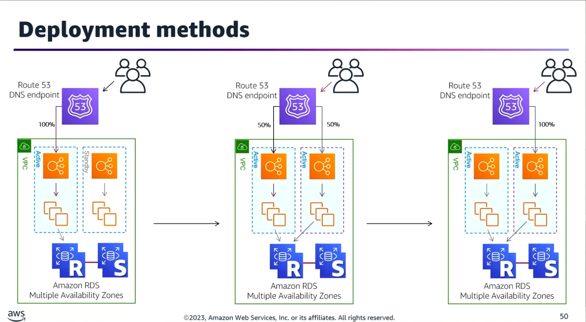

### 1. Amazon ECS Deployment Strategies

The depth required for the Professional exam mandates understanding the configuration, mechanics, and failure handling of the three core ECS deployment types.

#### The Three ECS Deployment Types
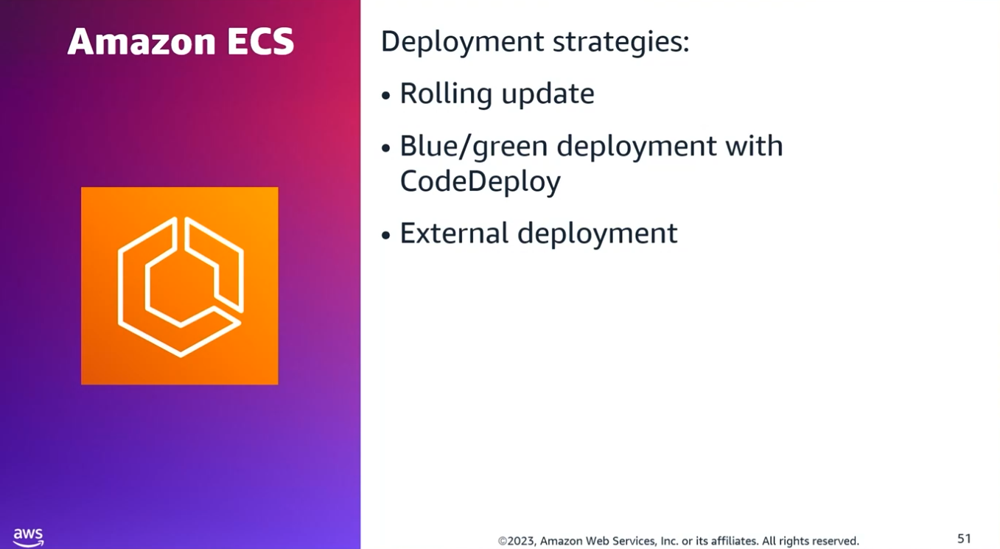
- **Rolling Update**: Modifies the current running version of the service with a new version. Controlled by minimumHealthyPercent and maximumPercent parameters.
- **Blue/Green Deployment (via AWS CodeDeploy)**: Minimizes downtime by launching a new set of tasks (Green) alongside the old ones (Blue), shifting traffic balance incrementally or all-at-once, and verifying before deleting the old fleet.
- **External Deployment**: Allows third-party orchestrators (e.g., step functions or custom scripts) to manage task deployments via the deployment controller.

#### Rapid Deployment Failure Detection (Rolling Updates)

1. **CloudWatch Alarms**: Monitors service performance metrics (like CPU/Memory utilization or ELB 5XX errors) during deployment to trigger an automated rollback if specific thresholds are breached.
2. **ECS Deployment Circuit Breaker**:
	- Automatically monitors if tasks fail to reach a RUNNING or healthy state.
	- Can be configured to automatically roll back to the last successfully deployed version once a failure is declared.

### 2. Advanced EC2 Blue/Green Scenario & Architecture

#### Scenario Requirements

- **Infrastructure:** An ASG of EC2 instances spanning multiple Availability Zones behind an Application Load Balancer (ALB).
- **Traffic Shifting:** 50% of traffic routes to the new version; 50% remains on the old version.
- **Success Criteria:** Traffic successfully routes to $\geq$ 50% of the new instances, temporary installation/build files are purged, and the old fleet is immediately terminated post-success for cost optimization.

#### Design Solution & Implementation Matrix
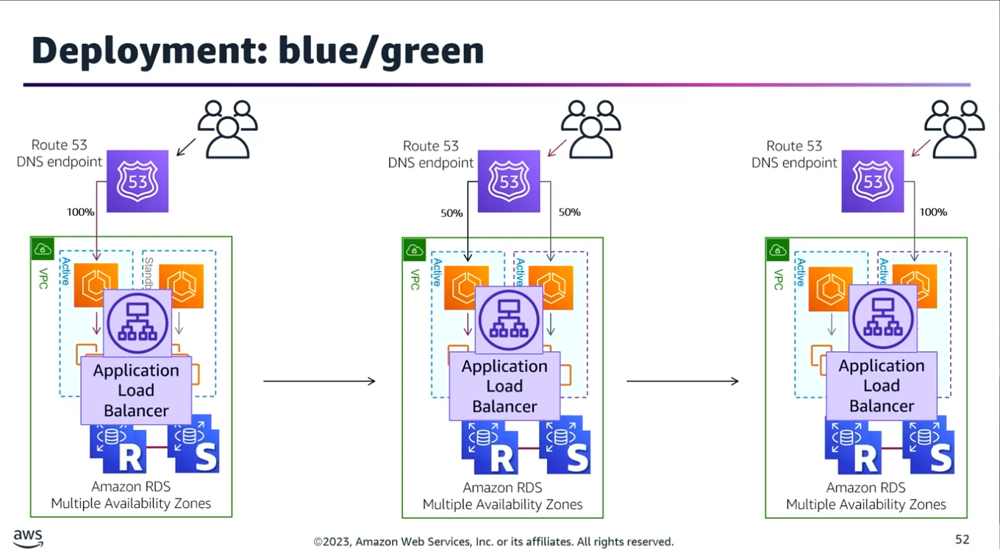
| Component |	Configuration / Implementation |
|-----------|--------------------------------|
|**Routing / Scaling** |	Application Load Balancer (ALB) integrated with AWS CodeDeploy.|
|**Deployment Type** |	Blue/Green Deployment group. |
|**Minimum Healthy Host** |	Defined at 50% inside CodeDeploy's custom deployment configuration. |
|**Lifecycle Clean-up** |	Run script under the BeforeAllowTraffic lifecycle hook in appspec.yml to purge temporary files before live users hit the instances. |
|**Cost Optimization** |	Configure the CodeDeploy Deployment Group to immediately terminate the original instances in the old Auto Scaling Group once the green deployment succeeds.


### 3. AWS CodeDeploy Architecture & Components
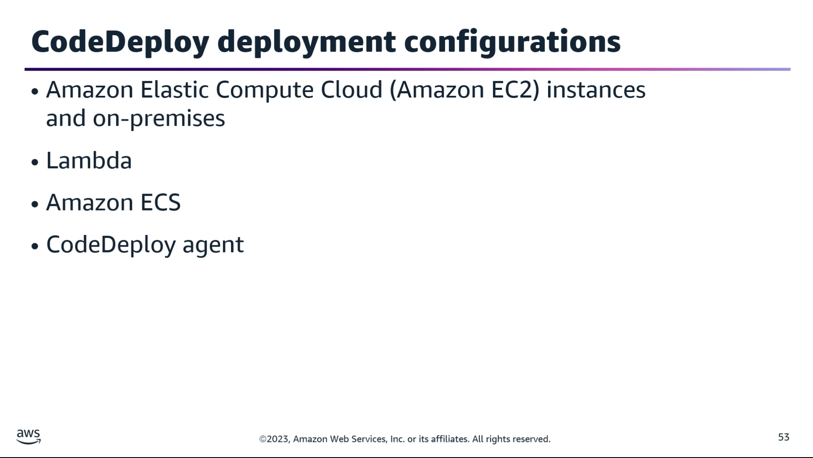
#### Lifecycle Hooks Behavior by Compute Platform

The contents of the hooks section in the appspec.yml file behave fundamentally differently depending on the target compute resource:
- **EC2 / On-Premises:** Maps lifecycle events directly to shell scripts or code files hosted on the OS filesystem.
- **AWS Lambda / Amazon ECS:** Specifies Lambda validation functions that execute tests and signal Success or Failure back to CodeDeploy via a callback before moving to the next stage.
- **Note:** If an event hook is omitted, CodeDeploy skips it. Hooks are only mandatory if active scripting or validation is required.

#### CodeDeploy Agent Requirements

- **Required for:** Amazon EC2 instances and On-Premises bare metal/virtual servers.
- **NOT Required for:** AWS Lambda or Amazon ECS (managed natively by AWS).

### 4. Serverless & AWS Lambda Deployment Patterns
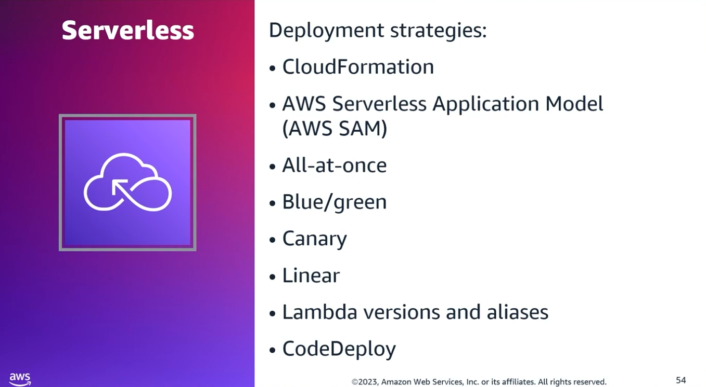
#### Frameworks & Mechanisms

- Deployments are orchestrated primarily via AWS CloudFormation or AWS SAM (Serverless Application Model).
- Supported strategy types: All-at-Once, Linear, and Canary.

#### Versioning vs. Aliases

- **Versions:** Immutable snapshots of a Lambda function’s code and environmental configurations.
- **Aliases:** Mutable pointers targeting a specific version (e.g., a prod alias pointing to version 2). Aliases possess unique ARNs used to invoke specific lifecycles.

#### CI/CD Progression Pattern (Integration Testing)

1. Push new code and configuration.
2. Publish a new immutable version.
3. Invoke and execute automated integration tests directly against the new version's ARN.
4. If testing passes, shift the production Alias to point to the new version, shifting traffic seamlessly.

#### Serverless Lifecycle Hooks (CodeDeploy)
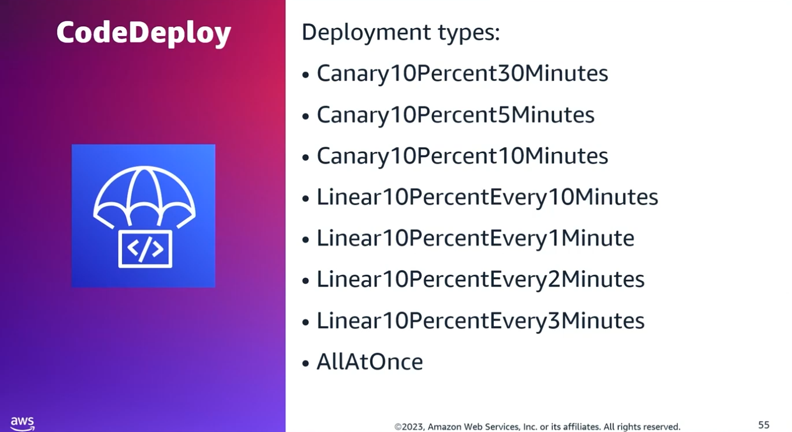
- **PreTraffic Hook:** A dedicated Lambda validation function executed before traffic begins shifting. Must explicitly return a success callback to CodeDeploy, or the deployment is automatically canceled and rolled back.
- **PostTraffic Hook:** A Lambda validation function executed after traffic shifting concludes (ideal for final smoke or integration testing).

### 5. Troubleshooting & Observability Real-World Scenarios
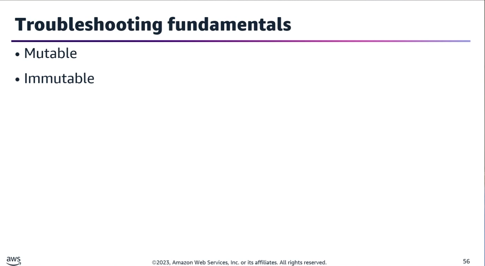
#### Scenario A: URL Protocol Change (HTTP ➡️ HTTPS) Breaking EC2 ASG App

- **The Problem:** A rolling deployment changed an API connection URL to HTTPS. The API functions externally, and the VPC Network Access Control Lists (NACLs) have not changed, yet the app fails.
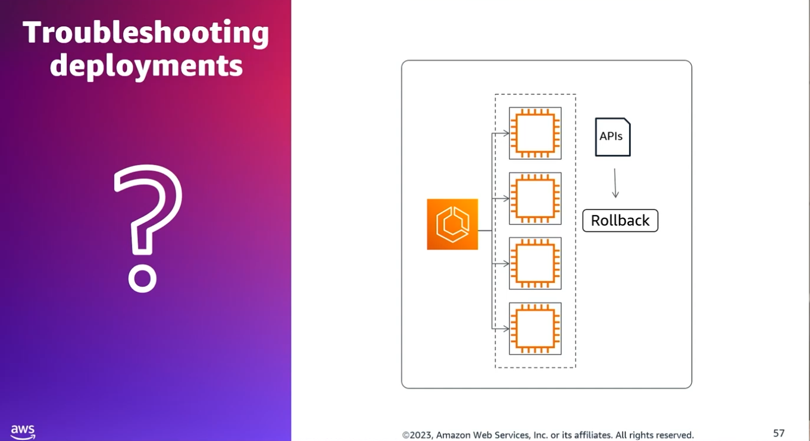
- **Troubleshooting Steps:**
	1. Inspect the Security Group Egress (outgoing) rules on the Auto Scaling Group instances to verify port 443 is permitted.
	2. Search for REJECT records in the VPC Flow Logs originating from the ASG instances to identify blocked outbound handshakes.

#### Scenario B: Automated Alerts for AWS OpsWorks Auto-Healing Stacks

- **The Problem:** OpsWorks is unexpectedly restarting EC2 instances in production due to failed health checks or lost endpoint communications.
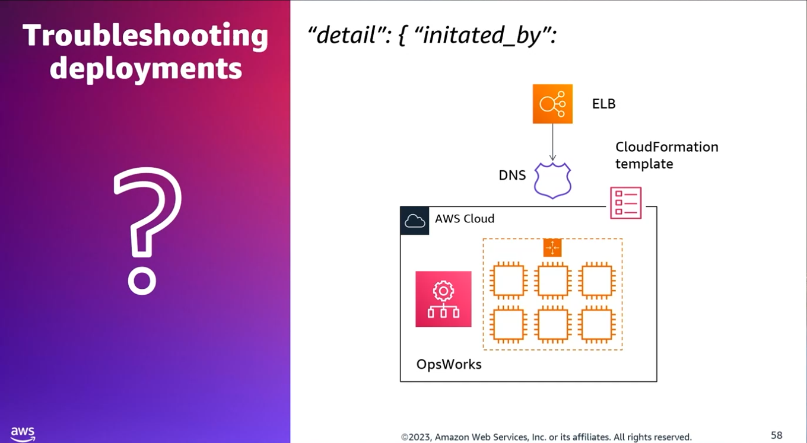
- **The Solution:**
	- Create an EventBridge (CloudWatch Events) Rule configured to listen for state changes in AWS OpsWorks Stacks resources.
	- Target an Amazon SNS Topic to broadcast notifications whenever an instance is restarted.
	- **Critical Metric Attribute:** To isolate automated recovery events, you must explicitly filter by "initiated_by": "auto-healing" inside the event detail pattern configuration.

#### Scenario C: Validating APIs and Handling Rollbacks in AWS SAM + CodeDeploy

- **The Solution:** Implement automated Lambda validation scripts within the AppSpec lifecycle hooks to verify test traffic.
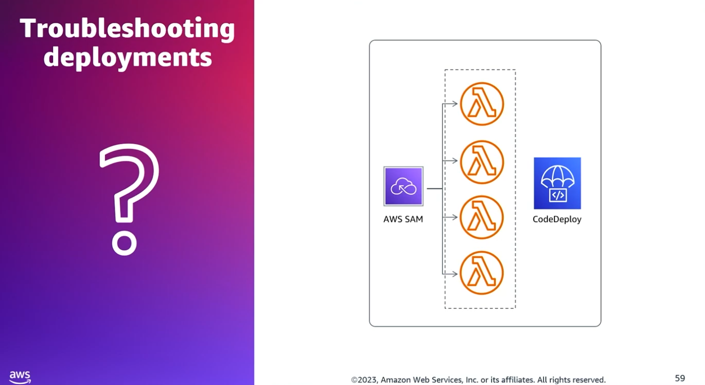
- Map a CloudWatch Alarm directly to the CodeDeploy Deployment Group. If validation tests fail or specific custom metric error thresholds are breached, the alarm fires and triggers an automated rollback while concurrently publishing an alert to an Amazon SNS topic.

### 6. Enterprise Storage & Architecture Patterns
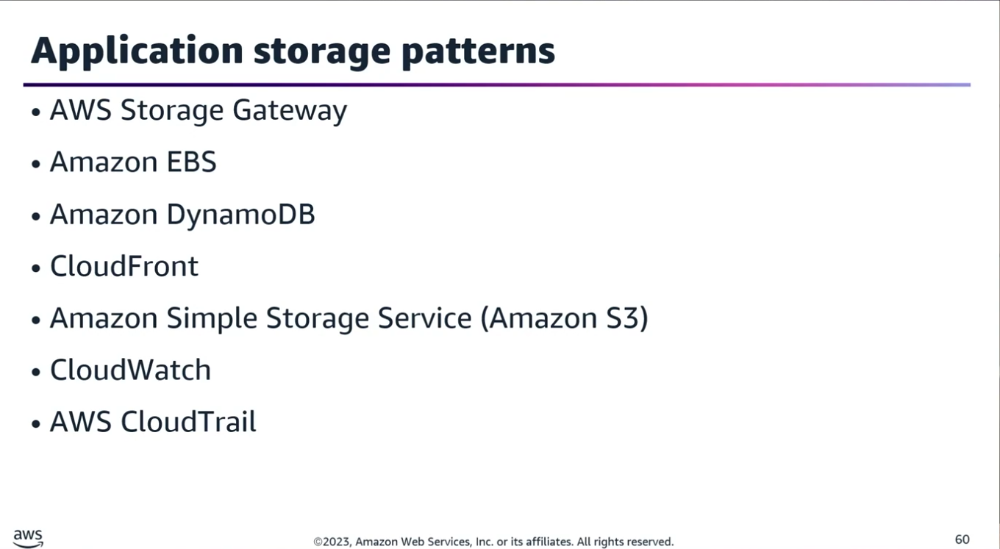
| Business Requirement / Scenario |	Optimal AWS Storage Service |	Implementation Detail |
|----------------------------------|-------------------------------|-----------------------|
| On-Premises Tape Library Replacement | AWS Storage Gateway (Tape Gateway / File Gateway) | Connects via AWS Direct Connect into the Amazon VPC to securely offload media files and legacy tape records to AWS. |
| CloudFront Edge Caching Backend | Amazon S3 Bucket | Serves as the origin storage for web assets, media, and images with global distribution. |
| Elastic Beanstalk + RDS App Log Aggregation | Amazon CloudWatch Logs | Configured to stream, store, and automatically expire log files after a retention window of 90 days. |
| Cross-Region Compliance & Financial Encryption | Amazon S3 with Cross-Region Replication (CRR) | Enforces encryption at rest and in transit utilizing Customer Managed Keys (CMK) via AWS KMS across two distinct geographic Regions.


### 7. Containerized CI/CD End-to-End Pipeline Architecture

The step-by-step assembly of an automated container pipeline using AWS Native tools:

```
[AWS CodeCommit] ──> [AWS CodeBuild] ──> [Amazon ECR] ──> [AWS CodePipeline] ──> [Amazon ECS on Fargate]
 (Source Code)         (Test/Build)     (Image Registry)   (Orchestrator)         (Serverless Compute)
```
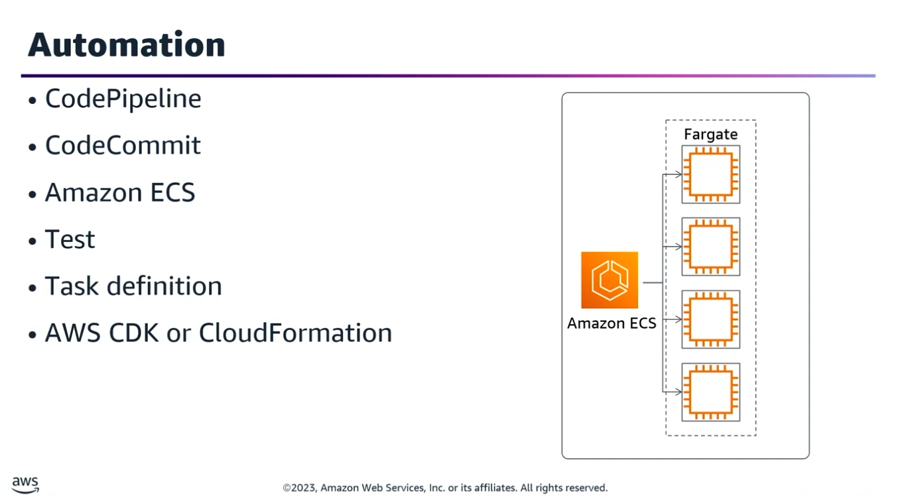
1. **Source Control:** Code repository managed in AWS CodeCommit (or GitHub/S3). Configured with automated change detection methods to trigger the pipeline upon code push.
2. **Infrastructure as Code (IaC):** AWS CDK or AWS CloudFormation provisions the entire environment:
	- Amazon VPC and networking.
	- ECS Task Execution Roles (granting permissions to pull images from ECR and push logs to CloudWatch).
	- Amazon ECR (Elastic Container Registry) repository.
	- ECS Cluster, Task Definitions, and Services.
3. **Pipeline Orchestration:** AWS CodePipeline manages stages:
	- **Source Stage:** Triggers off CodeCommit branch activity.
	- **Build/Test Stage:** Compiles the Docker image, runs tests, and pushes images to ECR.
	- **Deploy Stage:** Targets Amazon ECS as the deployment provider using an ECS Service Role to securely transition running containers on AWS Fargate.
