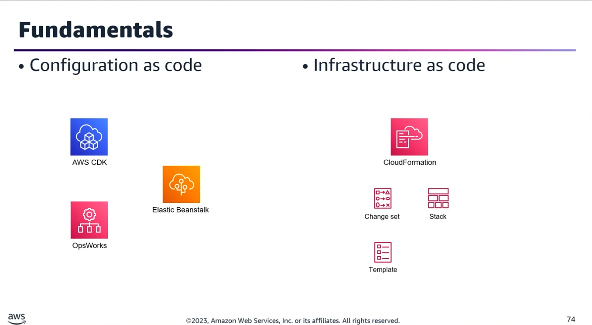
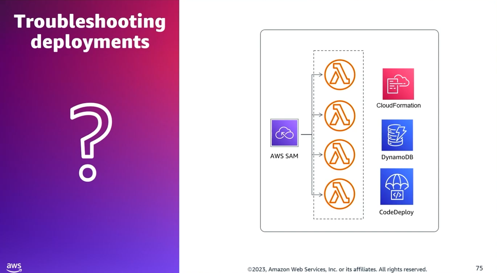
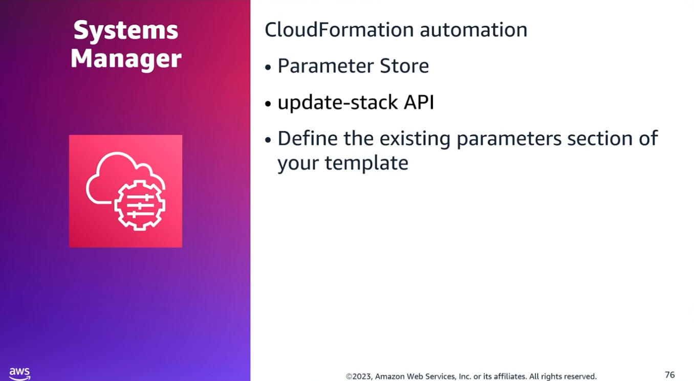
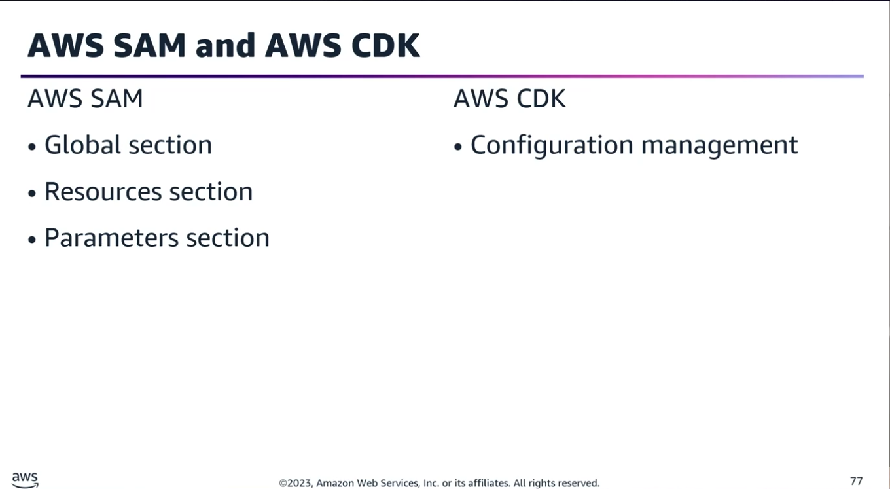
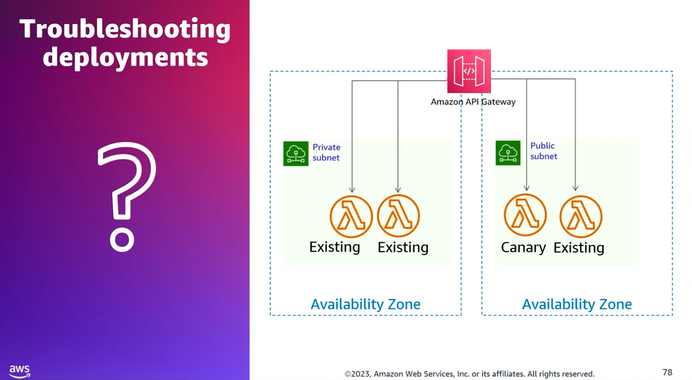
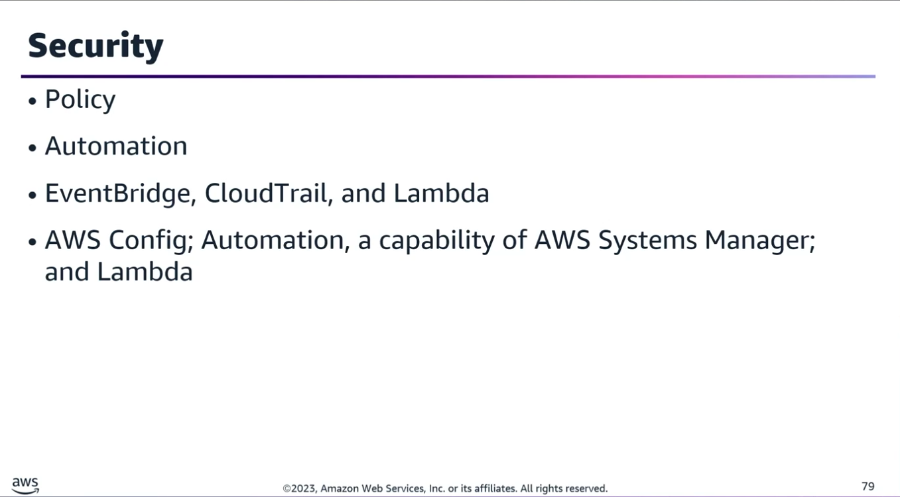
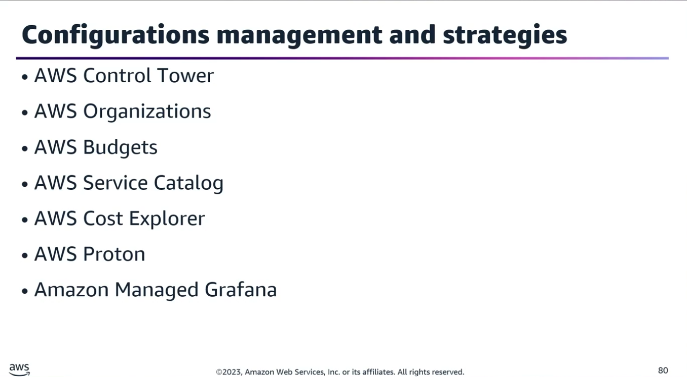

## Task Statement 1: Define cloud infrastructure and reusable components to provision and manage systems throughout their lifecycle.

### 1. Pipeline Deployments & Lambda Traffic Shifting

- **Canary Deployments via CodeDeploy:** To reduce the risk of failed deployments in a serverless pipeline (CodePipeline + CodeBuild), use CloudFormation to define/publish the new Lambda version and CodeDeploy to manage traffic shifting.
- **Predefined Configurations:** Use configurations like CodeDeployDefaultLambdaCanary10Percent5Minutes to route 10% of traffic to the new version for 5 minutes before full release.
- **Lambda Aliases & Traffic Shifting:** By default, a Lambda alias points to one version. To prevent traffic from switching too quickly, configure the routing-config parameter on the Lambda alias to specify a percentage split between two versions manually.
- **CodeBuild Limitation:** CodeBuild cannot natively publish new versions of a Lambda function or manage traffic shifting directly; it should be handled via CloudFormation and CodeDeploy.

### 2. CloudFormation Automation (AMI Updates)

- **Automating AMI IDs:** Instead of manually updating CloudFormation templates with the latest AMI IDs, reference AWS Systems Manager (SSM) Parameter Store directly inside the CloudFormation template.
- **Triggering the Update:** Once the Parameter Store is updated with a new AMI ID, invoke the update-stack API using the existing parameters section to roll out the new AMI to EC2 instances.

### 3. AWS SAM vs. CloudFormation

AWS Serverless Application Model (SAM) is an extension of CloudFormation specifically for serverless applications.
- **The Globals Section:** Unique to AWS SAM. It defines common properties (like timeouts or environment variables) shared across all serverless functions and APIs in the template.
- **Mixed Resources:** The Resources section of a SAM template can seamlessly combine native AWS CloudFormation resources and SAM-specific serverless resources.
- **Guided Deployments:** Objects declared in the parameters section work alongside the sam deploy --guided command to provide interactive prompts to the user during deployment.

### 4. Governance, Security, & Compliance Automation

- **Event-Driven Drift Correction:** To protect sensitive assets (like encrypted S3 buckets with federated Active Directory access) from unauthorized policy changes, use AWS Config over scheduled EventBridge/Lambda scans.

- **Real-time Remediation Loop:** AWS Config detects configuration changes near real-time and triggers an AWS Systems Manager Automation (or Lambda function) to instantly revert unauthorized changes back to the compliant state.

### 5. AWS Governance & Operations Ecosystem

AWS provides a wide array of tools to balance developer speed with controlled governance:

|Category |	AWS Services |	Key Purpose |
|---------|--------------|-------------|
|**Innovating with Governance**|AWS Control Tower, AWS Organizations, AWS Budgets|Account management, landing zones, guardrails, and cost tracking.|
|**Provisioning Resources**|CloudFormation, AWS CDK, AWS OpsWorks (Chef/Puppet), AWS Service Catalog|Infrastructure as Code (IaC), configuration management, and pre-approved product catalogs.|
|**Management & Operations**|CloudWatch, CloudTrail, AWS Config, Systems Manager, AWS AppConfig, AWS Proton|Monitoring, logging, compliance, drift remediation, and feature flagging.|
|**Visualization & Metrics**|Amazon Managed Grafana, Amazon Managed Service for Prometheus, AWS Cost Explorer|Visualizing operational metrics, monitoring container environments, and analyzing costs.
