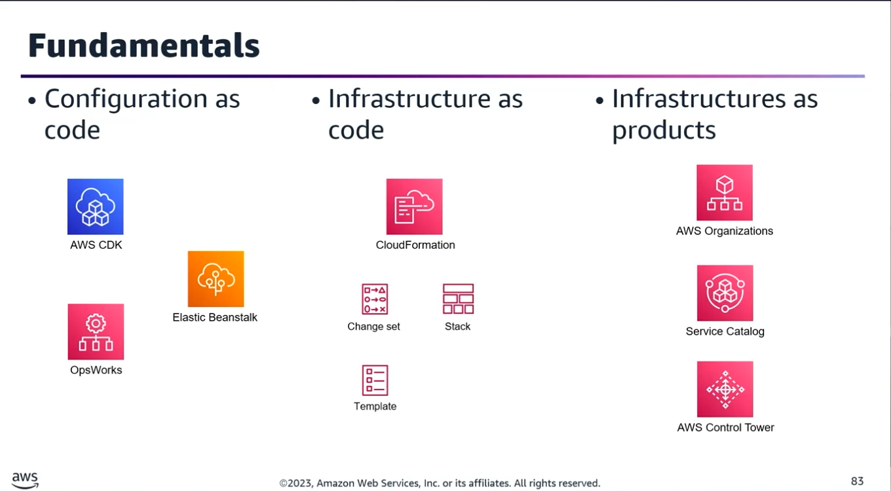
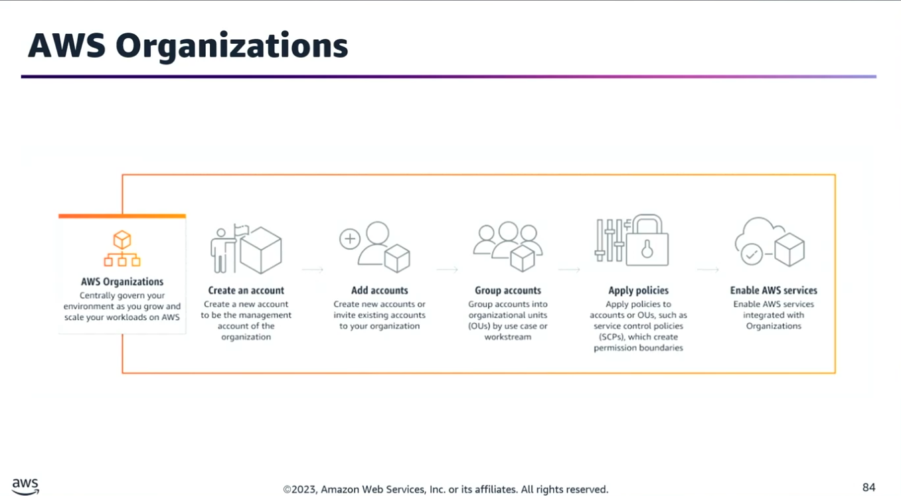
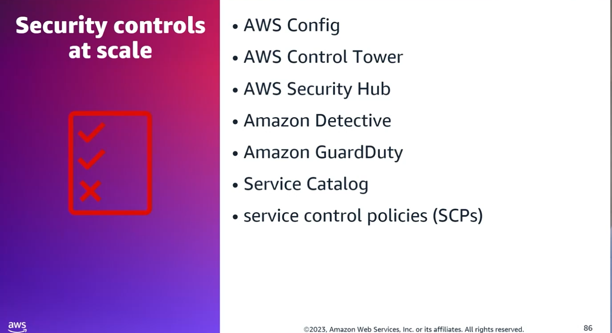
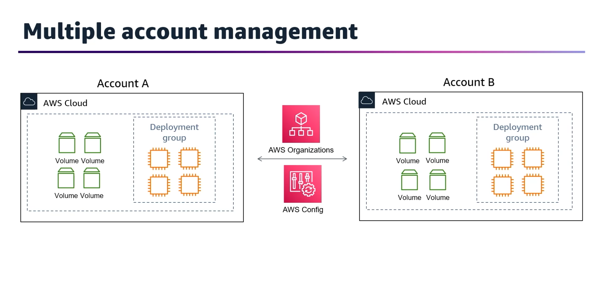
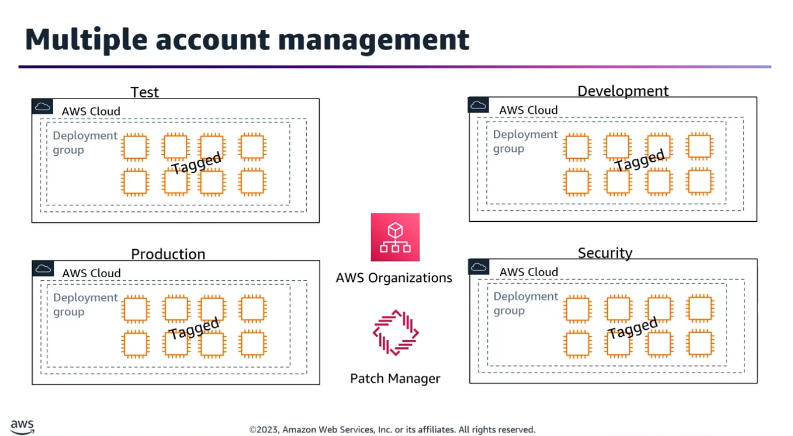
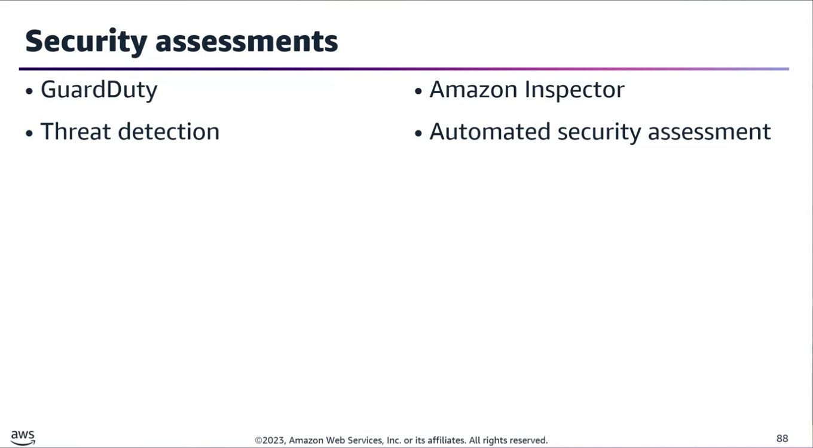
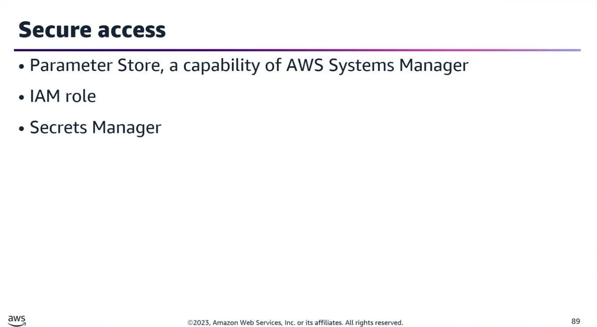
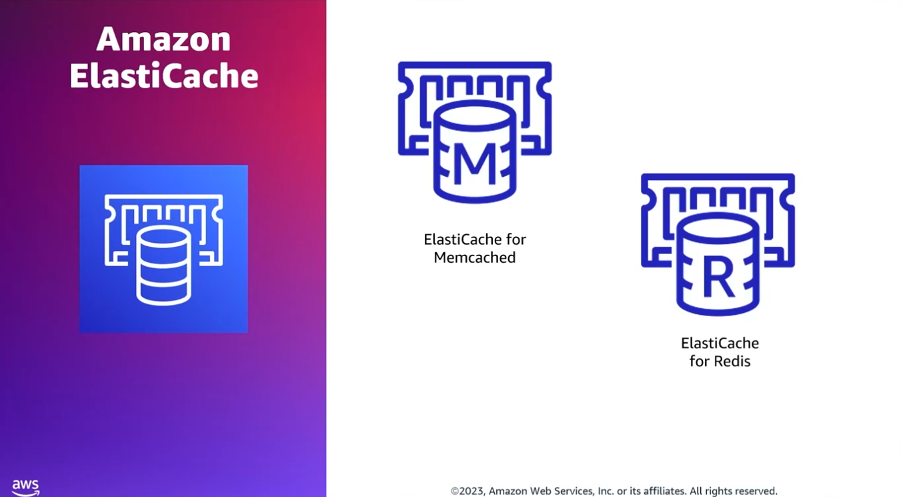

## Task Statement 2: Deploy automation to create, onboard, and secure AWS accounts in a multi account/multi-Region environment.

### 1. Infrastructure as Products & Multi-Account Management

Infrastructure as Products focuses on controlling, managing, and provisioning how AWS resources are centrally allocated, governed, and consumed across scale.
- **AWS Organizations & OUs:** Used to restrict organizational units (OUs) or individuals to only the functional capabilities, products (resources/services/software), and specific AWS Regions they require.
- **AWS Service Catalog:** Supports managing and provisioning infrastructure as a product. It is backed by AWS CloudFormation and integrates fully with the AWS CDK.
- **CI/CD Integration:** Products can be developed, tested, and released across lifecycle environments using a customized AWS CodePipeline or the built-in CDK pipeline capabilities.
- **Multi-Account Strategy Cases:**
	- **Scenario 1 (Serverless Vending):** 
    To provide a multi-account solution that uses a CI/CD pipeline to build, test, deploy serverless apps, and offer account vending at scale for employees &rarr; Use AWS Control Tower Account Factory.
	- **Scenario 2 (Preventing Accidental Cross-BU Deletions):**
    
    If multiple business units share a production account but must not delete each other's resources &rarr; Manage all accounts via AWS Organizations &rarr; Group them into OUs &rarr; Create an IAM role in the production account with a resource-level permissions policy &rarr; Associate cross-account access and the IAM policy to every member account of that OU.

### 2. Governance, Security Controls, and Monitoring at Scale

Key governance services include: AWS Config, AWS Control Tower, AWS Security Hub, Amazon Detective, Amazon GuardDuty, AWS Service Catalog, and Service Control Policies (SCPs).
#### Automated Compliance Reporting & Remediation

- **Scenario (Enforcing & Reporting Multi-Region/Multi-Account EBS Encryption):**

	- **The Strategy:** Use AWS Config Aggregators to centrally collect and view resource configuration and compliance data across multiple accounts, regions, and AWS Organizations.
	- **The Execution:** Detect unencrypted volumes via Config rules, send notifications via Amazon SNS, and use AWS Lambda or AWS Systems Manager (SSM) Automation Documents to trigger automatic remediation.
	- **Why other tools fall short:** CloudFormation templates with local Config rules require too much maintenance effort; SSM Configuration Compliance is better optimized for software patching and verification rather than multi-account resource configuration states.

#### Centralized Patch Management

- **Scenario (Phased Testing & Production Patching across hundreds of EC2 instances):**

	1. **Tagging:** Ensure all instances are tagged based on their environment (Test, Dev, Prod) and business unit.
	2. **Patch Groups:** Put each instance into a distinct Patch Group based on these tags.
	3. **Patch Baselines:** Create a custom patch baseline in AWS Systems Manager Patch Manager for each specific environment.
	4. **Execution:** Apply the specified patch baselines to the correct patch group sequentially (e.g., verify in Dev/Test patch groups first before deploying to Prod).

#### Threat Detection vs. Vulnerability Assessment

- **Amazon GuardDuty:** A threat detection service that continuously monitors for malicious activity and unauthorized behavioral anomalies.
- **Amazon Inspector:** An automated security assessment service designed to identify software vulnerabilities and deviations from security best practices within applications deployed on AWS.

### 3. Securing Pipelines and Remote Management
#### Eliminating Hardcoded Secrets

- **Problem:** Database passwords or AWS access keys exposed as plain text environment variables inside buildspec.yaml files.
- **Resolution:**
	- Create a SecureString parameter inside AWS Systems Manager Parameter Store (or utilize AWS Secrets Manager, especially if automated password rotation is required).
	- Remove hardcoded environment credentials entirely from buildspec.yaml.
	- Configure the AWS CodeBuild project to assume an IAM service role that possesses the specific permissions needed to fetch parameters or interact with downstream resources.
- **Remote Updates:** Utilize AWS Systems Manager Run Command to remotely execute secure configuration changes (e.g., via secure copy/SSH) directly on running instances without exposing interactive access protocols.

### 4. Session State & Stateless Resilience at Scale
#### Maintaining Session Persistence during Blue/Green Deployments

- **Problem:** When utilizing immutable, blue/green deployment processes behind an Application Load Balancer (ALB), user sessions are dropped if stored locally on the EC2 instances. ALB sticky-sessions are inadequate because new, immutable instances replace the old ones entirely during scaling/deployment events.
- **Resolution:** Abstract the HTTP session data away from the web servers entirely by utilizing a central, external in-memory key-value store.

#### In-Memory Storage Comparison

| Feature |	Amazon ElastiCache for Redis |	Amazon ElastiCache for Memcached |
|---------|-------------------------------|----------------------------------|
| **Data Replication** | Supported (Provides high availability across AZs) | Not Supported |
| **Architecture** | Cluster mode with multi-node setups across AZs | Individual nodes without cross-node data sharing |
| **Best Use Case** | User-session information tracking across scaling events | Simple, transient caching without persistence needs |

- **Trade-offs:** Moving sessions to an ElastiCache Redis cluster keeps users seamlessly logged in during heavy auto-scaling or application deployment rollouts, though it introduces minor network latencies and additional AWS infrastructure costs.