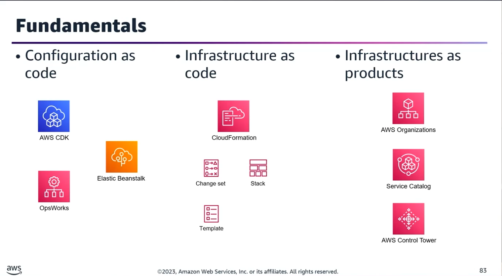
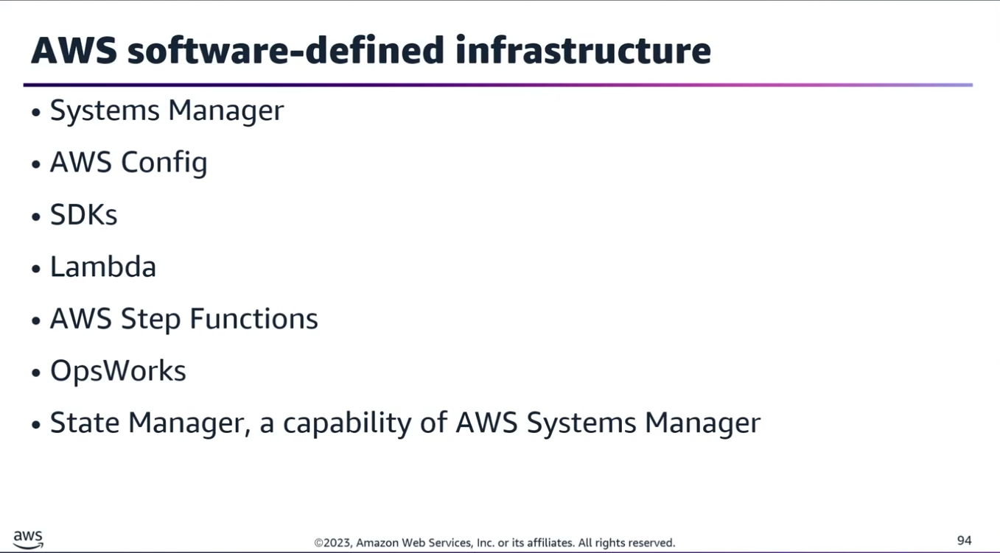
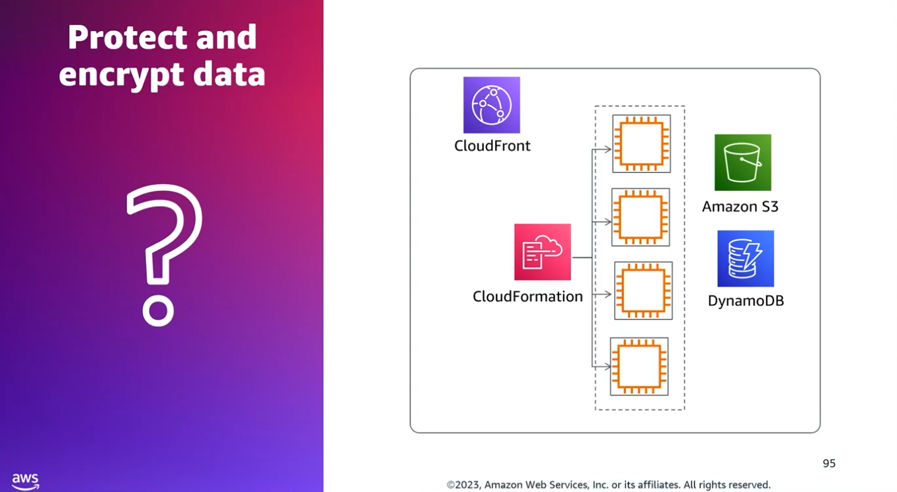
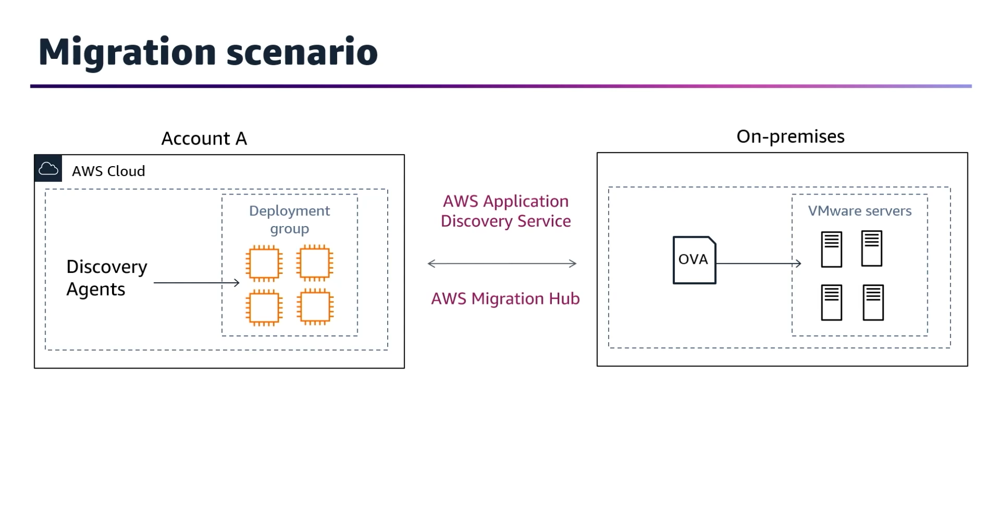
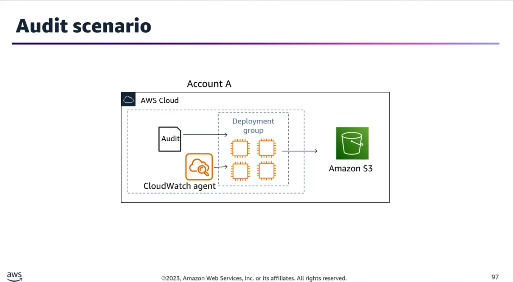

## Task Statement 3: Design and build automated solutions for complex tasks and large-scale environments.

### 1. Core DevOps Practices & Infrastructure Concepts

Under a DevOps model, teams use automation stacks and tooling to operate, evolve, and deploy applications quickly and reliably.

#### The Six Pillars of DevOps Practices

| Pillar | Preview |
| --- | --- |
| Continuous Integration (CI) | Automates code validation, testing, and integration to catch issues early. |
| Continuous Delivery (CD) | Enables reliable, repeatable releases through automated deployment pipelines. |
| Microservices | Breaks systems into smaller, independently deployable services for agility and scale. |
| Infrastructure as Code (IaC) | Defines infrastructure through code for consistency, repeatability, and version control. |
| Monitoring and Logging | Provides observability to detect failures, track performance, and improve uptime. |
| Communication and Collaboration | Aligns teams and workflows to reduce friction and accelerate delivery. |

- **IaC Sub-disciplines:** IaC can be further broken down into Configuration Management (Configuration as Code) and Policy as Code.
- **Key Exam Fundamentals:** Ensure a deep understanding of Infrastructure as Code, Configuration as Code, Policy as Code, and Infrastructure as Products.

### 2. Interacting with AWS Software-Defined Infrastructure

AWS provides several key methods and strategies to automate systems, code, and compliance at scale:
- **System Inventory, Configuration, & Patch Management:** Handled via AWS Systems Manager and AWS Config.
- **Complex Custom Automations:** Developed using AWS SDKs, AWS Lambda, and AWS Step Functions.
- **Desired-State Software Configuration:** Automated using AWS OpsWorks and AWS Systems Manager State Manager.
- **Software Compliance:** Maintained at scale using AWS Systems Manager.

### 3. Scenario Walkthroughs & Deep Dives
--- 

### Scenario 1: Securing Sensitive Data & Optimizing Performance (Amazon CloudFront)

- **Objective:** Configure an existing online store (EC2, DynamoDB, S3, CloudFront) to securely process credit card transactions while improving the cache hit ratio.
- **Security Layer (Credit Cards):** Use HTTPS combined with Field-level Encryption.
	- HTTPS enforces secure, end-to-end connections to origin servers.
	- Field-level encryption adds an extra cryptographic layer to protect sensitive user-submitted fields (like credit card numbers) all the way to the web servers.
- **Performance Layer (Cache Hit Ratio):** To serve more requests directly from the CloudFront edge cache, configure a Cache-Control max-age directive on the S3 objects. Specify the longest practical value for max-age. Shorter cache durations force CloudFront to frequently query the origin to check for changes, hurting performance.
- **Incorrect Distinctions for the Exam:**
	- Custom SSL: Provides end-to-end encryption but does not protect specific data fields.
	- Signed URLs: Used for restricting access to private content; they do not encrypt transaction details.
	- Origin Access Identity (OAI): Restricts direct S3 bucket access to CloudFront only; it does not encrypt data fields.

### Scenario 2: On-Premises VMware Migration Planning & Visualization

- **Objective:** Collect system performance, utilization, and dependency data from both on-premises VMware servers (using vCenter/vSphere) and AWS EC2 instances, then visualize it for management.
- **The Ideal Solution:** Use the AWS Application Discovery Service alongside the AWS Migration Hub dashboard.
	- Agentless Discovery: Deploy the AWS Agentless Discovery Connector as an OVA file directly into VMware vCenter. Note for exam: The agentless connector is a VMware appliance.
	- Agent-based Discovery: Install the AWS Discovery Agent on the target servers. Note for exam: Agent-based discovery is strictly for Windows and Linux operating systems.
	- Data & Cost Modeling: Export network connections and process data via APIs to group servers into distinct applications based on network dependencies. Performance data can be exported into cost models to calculate target AWS running costs.
- **Incorrect Distinctions for the Exam:**
	- AWS Service Catalog: Lacks the capability to natively integrate with on-premises VMware servers.
	- Systems Manager Resource Data Sync: Installing the SSM agent across all legacy on-premises machines requires significantly more manual effort compared to the application discovery tools.

### Scenario 3: Mandated Compliance Logging & Auditing (EC2)

- **Objective:** Audit all Windows and Linux EC2 instances by automatically collecting system logs and custom metrics, pushing them to an S3 bucket, and analyzing them with analytical tools.
- **The Ideal Solution:** Configure and install the unified Amazon CloudWatch Agent on each instance, enable detailed monitoring, and push the data to CloudWatch Logs, then analyze the log data using CloudWatch Logs Insights.
	- Using the dedicated CloudWatch Agent is the most efficient, least-effort mechanism to natively handle application logs and deep system metrics without needing custom hookups.
- **Incorrect Distinctions for the Exam:**
	- Amazon Inspector: A security vulnerability assessment service, not a custom metric/log aggregator.
	- Systems Manager Agent: While it can gather basic system data, it requires connecting directly to instances to troubleshoot and view logs, making it less efficient than the centralized CloudWatch stream.