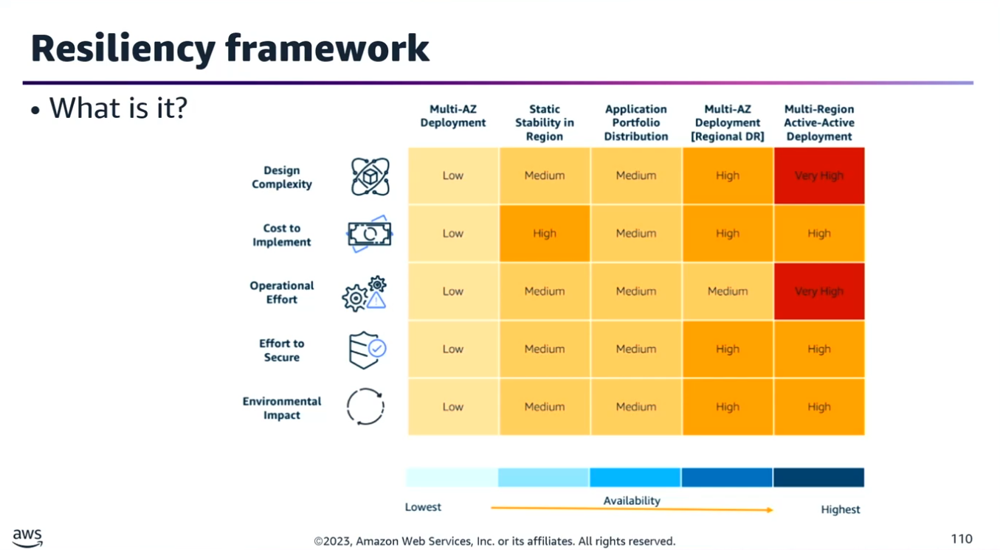
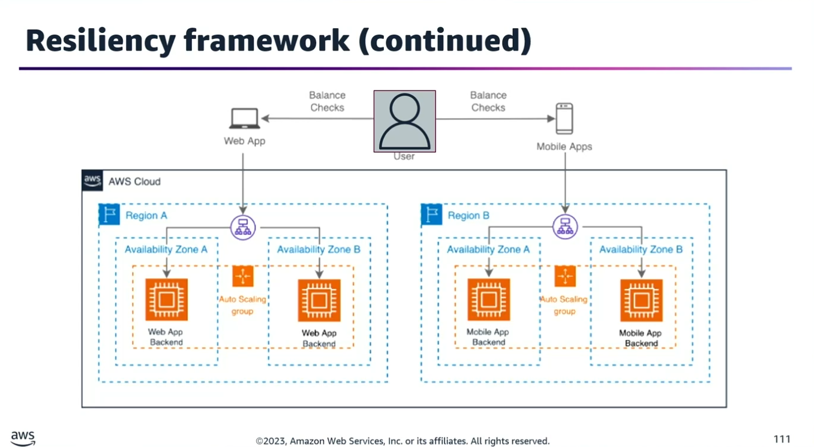
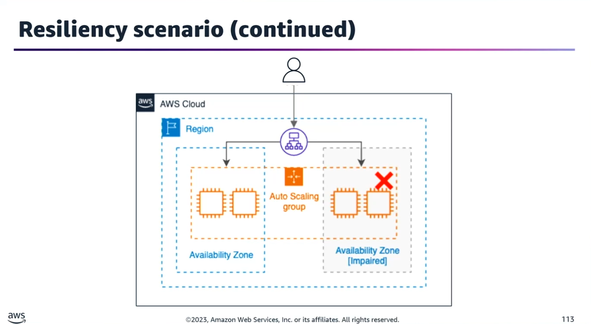
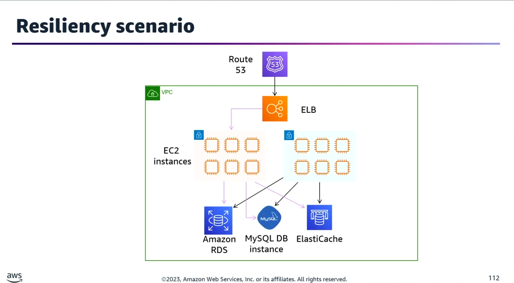
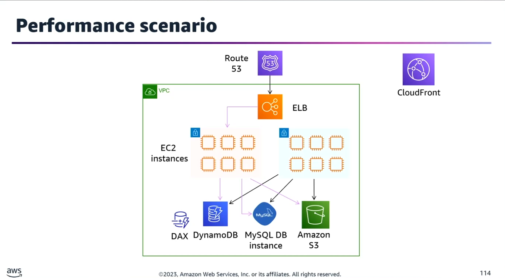
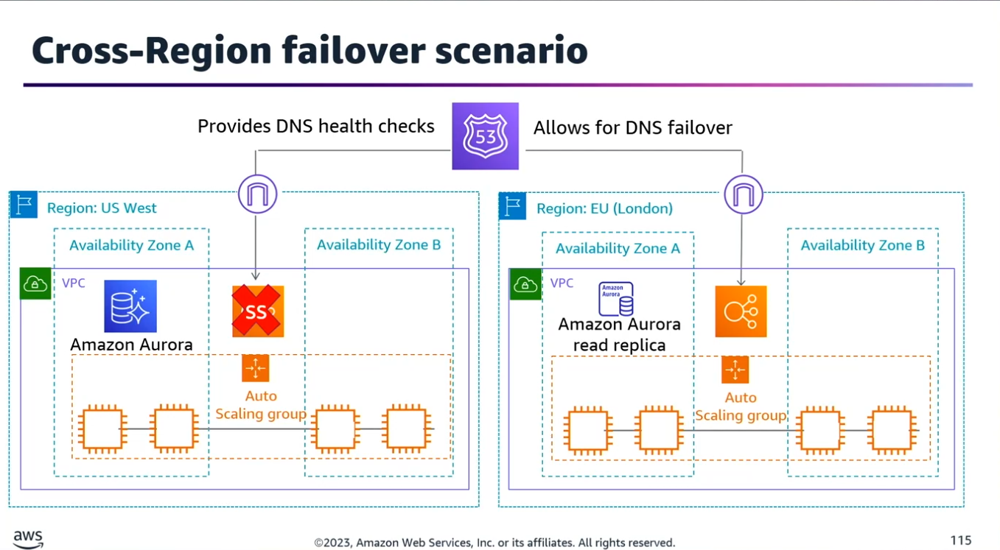

## Task Statement 1: Implement highly available solutions to meet resilience and business requirements.

### 1. Resiliency Framework & Core Pillars

A resiliency framework defines a set of best practices and ideas that promote building fault-tolerant and highly available solutions.

#### Operational & System Dependencies

To detect the root causes of failures, you must map out and monitor all layers of dependencies:
- **System/Software:** Specific code libraries, framework versions, or runtime environments.
- **Network:** External endpoints, API integrations, and core routing services like DNS.
- **Regional/Zonal:** Physical single points of failure bound to an AWS region or Availability Zone (AZ).
- **Build-Time:** Dependencies required during compilation, deployment, auto-scaling, or failover events.

#### The Three Pillars of Resiliency

- **Statelessness:** Stateless applications are significantly easier to scale because any instance can handle any incoming request. Offload state management to managed external layers using failover strategies.
- **Reliability:** Ensured by combining active redundancy, strict availability targets, consistent background backups, and tested recovery strategies.
- **Observability:** Leverages continuous cross-telemetry streams to generate deep operational insights:
	- Metrics: Numeric values tracked over time to monitor system health and performance.
	- Logs: Text records of events that occur within the application stack or infrastructure.
	- Traces: End-to-end paths of requests as they move across distributed microservices.

#### Business & Operational Metrics

Engineering teams must configure explicit corrective actions and automated recovery mechanisms tied directly to corporate agreements:
- **SLA (Service Level Agreement):** The commitment made to external customers regarding system uptime.
- **SLO (Service Level Objective):** The internal goal or target for system performance and reliability.
- **RTO (Recovery Time Objective):** The maximum tolerable duration of downtime before system restoration.
- **RPO (Recovery Point Objective):** The maximum acceptable amount of data loss measured in time.

### 2. Real-World Architecture Scenarios
#### Scenario A: Zero-Disruption Application Deployments

- **Current State:** Auto Scaling Group (ASG) behind an Application Load Balancer (ALB).
- **Solution:** Implement a Canary Deployment using a completely separate infrastructure stack. This second stack contains its own ALB and ASG running the updated application code. Traffic is gradually shifted to minimize blast radius, ensuring high availability and seamless testing.

#### Scenario B: Zero-Downtime Major Database Upgrades

- **Requirement:** Upgrade an Amazon RDS MySQL database to a new major version with minimal downtime.
- **Solution:**
	1. Update the EngineVersion property inside the AWS::RDS::DBInstance resource using AWS CloudFormation.
	2. Spin up a separate application stack and launch a new RDS Read Replica with identical properties to act as your staging/failover target.
	3. Upgrade the replica first, use it to sustain operations during the master migration, and perform a clean CloudFormation Stack Update to cut over.
- **Architectural Insight:** Amazon RDS multi-AZ configurations will automatically upgrade the primary and secondary database instances at the exact same time. This maintenance can take the instances offline, making a proactive read-replica failover strategy critical for continuity.

#### Scenario C: Performance Optimization for Global Content

- **Requirement:** Speed up a global web application using an Amazon S3 bucket for assets and an Amazon DynamoDB table for metadata.
- **Solution:**
	- **Amazon CloudFront:** Deploy a CloudFront distribution in front of the S3 bucket to cache static assets (images, videos) at edge locations via the AWS global network.
	- **DynamoDB Accelerator (DAX):** Implement an in-memory DAX cluster to cache frequent, repetitive database read requests. This increases application throughput and reduces database load.

#### Scenario D: Automated Cross-Region Database Failover

- **Requirement:** Build an automated cross-region failover mechanism for an Amazon Aurora database utilizing Route 53.
- **Solution:**
	1. Deploy an active Aurora Read Replica in a secondary target AWS region.
	2. Configure Amazon RDS Event Notifications to track database health and publish alerts to an Amazon SNS topic.
	3. Subscribe an AWS Lambda function to the SNS topic.
	4. Code the Lambda function to promote the cross-region read replica to the primary master during a system failure.
	5. Update the Route 53 DNS records dynamically via the function to route users to the new region.
	6. Alternative/Addition: Integrate DynamoDB Global Tables for multi-region multi-write performance.

### 3. Load Balancing & DNS Management

#### Cross-Zone Load Balancing Behaviors

| Load Balancer Type |	Default State |	Configuration Flexibility |
|---------------------|---------------|----------------------------|
| Application Load Balancer (ALB) |	Always Enabled |	Cannot be globally disabled, but can be managed per target group. |
| Network Load Balancer (NLB) |	Disabled by Default |	Can be turned on/off manually or via AWS SDK. |
| Gateway Load Balancer (GWLB) |	Disabled by Default |	Can be turned on/off manually or via AWS SDK. |
- **Zonal Architecture Isolation:** Disabling cross-zone load balancing minimizes latency between the load balancer and application nodes while removing cross-AZ data transfer fees. This forces ASGs to scale resources on a strict per-AZ basis and adds a zonal dimension to metrics.
- **NLB Routing Mechanics:** If cross-zone load balancing is enabled on an NLB and a target becomes unhealthy in AZ-1 while all targets are healthy in AZ-2, the NLB will still include both IP addresses in the DNS hostname resolving. Traffic hits either balancer node and is forwarded across the back-end network to healthy targets based on the specific load-balancing routing algorithm.

#### Mitigating DNS Failover Lag

Global DNS servers inherently cache lookups, which can delay regional failovers. You can mitigate this delay through three main techniques:
- **Manage Time-to-Live (TTL):** Reduce the TTL attribute on Route 53 records to enforce rapid client-side expiration.
- **Refresh Intervals:** Tighten lookup refresh intervals inside your application configuration.
- **AWS Global Accelerator:** Utilize AWS Global Accelerator to bypass traditional DNS propagation delays entirely by routing traffic through static Anycast IP addresses.