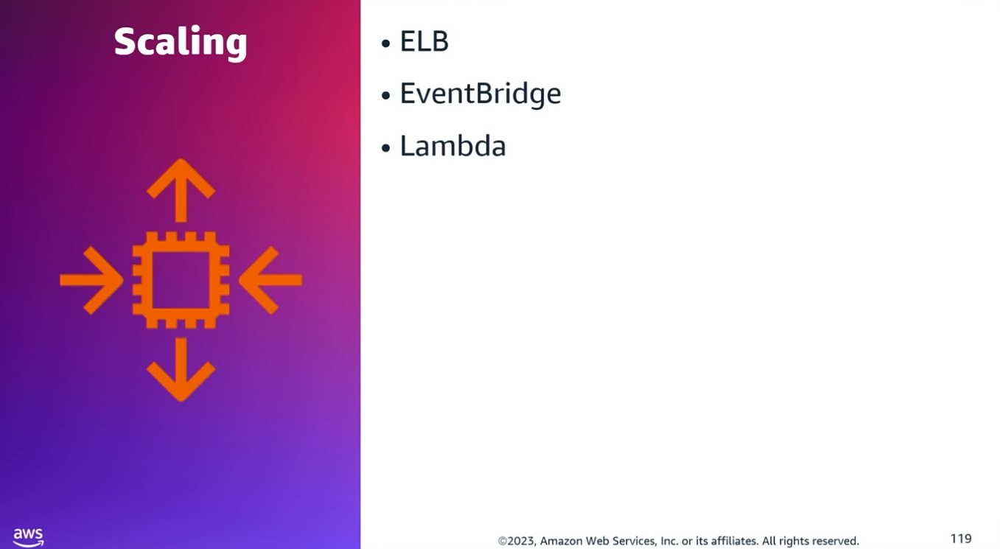
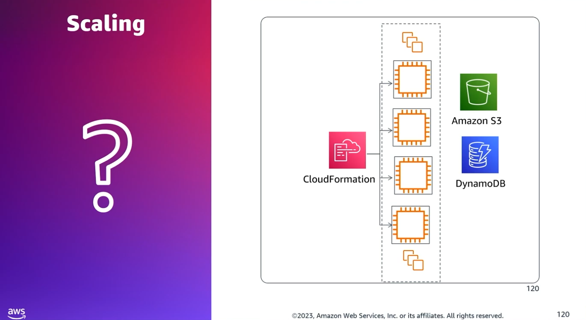
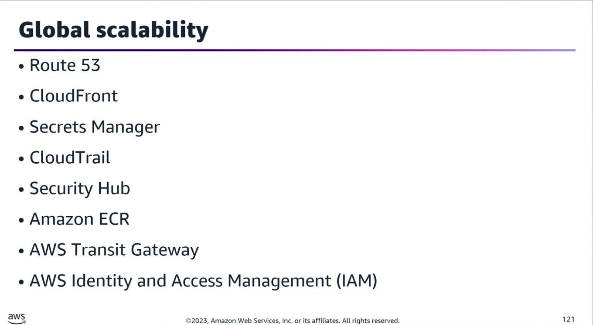
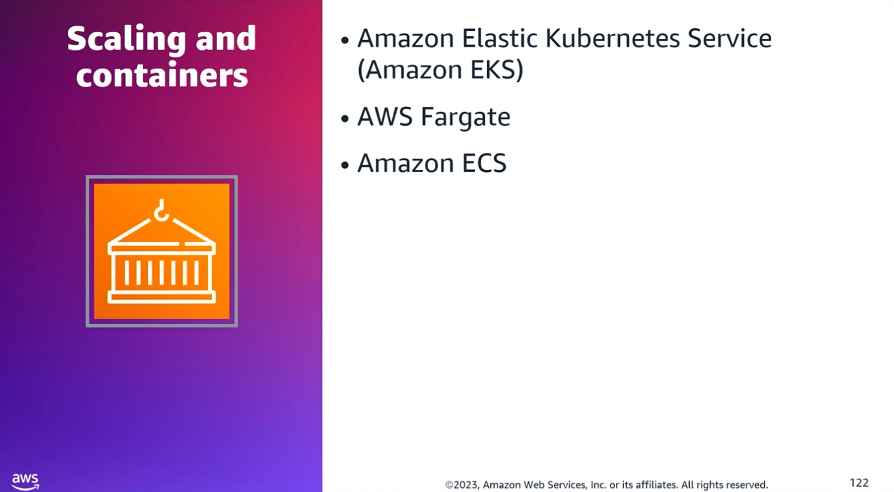
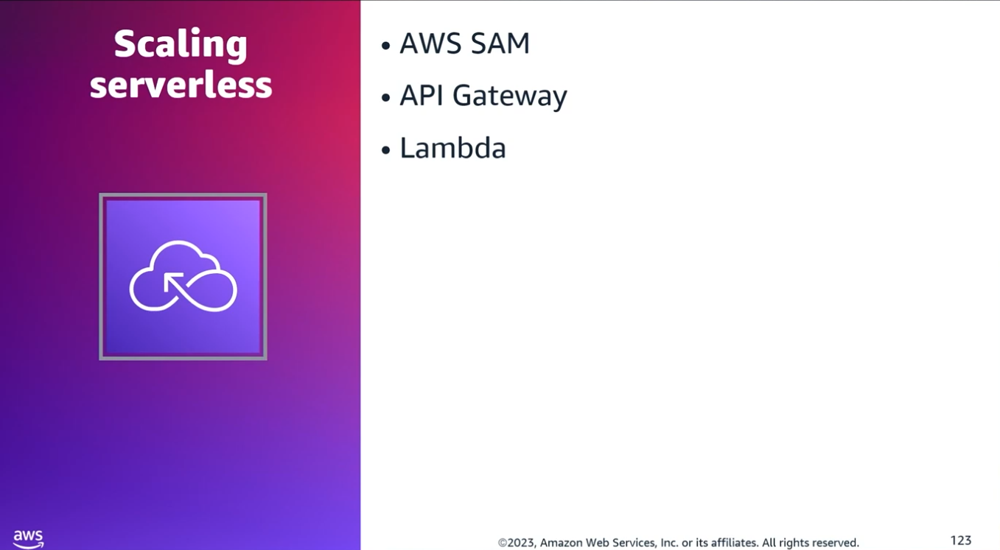
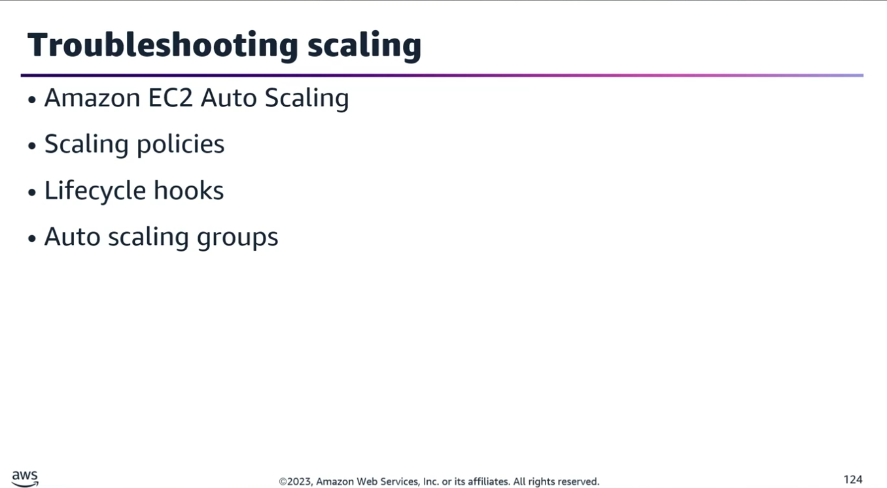

## Task Statement 2: Implement solutions that are scalable to meet business requirements.

### 1. Auto Scaling, Load Balancing, and Caching Solutions

- **Core Concepts:**
	- **Elastic Load Balancing (ELB):** Distributing traffic across multiple Availability Zones (AZs) increases fault tolerance.
	- **Auto Scaling Groups (ASG):** Automatically adding/removing instances distributes traffic and increases application scalability and availability.
- **Handling Scaling Events:**
	- **Amazon EventBridge:** Used to intercept and respond to scaling events.
	- **AWS Lambda:** Can be triggered by EventBridge to perform custom, pre-configured tasks in response to scaling.
- **ASG Lifecycle Hooks & Warm Pools:**
	- Lifecycle hooks put instances into a wait state during scale-out or scale-in.
	- Exam Tip: To filter EventBridge patterns for specific events coming from an ASG with a Warm Pool, check for the presence of the origin and destination fields in the detail section of the event. Only warm pool-enabled ASGs emit these attributes.

### 2. Optimizing EC2 Boot Times & Application Scaling

- **Scenario:** A photo-sharing app uses EC2 (web tier), DynamoDB (session management), and S3 (media storage). Scaling out manually by launching 6 raw EC2 instances takes too long due to downloading dependencies and boot-time configuration.
- **Highly Available & Rapid-Deployment Solution:**
	- **Compute:** Use an ASG across multiple AZs attached to an ELB.
	- **Database:** Enable DynamoDB Auto Scaling.
	- **DNS:** Point the Amazon Route 53 record directly to the ELB.
	- **Deployment Optimization:** Pre-bake dependencies, web components, and libraries into a custom AMI using AWS Systems Manager Automation to drastically reduce deployment time.

### 3. Multi-Region Architectures & Global Scalability

When architecting persistent, secure, and elastic multi-Region applications, master the usage of the following global services:

| Service |	Multi-Region Use Case / Functionality |
|---------|--------------------------------------|
| **Amazon Route 53** | Uses Latency Routing Policies to direct global users to the deployment/Region with the lowest network latency. |
| **Amazon CloudFront** | Serves static content globally. Supports Origin Failover (e.g., primary origin in Region 1, secondary failover origin in Region 2) for disaster recovery. |
| **AWS Secrets Manager** | Supports Cross-Region Replication to securely sync and store third-party API keys across environments. |
| **AWS CloudTrail** | Aggregates API logs from multiple Regions into a single, centralized S3 bucket for consolidated analysis and auditing. |
| **AWS Security Hub** | Aggregates security findings and compliance checks from all active Regions into a master account/Region view. |
| **Amazon ECR** | Utilizes cross-Region replication to pull the latest container images locally to each target Region. |
| **AWS Transit Gateway** | Best long-term architectural choice for connecting multiple Regions over private IPs via inter-Region peering (scales better than complex VPC peering meshes). |
| **AWS Global Accelerator** | Distributes and routes global user traffic across multi-Region endpoints using the AWS global network. |
| **Amazon Aurora Global Database** | The ideal relational choice to span multiple Regions providing a persistent, globally synchronized transactional data store. |
| **AWS IAM** | Centralized global service used to grant and manage access across all AWS resources. |

### 4. Serverless Applications & Container Scaling

- **4 Pillars of Serverless:** No server management, no payment for idle capacity, built-in high availability, and effortless scaling.
- **Container Scaling (EKS & ECS):**
	- **AWS Fargate:** A serverless compute engine that removes the need to manage underlying EC2 infrastructure for both Amazon ECS and Amazon EKS.
	- **Scaling Mechanism:** Serverless systems scale automatically and adjust capacity using units of consumption rather than individual server units.
    
- **AWS Serverless Application Model (AWS SAM):**
	- Simplifies CI/CD pipelines for serverless architectures.
	- Supports build container images to isolate environments across various CI/CD toolsets.
	- **Choice of CI/CD pipeline depends on:** Single vs. multiple runtimes, and whether you build directly on a host machine or inside a container image.
    
- **Amazon API Gateway for Multi-Region Deployments:**
	- **Regional API Endpoints:** Intended to serve local clients (e.g., EC2 instances in the same Region) directly without routing through CloudFront.
	- **Multi-Region Setup:** Deploy the API as a Regional endpoint across multiple Regions, configure the same custom domain name for each, and use Route 53 latency-based routing to send users to the closest API Gateway.

### 5. Troubleshooting & Remediating Scaling Issues

If an ASG fails to respond to CloudWatch alarms or a deployment stalls, investigate based on the scaling policy type:
- **Simple Scaling Policy:** Check if the group is in a cooldown period. Simple scaling actions remain suspended until the cooldown expires.
- **Step Scaling / Target Tracking Policy:** Check the in-progress instance warmup timer. The ASG will not calculate aggregate group metrics using new instances until their warmup period completes.
- **Lifecycle Hooks:** The ASG might be waiting for a lifecycle hook to be explicitly marked as complete, or waiting for the default timeout period to expire.
- **Scheduled Actions:** If a scheduled event didn't trigger, verify the configured time zone or review the history log for a conflicting scaling action that may have overridden it.