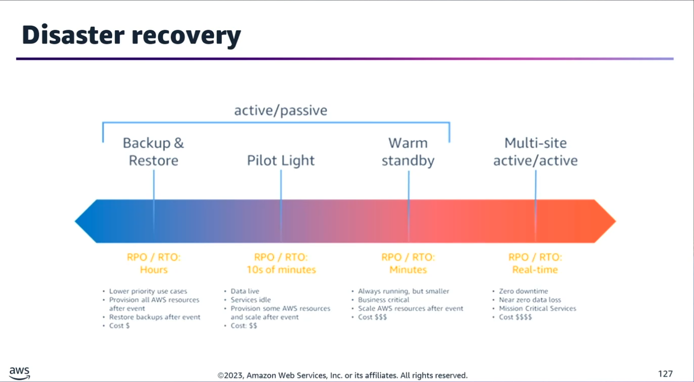
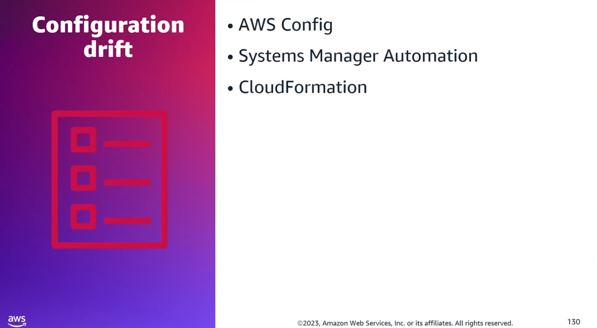
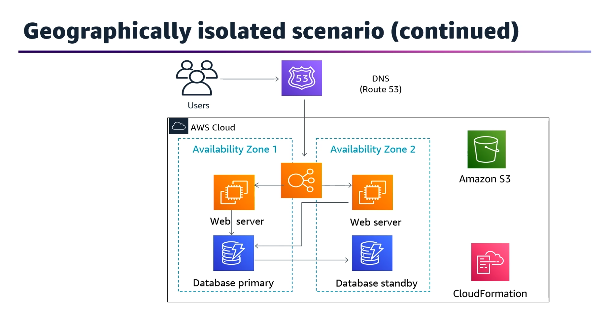

## Task Statement 3: Implement automated recovery processes to meet RTO/RPO requirements.

### 📌 Core Concepts

- **Disaster Recovery (DR) Trade-off:** Choosing a DR strategy balances reducing downtime (RTO) and data loss (RPO) against implementation cost and complexity.
- **Failure Detection & Automation:** Key to DR is knowing how to automate failure detection, coordinate environment recovery, and choose the correct deployment method.

### 🛠️ Key AWS Disaster Recovery Services

#### 🛰️ Routing & Orchestration

- **Amazon Route 53 Application Recovery Controller:** Manages and coordinates application failover across multiple AWS Regions, Availability Zones (AZs), and on-premises environments.
- **AWS Elastic Disaster Recovery (AWS DRS):** Minimizes downtime and data loss using fast, reliable recovery of physical, virtual, and cloud-based servers into AWS. Supports cross-Region and cross-AZ DR.

#### 💾 Backup & Replication

- **AWS Backup / Cross-Region Replication (CRR):** Used to copy backups to multiple AWS Regions automatically or on-demand.
- **Amazon S3 Cross-Region Replication & Object Versioning:** Essential for preserving and replicating static content across different regions while protecting against accidental deletion.

#### 🔍 Drift Detection & Testing

- **AWS Config:** Detects configuration drift in the DR Region and can trigger AWS Systems Manager Automation to remediate drifts and raise alarms.
- **AWS CloudFormation:** Features native drift detection for infrastructure stacks deployed via templates.

### 🏗️ DR Architectural Strategies

| Strategy |	Type |	Description |
|----------|------|------------|
|**Backup and Restore**|	Passive	|Low cost, high RTO/RPO. Data is backed up and restored during a disaster.|
|**Pilot Light**|	Active/Passive	|Core data is kept mirroring while application servers are kept switched off/scaled down.|
|**Warm Standby**|	Active/Passive	|A scaled-down but fully functional copy of the environment runs concurrently.|
|**Multi-Site**|	Active/Active	|Zero or near-zero downtime. Traffic is actively served from multiple regions simultaneously.

### 💼 Practical Scenarios & Architecture Fixes

#### Scenario 1: Geographically Isolated DR Site

- **Requirements:** RPO = 5 minutes, RTO = 2 hours.
- **Current Stack:** Auto Scaling Group (ASG) behind an Application Load Balancer (ALB) across multi-AZ; Amazon RDS MySQL; Route 53.
- **Implementation Plan:**
  - Clone the application stack in a secondary Region using CloudFormation.
  - Create an Amazon RDS Read Replica in the secondary Region and point the secondary application stack to it.
  - Configure Route 53 Failover Routing to automatically redirect incoming traffic to the secondary ALB if the primary health check fails.

#### Scenario 2: Achieving Lowest RTO & RPO for Multi-Region DR

- **Requirements:** Replicate a multi-AZ web app (ALB + ASG + RDS Multi-AZ + S3 static content) to another region with minimum data loss and recovery time.
- **Implementation Plan:**
  - Launch the application infrastructure in the secondary Region using CloudFormation templates.
  - Increase the capacity of the ASG in the secondary region's CloudFormation configuration.
  - Establish an Amazon RDS Cross-Region Read Replica (Note: Do not use cross-region snapshot copies here, as they take hours to complete and fail to meet low RTO requirements).
  - Enable S3 Cross-Region Replication for static content and turn on S3 Object Versioning.

### 🎯 Exam Blueprint Objectives

To pass this section of the exam, you must confidently determine:
1. **Multi-AZ vs. Multi-Region:** When to design for high availability (Multi-AZ) vs. true disaster recovery (Multi-Region).
2. **Deployment Adjustments:** Tailoring deployment strategies to match specific HA and DR rules.
3. **Data Replication Choices:** Balancing cost against durability constraints.
4. **Service Scope Awareness:** Designing based on whether an AWS service is Global, Regional, or Single-AZ.
5. **Cost-Effective Storage:** Selecting storage tiers that support failover without over-budgeting.