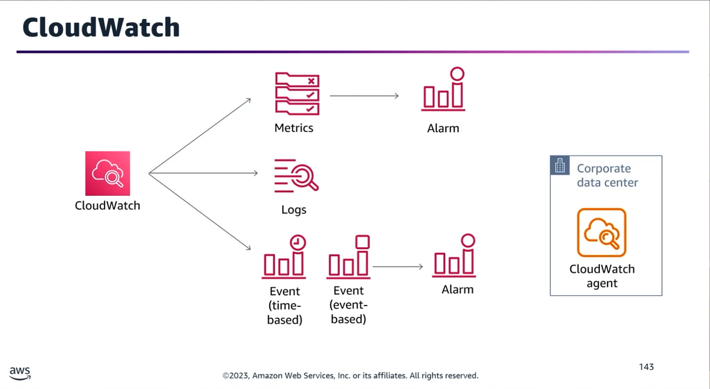
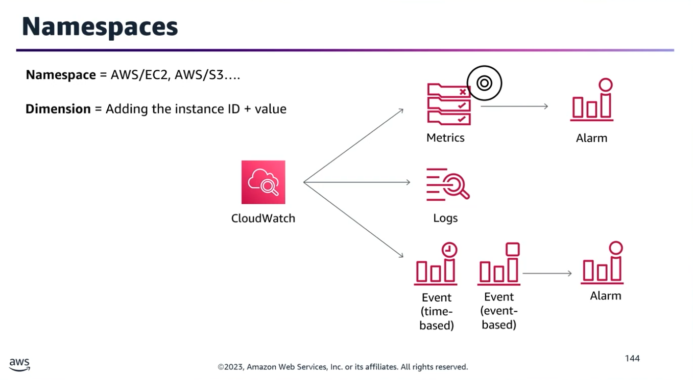
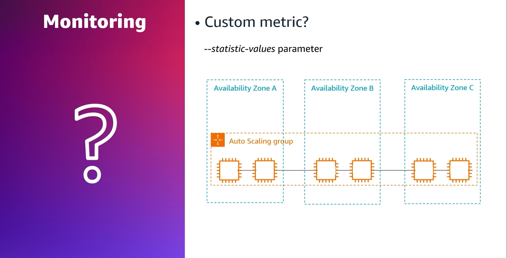
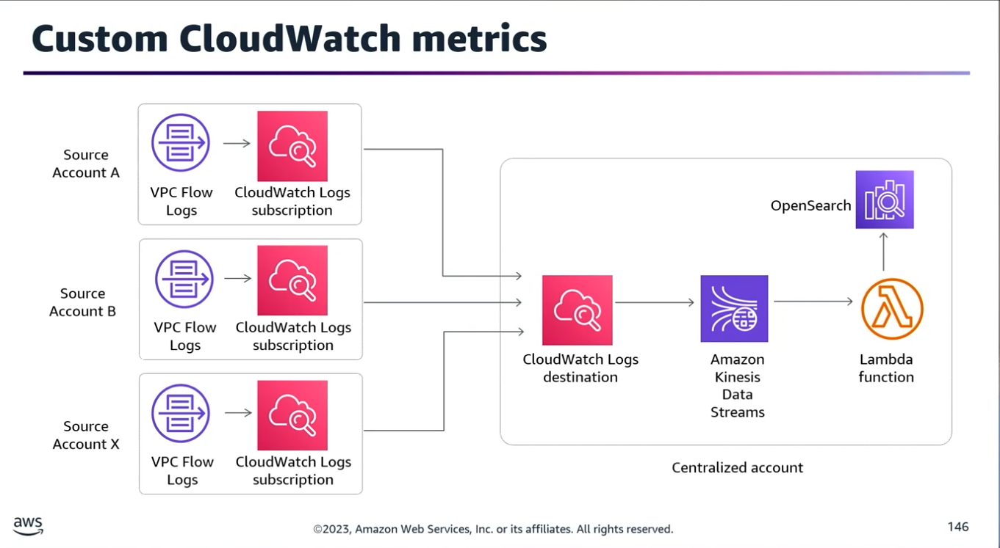
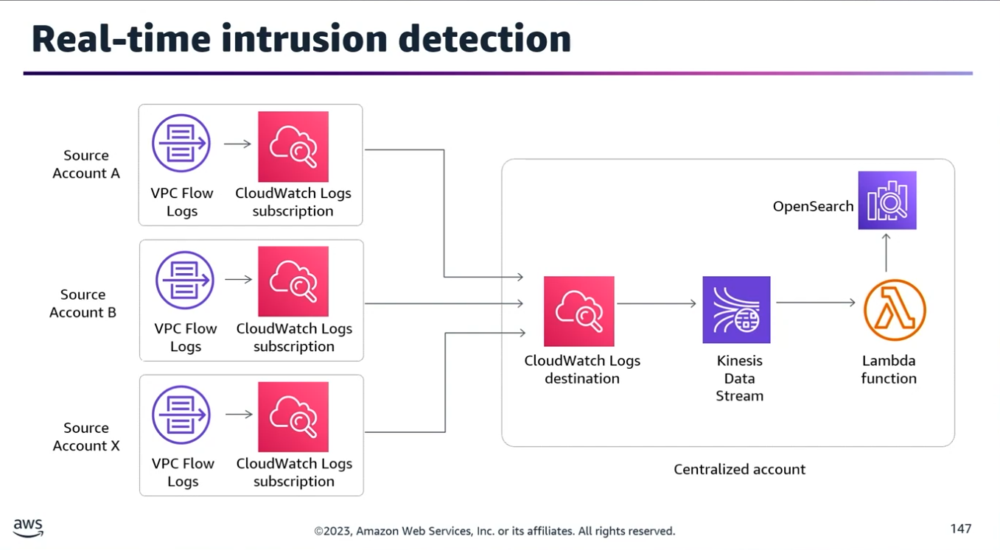
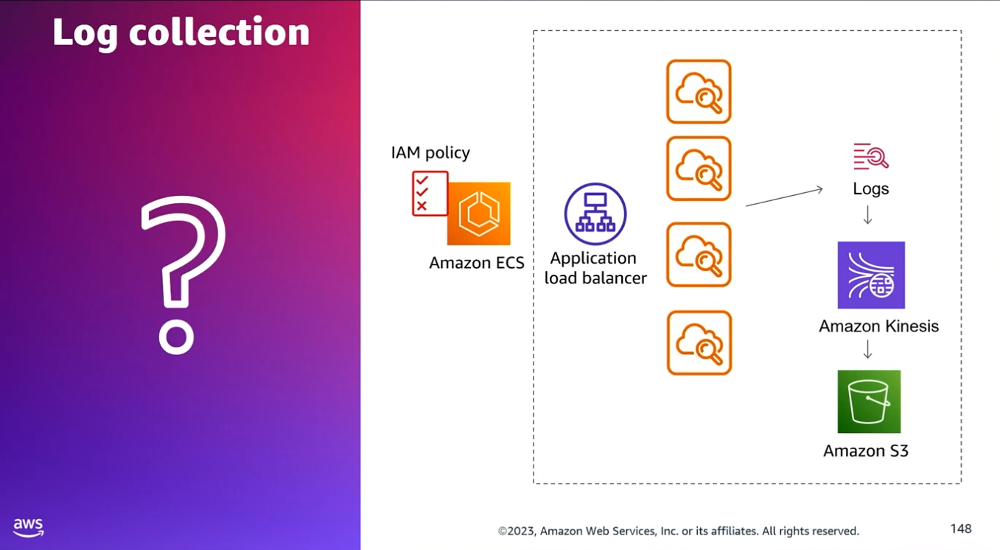
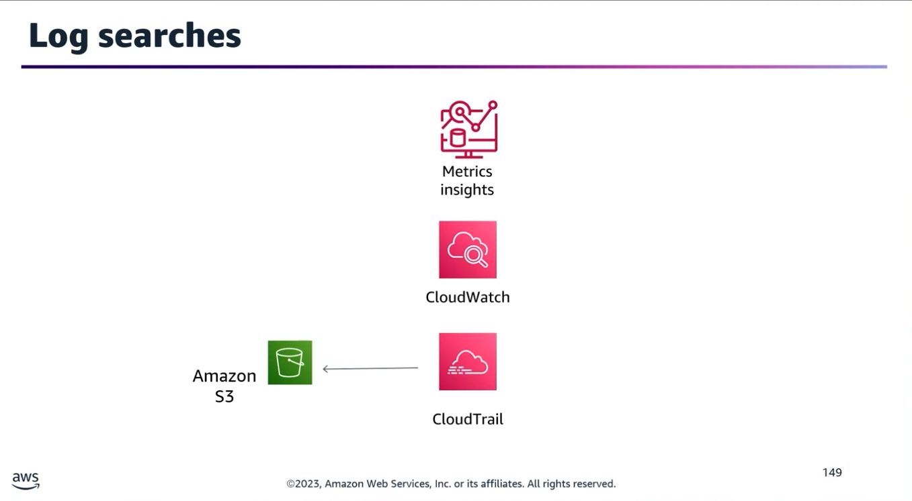
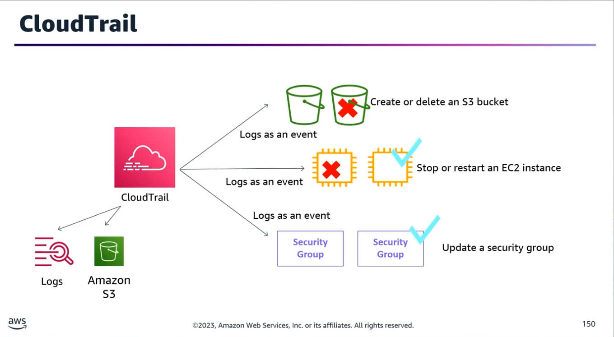

## Task Statement 1: Configure the collection, aggregation, and storage of logs and metrics.

### 1. Amazon CloudWatch

Amazon CloudWatch provides monitoring, alerting, and operational data collection for developers and operations teams to collaborate transparently.

#### The Three Pillars of CloudWatch

- **Metrics:** Collects, monitors, and drives automated actions based on numeric performance data.
- **Logs:** Collects, monitors, and orchestrates actions based on textual log events.
- **Events / EventBridge:** Triggers automated actions on a schedule, a metric alarm, or a state change in an AWS service.

#### Namespaces & Dimensions

- **Namespaces:** Isolated containers for metrics. AWS service namespaces always start with AWS/ (e.g., AWS/EC2, AWS/S3) and are strictly reserved.
- **Custom Namespaces:** Can be any name following standard naming rules. The default namespace for the CloudWatch agent is CW Agent (customizable).
- **Data Points:** A metric measurement reported at a specific timestamp.
- **Dimensions:** Unique name/value pairs (e.g., InstanceId=i-1234567890abcdef0) used as structural attributes to isolate and drill down into specific data points.

#### The CloudWatch Agent

- **Default vs. Custom:** Not all metrics are collected natively. System-level and application-level metrics require the CloudWatch agent.
- **Hybrid Support:** The agent can be installed on on-premises servers as well as cloud instances to stream OS logs and custom metrics.

#### Optimization: Metric Aggregation

- **Problem:** Submitting multiple individual data points within a tight window (e.g., three points in three seconds) causes excessive PutMetricData API calls.
- **Solution:** Use the StatisticValues parameter during the PutMetricData API call to aggregate multiple data points into a single statistic set before publishing, minimizing API overhead and costs.

### 2. Advanced Logging Architectures

#### Centralized Cross-Account Compliance Logging

To deliver CloudWatch Logs and VPC Flow Logs across all current and future accounts in an AWS Organization to a dedicated, searchable compliance account:
>[Member Accounts] &rarr;(Subscription Filter)&rarr; [Central Kinesis Data Stream] &rarr; [Lambda] &rarr; [OpenSearch Cluster]
- **Target Destination:** Kinesis Data Streams is the only supported resource capable of acting as a direct target for cross-account subscription filters.
- **The Pipeline:** Create a centralized Kinesis Data Stream &rarr; Attach an AWS Lambda event handler &rarr; Stream data into an Amazon OpenSearch cluster for auditing, indexing, and rapid log retrieval.
- **Subscription Filters:** Control exactly which log events get matched and where they are delivered.

#### Container Logging (Amazon ECS)

To automatically collect and upload logs from an Amazon ECS cluster distributed across EC2 or Fargate:
- **Task Configuration:** Use the awslogs log driver inside the ECS task definition to pass container stdout/stderr logs from Docker directly to CloudWatch Logs.
- **ECS on EC2 vs. Fargate:**
	- **Fargate:** Native support allows you to easily view container logs directly.
	- **EC2 Launch Type:** Requires you to explicitly install the CloudWatch agent on the underlying EC2 instances and ensure the EC2 instance role possesses the correct IAM permissions.
- **Downstream S3 Delivery:** Utilize a CloudWatch Logs subscription filter integrated with Kinesis Data Firehose to batch and deliver the real-time log stream to an Amazon S3 bucket for near real-time analysis.

#### Application Load Balancer (ALB) Access Logs

- **Function:** Captures comprehensive transaction details (client IP, latencies, request paths, server responses).
- **Storage:** Delivered directly to Amazon S3.
- **Security:** Files are automatically and transparently encrypted before storage using regularly rotated, unique keys, requiring no manual setup for decryption during access.

### 3. Auditing & Search Capabilities

#### CloudWatch Logs Insights

- **Purpose:** Provides interactive, deep-dive searching and querying of historical log data.
- **Auto-Discovery:** Automatically detects structured fields from Route 53, AWS Lambda, AWS CloudTrail, Amazon VPC Flow Logs, and any custom application log formatted as native JSON.

#### Tracking Confidential S3 Object Operations (Puts/Gets/Deletes)

- **The Blueprint:** CloudWatch Events/EventBridge cannot natively match raw S3 object API calls. You must first configure an AWS CloudTrail trail to record data events.
- **Workflow:** S3 Data Event (Put/Get/Delete) \(\rightarrow \) CloudTrail Trail \(\rightarrow \) CloudWatch Event Rule \(\rightarrow \) Target Lambda Function \(\rightarrow \) CloudWatch Log Group (for searching).
- **Alternative (Expensive):** Enable native S3 server access logging to a secondary bucket and manually index the raw outputs into an OpenSearch cluster.

### 4. AWS CloudTrail Deep Dive

| Feature |	Details |
|---------|---------|
| Scope |	Natively a Regional service. However, it can be configured to log across all regions globally with a single setting.|
| AWS Organizations |	An Organizational Trail can be deployed from the management account to globally log events for all member accounts automatically. |
| Management Events |	Logs control plane actions (e.g., configuring EC2 instances, creating S3 buckets). Enabled by default with a free 90-day event history timeline. |
| Data Events |	Logs high-volume resource operations (e.g., S3 object-level APIs, Lambda executions). Disabled by default and incurs an additional cost. |
| Long-term Storage |	To retain log history past the default 90-day window, configure CloudTrail to stream events directly to an Amazon S3 bucket or CloudWatch Logs.
