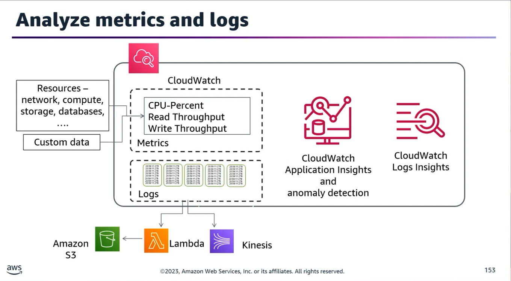
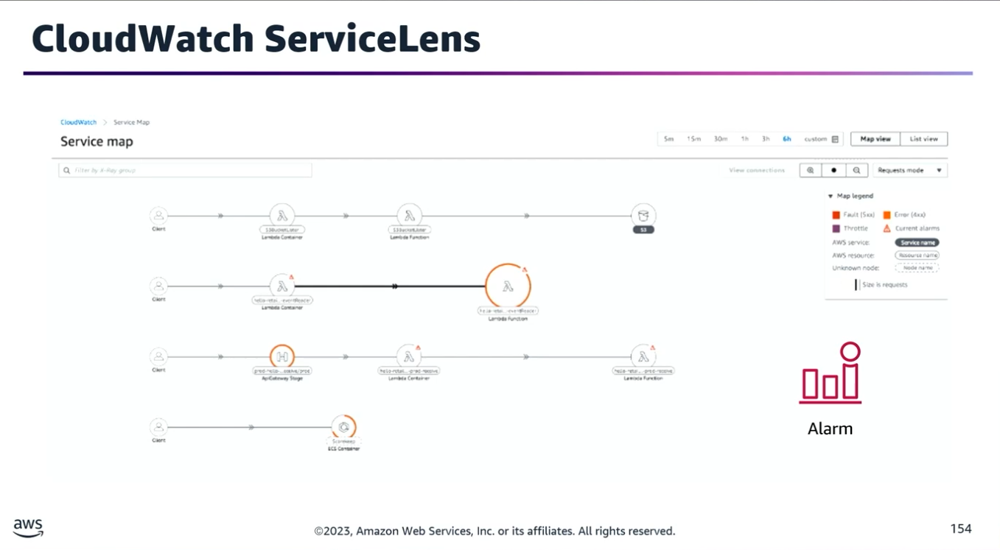
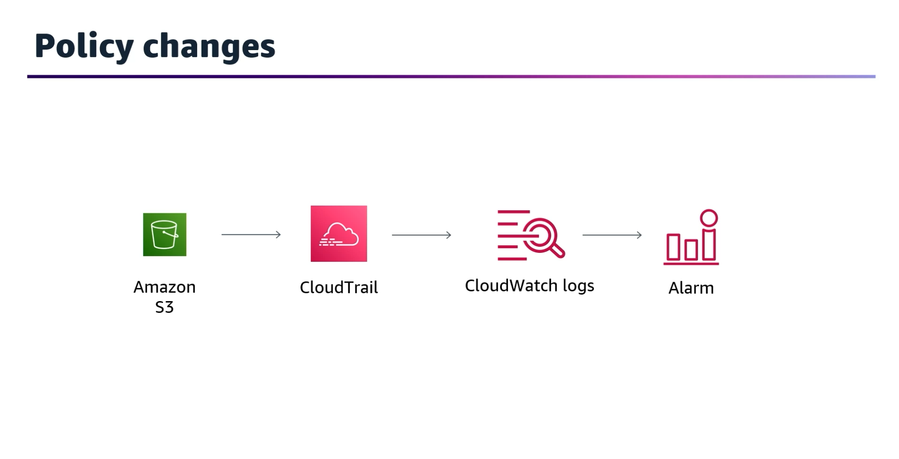
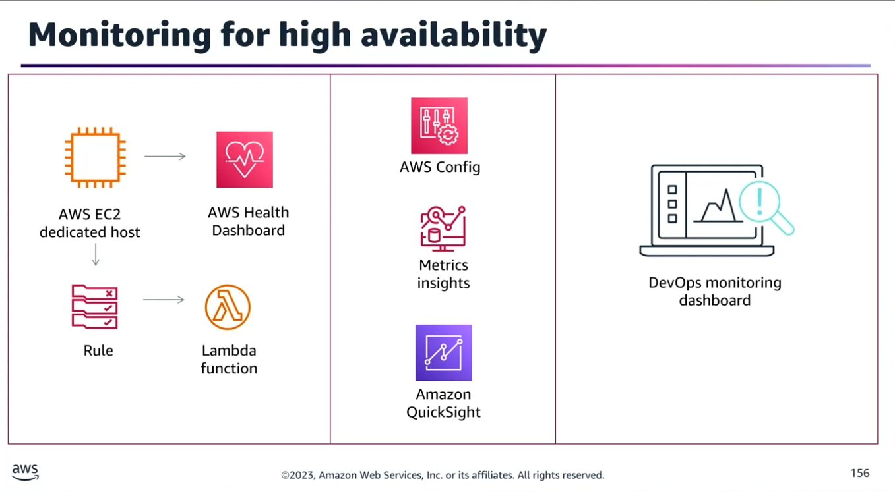
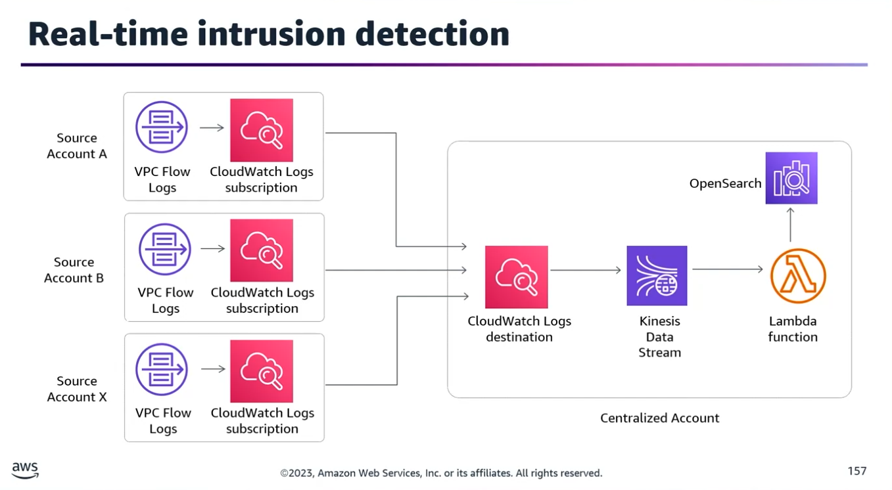
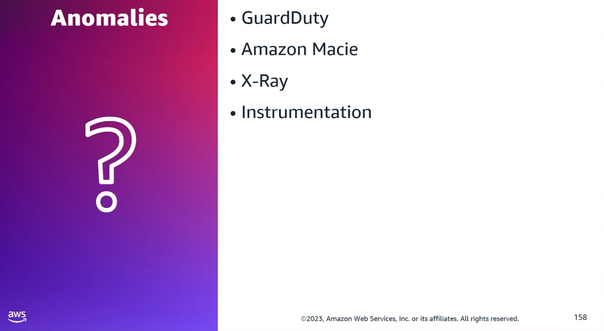

## Task Statement 2: Audit, monitor, and analyze logs and metrics to detect issues.

### 1. Core CloudWatch Analysis Features

Amazon CloudWatch provides several advanced features to moving past basic log storage into proactive analysis and operational efficiency:
- **CloudWatch Application Insights:** Collectively defines and monitors metrics and logs for an entire application across different, disparate AWS resources.
- **CloudWatch Anomaly Detection:** Applies machine learning/statistical algorithms to continuously analyze system metrics, determine normal baselines, and surface anomalies with minimal user intervention.
- **CloudWatch Logs Insights:** An interactive query tool used to search and analyze log data within CloudWatch Logs using a robust query language.
- **CloudWatch Service Lens:** A correlation tool that integrates and visualizes traces, metrics, logs, and alarms together in a unified view to accelerate root-cause diagnosis.

#### Deep Dive: CloudWatch Anomaly Detection

- **No Static Thresholds:** Alarms check the metric's live value against a dynamic model-expected range rather than a fixed hard number.
- **Visual Representation:** When graphing metric data, the model overlays expected values as a shaded band, making outliers visually immediate.
- **API Access:** You can programmatically fetch the upper and lower boundaries of the model's band using the GetMetricData API combined with the ANOMALY_DETECTION_BAND metric math function.

### 2. Best Practices for Metric Architecture

- **Baseline Initial Setup:** Begin collecting a foundational set of metrics and dimensions to establish standard baselines, then scale up granular tracking over time.
- **Grouping & Identification:** Use unique custom Namespaces to cluster relevant custom metrics and resources together under a single application umbrella.
- **Enhanced Searchability:** Add custom Dimensions to metrics and precise Identifiers to logs to enable quick cross-system and cross-service correlation during outages.
- **Multi-tiered Alarms:** Create multiple alarms for a single metric using varying thresholds and evaluation periods (e.g., an early-warning alarm vs. a critical-breach alarm).

### 3. Exam Scenarios & Architecture Solutions

#### Scenario 1: Unauthorized S3 Bucket Policy Changes (CI/CD Pipeline Breakdown)

- **Problem:** A developer accidentally alters an S3 bucket policy, breaking deployment artifact downloads.
- **Solution:**
	1. Configure an AWS CloudTrail trail to stream account API logs directly to a CloudWatch Logs Group.
	2. Implement a CloudWatch Metric Filter inside that log group targeted at specific S3 bucket events (PutBucketPolicy, DeleteBucketPolicy, PutBucketLifecycle, PutBucketReplication, PutBucketAcl).
	3. Attach a CloudWatch Alarm to that metric filter with a threshold of ≥ 1.
	4. Wire the alarm to an SNS Topic to send email alerts to the DevOps team.
	5. Optional Automation: Configure AWS CodeDeploy to execute an automatic rollback when this specific alarm threshold triggers.

#### Scenario 2: HA and Health Monitoring for a Single EC2 Dedicated Instance

- **Problem:** An application is constrained to a single Amazon EC2 dedicated instance but still requires high availability monitoring.
- **Solution:** Monitor the instance via AWS Personal Health Dashboard events. Create an Amazon EventBridge (CloudWatch Events) Rule that listens for instance failure states and triggers an AWS Lambda function to automatically launch a fresh backup EC2 instance.

#### Scenario 3: Real-Time Stream Auditing & Account Intrusion Detection

- **Problem:** A multi-division firm needs a centralized framework for auditing account logs and capturing real-time anomalous behaviors.
- **Solution:** Assemble a live stream of event data across all enterprise accounts and deliver it to the security team using Amazon Kinesis Data Streams.

#### Scenario 4: Multi-Account Malware & Brute Force Detection

- **Problem:** Automatically find malicious activities (like malware or SSH brute-force attempts) across multiple AWS Organizations accounts without budget constraints.
- **Solution:** Enable Amazon GuardDuty globally across all member accounts. Designate a dedicated security account as the GuardDuty Administrator. Configure an EventBridge rule in the security account to pipe findings via Amazon Kinesis Data Firehose into a central, secure Amazon S3 bucket.

### 4. Compliance, Visualization, & Dashboards

When tasked with choosing dashboard solutions for infrastructure compliance or pipeline visualization, match the use case to the specific service strengths:

| Service / Solution |	Best Used For |
|-------------------|----------------|
|**AWS Config**	|Built-in visualization dashboard that records configuration histories, evaluates infrastructure settings against automated rules, and logs violations.|
|**Amazon QuickSight**	|Advanced business intelligence tool used to build highly tailored dashboards. Perfect for querying compliance logs exported to Amazon S3 and indexed via Amazon Athena.|
|**DevOps Monitoring Dashboard on AWS**	|A pre-packaged AWS Solution that automates tracking and visualization of standard CI/CD pipeline and developer delivery metrics natively inside QuickSight.|
|**Amazon Macie**	|Specifically designed to scan, classify, and protect sensitive data footprints and detect anomalous usage patterns within Amazon S3.|

### 5. AWS X-Ray Integration Mechanics

You must know how X-Ray interacts with key services for transaction tracing:
- **Active vs. Passive Instrumentation:**
	- **Active:** The AWS resource generates and manages its own tracing segments.
	- **Passive:** The resource simply forwards existing tracing headers appended by an upstream service.
- **AWS Lambda:** Supports both modes. When mapped, it introduces two distinct nodes to your X-Ray Service Map—one representing the core Lambda Service layer, and another for the execution of the individual function.
- **Amazon API Gateway:** Uses custom sampling rules to decide which specific API requests to actively document, adding a dedicated node for the Gateway Stage to the service map.
- **Amazon EventBridge:** Operates under passive instrumentation. If an originating publisher is instrumented with the AWS X-Ray SDK, EventBridge accepts the trace ID headers and transparently forwards them to down-stream targets to preserve end-to-end tracing.