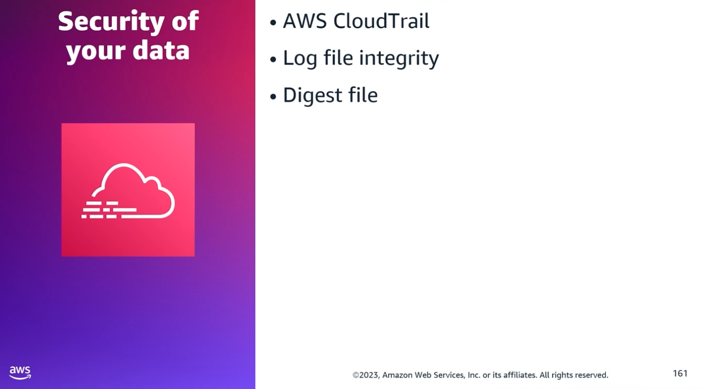
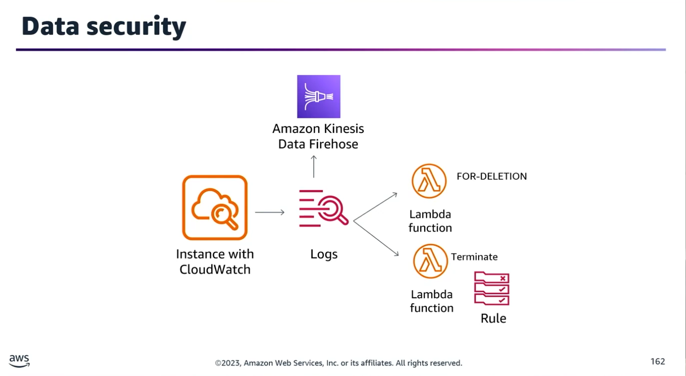
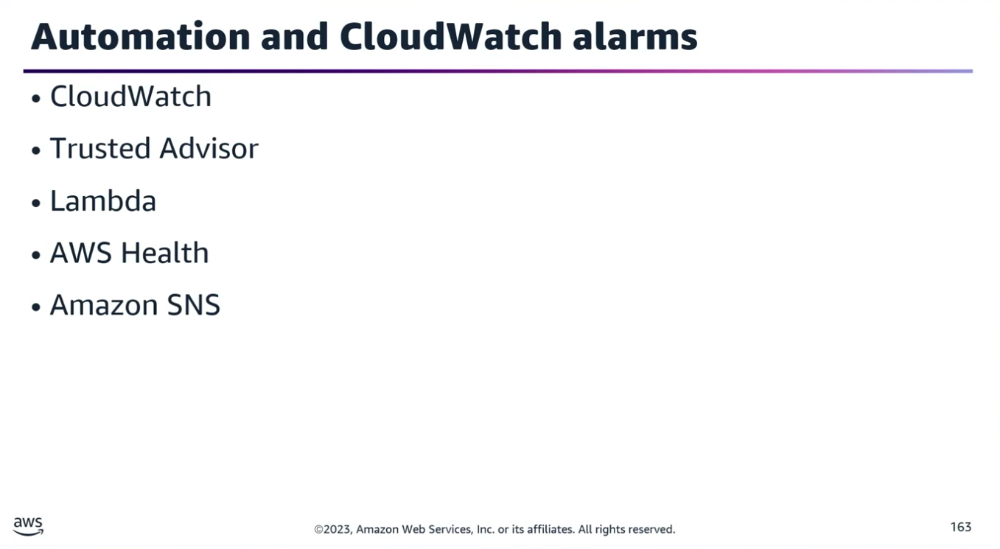
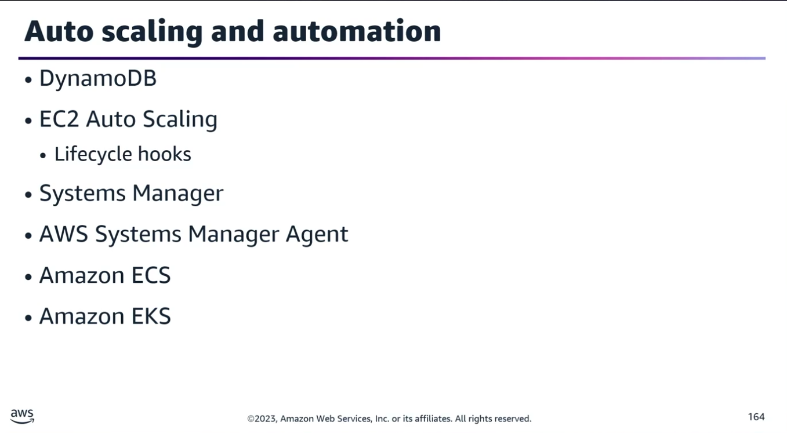
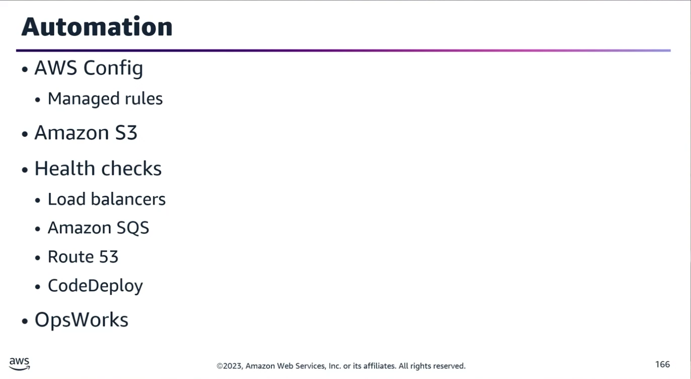

## Task Statement 3: Automate monitoring and event management of complex environments.

Automating notifications, alerts, and corrective actions is critical for maintaining high availability, fault tolerance, and data security across an AWS infrastructure.
### 1. Data Protection & Log Integrity

#### AWS CloudTrail Log File Integrity

- **Core Mechanism:** Validates that log files have not been tampered with or deleted after delivery.
- **Process:**
	- CloudTrail generates a cryptographic hash for every log file delivered.
	- Every hour, CloudTrail creates and delivers a Digest File.
- **Digest Files:**
	- Contain the hashes of all log files from the previous hour.
	- Reference the exact log files they validate.
	- Are digitally signed by CloudTrail using a private key specific to each region (using different key pairs per region) to verify authenticity.

### 2. Automated Incident Response & Security Remediation

#### Scenario A: Remediation of Unauthorized SSH Logins on EC2

**Goal:** Automate the termination of EC2 instances in an Auto Scaling Group (ASG) when manual SSH access occurs.
- **Architecture Solution:**
	1. **Log Collection:** Install the CloudWatch Agent on the EC2 instances to capture system logs.
	2. **Real-Time Streaming:** Set up a CloudWatch Log Subscription Filter on the relevant log group for real-time delivery of SSH login events.
	3. **Tagging (Lambda 1):** Stream log events to a primary AWS Lambda function. This function parses the event and adds a custom tag (for deletion) to the offending EC2 instance.
	4. **Termination (Lambda 2):** Create an Amazon EventBridge rule that detects the resource tagging event and triggers a secondary Lambda function to terminate the tagged instance.
- **Note on Subscription Filters:** CloudWatch logs can be streamed to Kinesis Data Streams, Kinesis Data Firehose, or AWS Lambda for custom processing, and emit metrics regarding forwarded events.

#### Scenario B: Enforcing Continuous CloudTrail Logging

**Goal:** Prevent or immediately undo unauthorized disabling of CloudTrail logging.
- **Why Managed Rules Aren't Enough:** The AWS Config managed rule (cloudtrail-enabled) evaluates compliance periodically (e.g., every hour). Real-time enforcement requires an event-driven layer.
- **Architecture Solution:**
	1. Create an EventBridge Rule to monitor configuration changes or specific API calls (e.g., StopLogging).
	2. Target an AWS Lambda function using the resource Amazon Resource Name (ARN) passed by the event.
	3. The Lambda function utilizes the AWS SDK to immediately re-enable logging by executing the StartLogging API call.

### 3. Resource Optimization & Cluster Management

#### Automating Low-Utilization EC2 Terminations

- **Mechanism:** Integrate Amazon EventBridge with AWS Trusted Advisor.
- **Process:** EventBridge detects underutilized EC2 instances flagged by Trusted Advisor metrics &rarr; Triggers a Lambda function to evaluate context &rarr; Invokes a secondary workflow or Lambda to safely terminate the underutilized nodes.

#### Automated Notifications for Cluster Maintenance (Hadoop/EMR)

- **Goal:** Notify a team via email when 100+ node Hadoop clusters require instance maintenance or face hardware retirement, allowing the team to safeguard the Hadoop Distributed File System (HDFS).
- **Architecture Solution:**
	- Create an EventBridge Rule filtering for the AWS Health Service.
	- Specify the EC2 service and relevant maintenance event types.
	- Set the target to an Amazon SNS Topic to which the engineering team is subscribed.
- **What DOES NOT Work (Exam Counter-Examples):**
	- **CloudWatch Metric Filters:** Cannot be applied directly to AWS Health Events; metric filters only scan CloudWatch Log Groups.
	- **Systems Manager Resource Data Sync:** Cannot track AWS Health live alert streams; it is strictly used to aggregate inventory data from managed nodes into a single S3 bucket.

### 4. Compute Scaling & Configuration Automation

#### Auto Scaling Group (ASG) Table Updates

- **Goal:** Keep a DynamoDB tracker table synchronized whenever an ASG launches or terminates instances.
- **Solution:** Configure an EventBridge Rule triggered by ASG Lifecycle Actions. Target an AWS Lambda function that parses the instance metadata and dynamically updates the DynamoDB table.

#### Dynamic Batch Processing Configuration Sync

- **Goal:** A standalone batch processing instance requires an updated configuration file listing the active IP addresses of a separate, dynamically scaling ASG.
- **Solution:**
	1. Configure an EventBridge Rule to listen for ASG launch and terminate events.
	2. Install the Systems Manager (SSM) Agent on the batch processing instance with the correct IAM permissions.
	3. Map the EventBridge target to an SSM Run Command.
	4. The Run Command executes a script on the batch instance to fetch the new active IPs and rewrite its configuration file.

#### Cluster-Wide Configuration Management

- **Goal:** Maintain consistent configuration files across a distributed system when cluster topology changes.
- **Solution:** Layer the nodes using AWS OpsWorks Stacks. Use Chef Recipes associated with the Configure lifecycle event. When a cluster change is detected, the stack automatically runs the configuration recipes across all layers to sync the file.

**Note:** Using AWS CodeCommit and CodeDeploy paired with EventBridge only manages deployment actions, not real-time state monitoring.

### 5. Container & Application Health Automation

#### Container Architecture Scaling

| Component / Tool |	Infrastructure Focus |	Scaling Architecture |
|------------------|----------------------|----------------------|
| Amazon ECS Capacity Providers |	ECS Workloads (Fargate / EC2) |	Manages infrastructure scaling for tasks within clusters using capacity provider strategies. |
| Kubernetes Cluster Autoscaler |	Amazon EKS |	Scans for un-schedulable pods and automatically scales AWS Auto Scaling Groups. |
| Karpenter (Open Source) |	Amazon EKS |	Evaluates pod requirements and provisions capacity directly via the Amazon EC2 Fleet API (bypassing ASGs). |

#### Health Check Automation Matrix

Automated system monitoring relies on distinct downstream definitions of "health" before taking action:
- **Application Load Balancers (ALBs):** Assess target instances via configured ping paths before routing client traffic.
- **Amazon SQS:** Checks component health boundaries prior to permitting consumers to pull deeper work from the queue.
- **Amazon Route 53:** Evaluates endpoint health by checking local resource status, cascading secondary health checks, or tracking designated CloudWatch Alarms.
- **AWS CodeDeploy:** Uses integrated CloudWatch Alarms to execute automatic rollbacks to a last-known-good state if metric thresholds are breached during deployment.

### 6. Open Review Challenge Question

**Scenario:** An application is hosted in an Amazon ECS cluster with multiple ECS services. The cluster uses an Application Load Balancer (ALB) to distribute traffic. You want to automatically collect logs from all services and upload them to S3 for near real-time analysis.
- Think about how you would solve this using AWS native tools (e.g., Firehose, sidecar containers, or CloudWatch container insights) before the next review.
