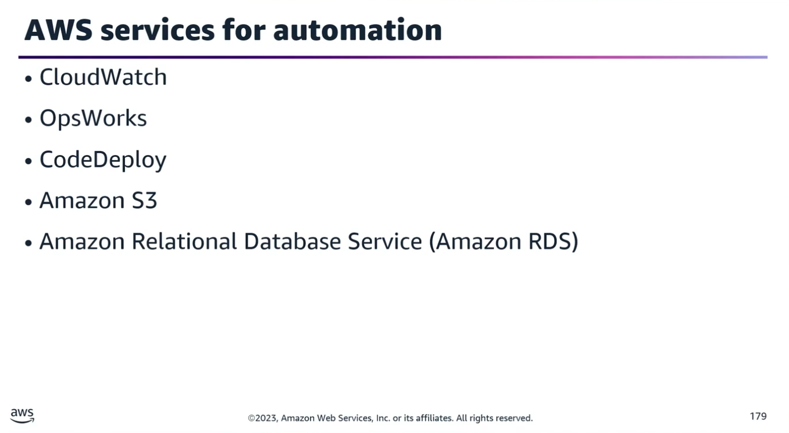
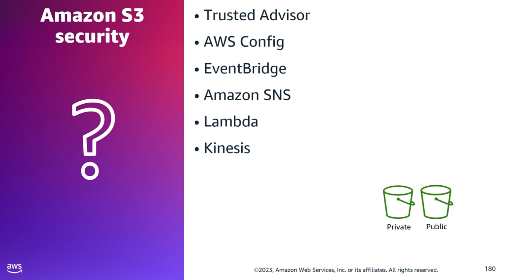
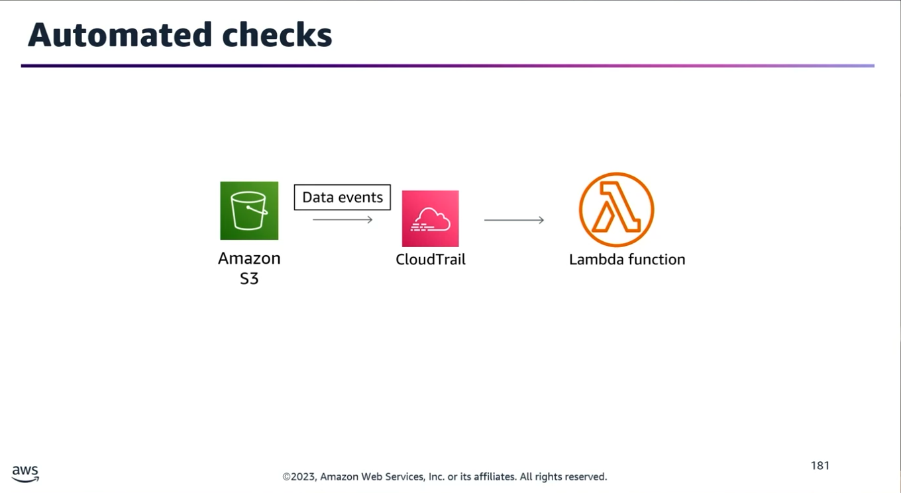

## Task Statement 1: Manage event sources to process, notify, and take action in response to events.

### Core Philosophy

Automating incident and event management is critical to maintaining infrastructure resiliency and high availability. AWS provides a robust ecosystem to replace manual, repetitive tasks with automated near-real-time remediations and notifications.

#### Service Event Sources & Automated Actions

- **OpsWorks:** Auto-heal stacks automatically when failures occur.
- **Amazon EC2:** Place instances into Auto Scaling groups to handle load and availability shifts dynamically.
- **AWS CodeDeploy & CloudWatch:** Monitor deployments, resolve issues, and execute automatic rollbacks if metrics degrade.
- **Amazon S3:** Use S3 events to monitor and alert on unauthorized actions.
- **Amazon RDS:** Track failovers, configuration changes, and backup events automatically.

### Scenario 1: Managing Public S3 Buckets (Restricting to List-Only Operations)

**Goal:** Ensure buckets meant for public/external use strictly permit only List operations, and instantly catch violations.
- **AWS Trusted Advisor:** Monitors public S3 bucket permissions out-of-the-box.
- **Custom AWS Config Rule:** Can be built to audit public S3 bucket permissions continuously.
- **Remediation Architecture (Near-Real-Time):**
	1. **Detection:** The custom AWS Config rule identifies a bucket policy violation.
	2. **Routing:** The violation triggers an Amazon EventBridge rule.
	3. **Remediation (Action):** EventBridge invokes an AWS Lambda function to automatically rewrite and correct the S3 bucket permissions.
	4. **Notification:** EventBridge concurrently triggers Amazon SNS to send an alert regarding the security recommendation violation.
- **Note on Kinesis:** Amazon Kinesis Data Streams can be integrated to push data checks for comprehensive, real-time logging and analytics.

#### EventBridge Targets for Trusted Advisor Workflows

When configuring EventBridge to handle Trusted Advisor check status changes, you can route to multiple targets:
- AWS Lambda functions
- Amazon SNS topics
- Amazon Kinesis Data Streams
- Amazon SQS queues
- CloudWatch Alarms

### Scenario 2: Cost Optimization for Underutilized Resources

**Goal:** Automate cost savings when infrastructure is underutilized.
- **Detection:** Underutilized or unused Elastic Load Balancers (ELBs) trigger flags within AWS Trusted Advisor’s cost optimization checks.
- **Monitoring:** CloudWatch tracks Trusted Advisor metrics (check status changes, resource status changes).
- **Remediation:** An EventBridge rule detects the status change and triggers a Lambda function to automatically delete the underutilized load balancers, immediately driving down costs.

### Scenario 3: Real-Time Compliance Monitoring of Private S3 Data

**Goal:** Ensure only a dedicated compliance team can access or modify objects within a highly restricted, private S3 bucket.
- **Correct Implementation:**
	- **Enable S3 Data Events in CloudTrail:** By default, CloudTrail only logs management events. To track object-level changes (reads/writes/permission edits), you must explicitly turn on Data Events.
	- **Automation:** Create an EventBridge rule that reacts to these CloudTrail S3 data events, invoking a Lambda function to verify if the calling identity belongs to the authorized compliance team.
- **Incorrect Alternative (Exam Trap):**
	- Can you use a custom AWS Config rule triggered by configuration changes alongside AWS Step Functions for this? No. You cannot directly trigger AWS Step Functions straight from AWS Config without an intermediary layer (like EventBridge). Furthermore, AWS Config tracks resource configurations (bucket level), not object-level data actions (like reading or modifying specific objects inside the bucket).
