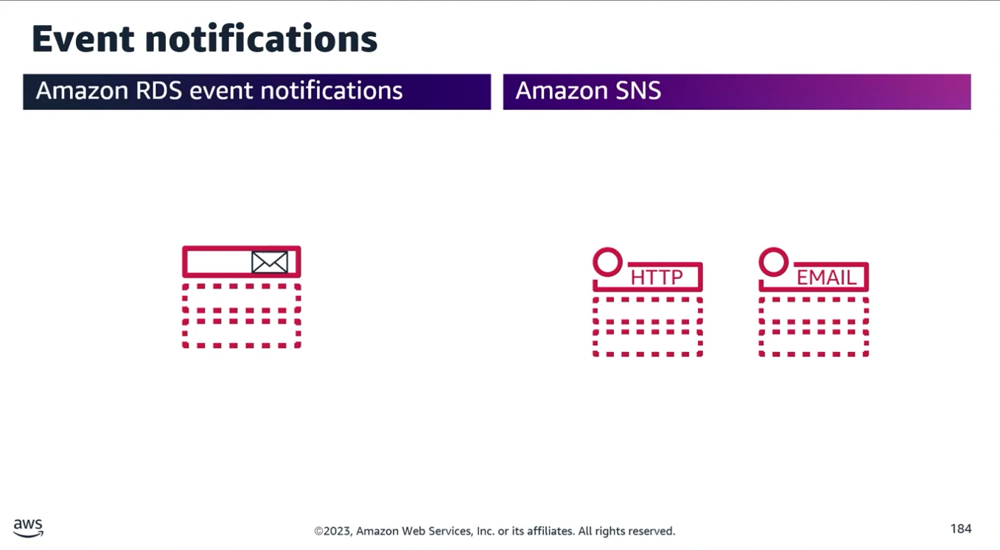
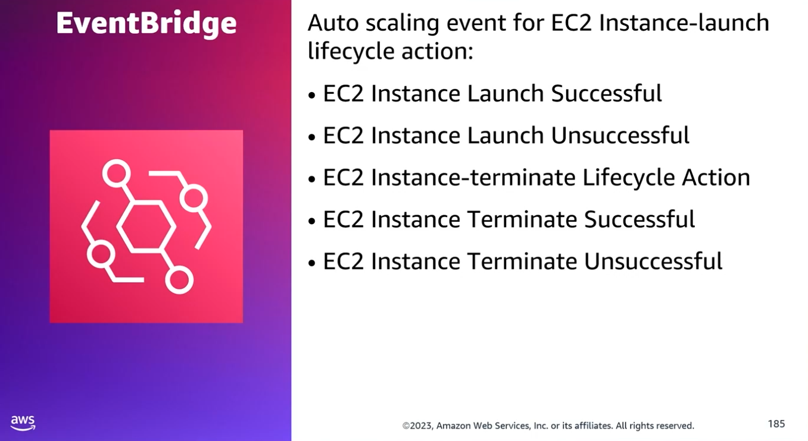
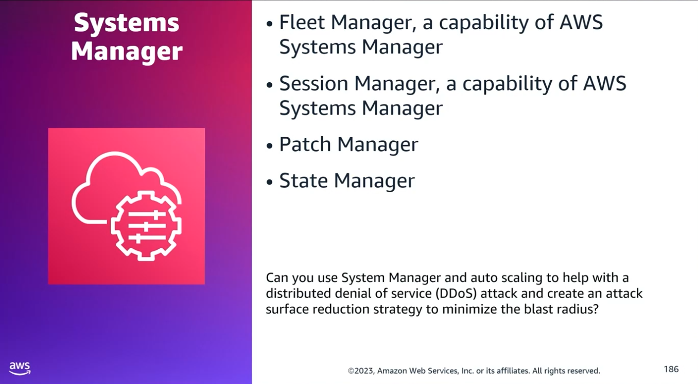
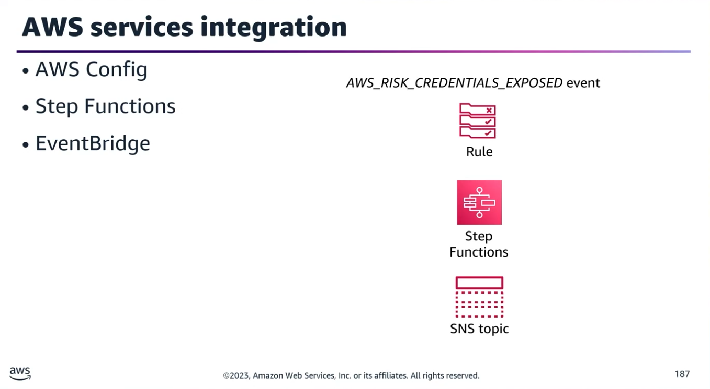
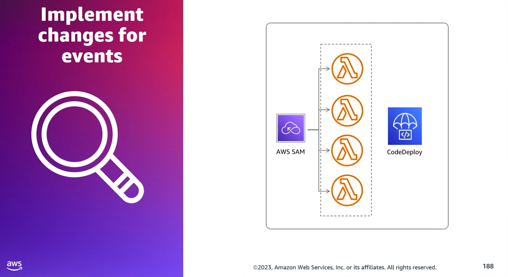

## Task Statement 2: Implement configuration changes in response to events.

### 1. Amazon RDS Event Notifications

- **Purpose:** Notifies you of state changes or operational occurrences within your database resources.
- **Common Notification Types:**
	- **Lifecycle events:** Creation, restarting, deletion.
	- **Performance/Infrastructure events:** Low storage space, Multi-AZ failovers.
	- **Operational events:** Configuration changes.
- **Automated Remediation Workflows:**
	- Process notifications automatically via AWS Lambda or Amazon CloudWatch alarms.
	- Route AWS Health API events to an Amazon SNS topic to trigger custom Lambda remediation scripts.
	- **Scheduled Events to Monitor:** Underlying EC2 host maintenance (shutdowns/terminations) and scheduled RDS updates (reboots).

### 2. Auto Scaling & EventBridge Integration

- **Mechanism:** Use Amazon EventBridge to track Auto Scaling events (e.g., scale-in, scale-out, lifecycle transitions).
- **Action:** Trigger custom AWS Lambda functions to run necessary configurations or resource preparation tasks upon scale events.

### 3. AWS Systems Manager (SSM) Capabilities

- **SSM Fleet Manager:**
	- Remotely manages server nodes running both on AWS and on-premises.
	- Provides a centralized console to view health, performance status, and individual node data.
	- Ideal for common troubleshooting, application patching, updates, and configuration changes at scale.
- **SSM Session Manager:** Provides secure, auditable instance management without needing open inbound ports, bastion hosts, or managed SSH keys.
- **SSM Patch Manager:** Automates the process of patching managed instances with security-related updates.
- **SSM State Manager:** A configuration management service that automates the process of keeping target infrastructure in a defined state.

### 4. 🧠 Exam Alert: DDoS Mitigation & Blast Radius Reduction

**Scenario:** Can you use Systems Manager and Auto Scaling to minimize the attack surface and blast radius of a DDoS attack?
- **Answer:** No.
	- Auto Scaling only absorbs traffic by scaling out network capacity; it does not reduce the attack surface.
	- SSM features (Session, Patch, and State Managers) manage configurations and access, but they do not mitigate active network-layer/application-layer DDoS attacks.
- **Correct Architecture Solution:**
	- AWS Shield Advanced: Enhanced DDoS detection and layer-7 traffic monitoring.
	- Amazon CloudFront: Protects origin servers by caching content at edge locations.
	- AWS WAF (Web Application Firewall): Identifies and blocks common DDoS request patterns.

### 5. Step Functions & EventBridge Orchestration

- **Integration Rule:** AWS Config does not directly integrate with AWS Step Functions. Use Amazon EventBridge as the middleman rule engine.
- **Exposed Credentials Remediation Scenario:**
	1. Hardcoded access keys are pushed to a public repository (e.g., GitHub).
	2. AWS Health generates an AWS_RISK_CREDENTIALS_EXPOSED event.
	3. An EventBridge rule detects this specific risk event.
	4. The rule invokes an AWS Step Functions state machine.
	5. The state machine orchestrates a workflow: deletes the exposed IAM access keys, compiles a summary of recent API activity for those keys, and publishes the report to an Amazon SNS topic.

### 6. Automated CodeDeploy Validations & Rollbacks

**Scenario:** A Lambda-based application deployed via AWS CodeDeploy requires all APIs to be tested before shifting production traffic, with an automatic rollback if validation fails.
- **AppSpec Lifecycle Hooks:** Define validation scripts in the AppSpec file under lifecycle hooks (e.g., PreTraffic or PostTraffic) to test the deployment group using test traffic. If the hook script fails, CodeDeploy automatically halts and rolls back the deployment.
- **CloudWatch Alarms Integration:**
	- Configure validation scripts to run during deployment and associate a CloudWatch alarm to the deployment group.
	- If validation metrics fail or a threshold (like a 5XX Error metric) is breached in the Auto Scaling group, CloudWatch triggers CodeDeploy to execute an automatic rollback and pushes a notification to an Amazon SNS topic.