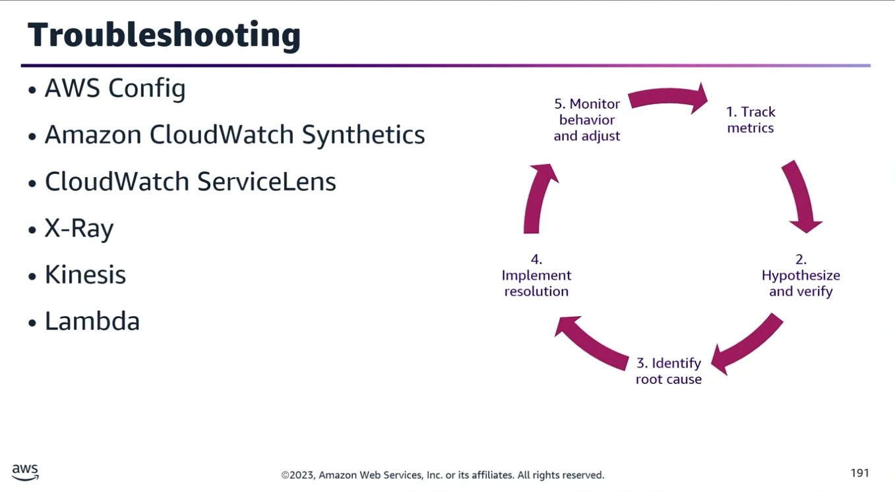
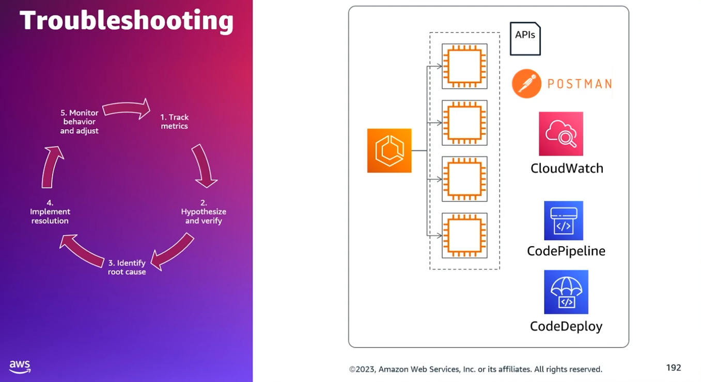
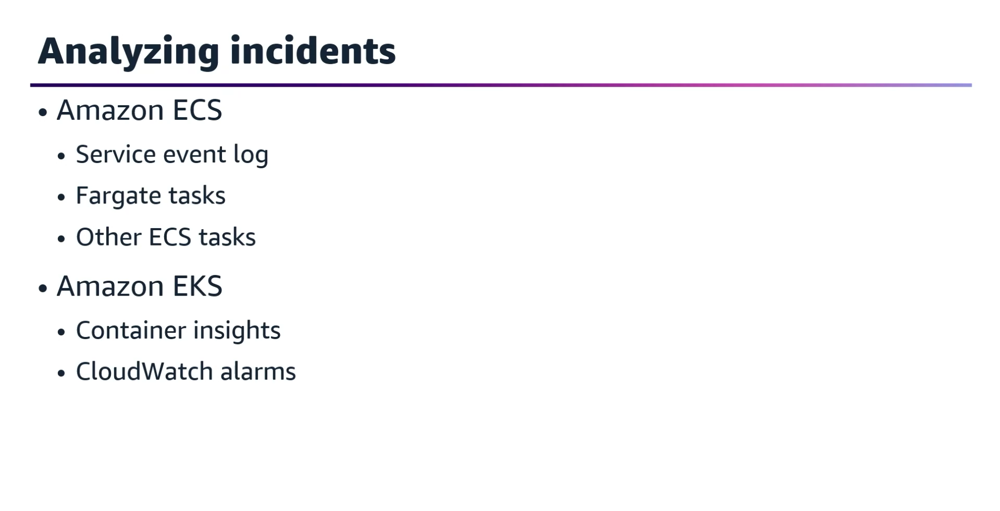
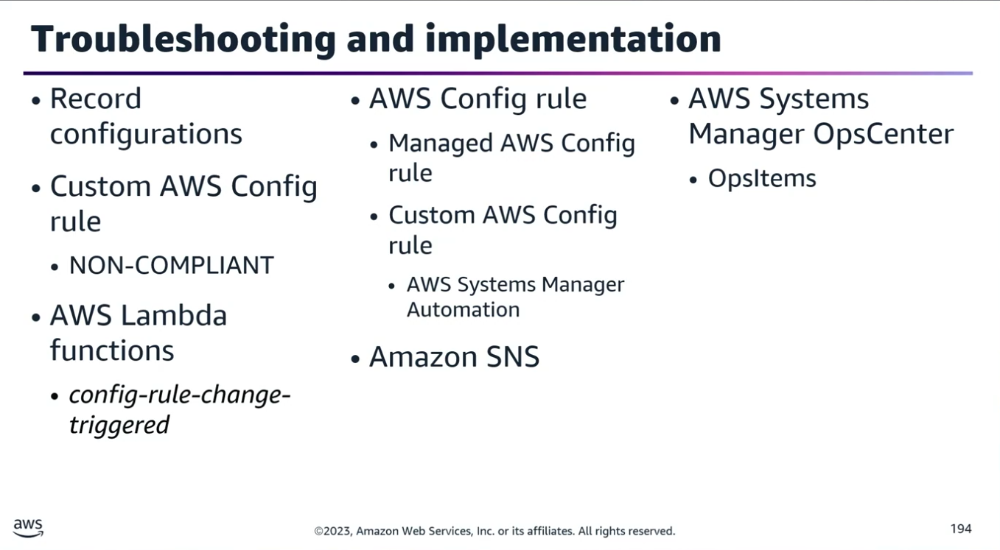

## Task Statement 3: Troubleshoot system and application failures.

### 1. The Incident Management & Troubleshooting Process

Troubleshooting closely mirrors the incident management lifecycle. It relies heavily on baseline metrics to identify deviations.
- Step 1: Establish baseline metrics and set up alerts for threshold breaches to identify issues.
- Step 2: Hypothesise causes.
- Step 3: Reproduce and verify the issue.
- Step 4: Identify the root cause.
- Step 5: Implement the resolution.
- Step 6: Monitor the system behaviour post-resolution.
- Step 7: Document the incident.
- Step 8: Evolve and modify the response process based on lessons learned.

### 2. Advanced Monitoring & Observability Integration

While AWS Config audits resource configurations, the following stack is used to analyse failed deployments, processes, and performance bottlenecks:
- **Amazon CloudWatch Synthetics:** Simulates user traffic to proactively discover issues.
- **CloudWatch ServiceLens:** Integrates with Synthetics and AWS X-Ray to provide an end-to-end operational view of the application, helping trace the cause of impacts, identify performance bottlenecks, and locate impacted users.
- **Real-Time Log Analysis:** Use CloudWatch Subscription Filters to stream real-time logs to:
	- Amazon Kinesis Data Streams
	- Amazon Kinesis Data Firehose
	- AWS Lambda (for immediate processing/analysis)

### 3. Scenario-Based Troubleshooting

#### Scenario A: ASG Application Fails After Changing API Protocol from HTTP to HTTPS
- **The Problem:** An application on EC2 instances in an Auto Scaling Group (ASG) stops working after a deployment changes an external API call from http:// to https://.
- **Troubleshooting Steps:**
	1. **Verify External API:** Use a tool like Postman to confirm the external API works correctly over HTTPS.
	2. **Check Network Security:** Inspect Network ACLs (NACLs) and Security Groups—specifically the egress (outbound) security rules for the ASG.
		- Remember: HTTP uses Port 80, but HTTPS requires Port 443.
	3. **Analyse VPC Flow Logs:** Look for REJECT records originating from the ASG traffic.
	4. **Review EC2 OS Logs:** Check CloudWatch Logs (Note: This requires the CloudWatch agent to be installed on the EC2 instances).

#### Scenario B: Expediting Serverless Pipelines (AWS CodePipeline)

- **Optimization:** To reduce pipeline execution time for a serverless application using Lambda, modify the CodePipeline configuration to run actions for each Lambda function in parallel by assigning them the same runOrder value.
- **Remediation:** Use CloudWatch to collect state information and rectify failed or rejected approval actions in your CI/CD processes.

#### Scenario C: Monitoring CodeDeploy Deployments

To monitor the status and count of healthy hosts during a deployment, check:
- **Minimum Healthy Host:** Tracks the minimum number of healthy instances that must remain available.
- **Metrics to Watch:** Check HOST_COUNT or FLEET_PERCENT to track the exact numbers or percentages of healthy hosts.

### 4. Container Troubleshooting (ECS & EKS)

#### Amazon ECS (Elastic Container Service)

- **Diagnostic Info:** Always check the Service Event Log first for high-level tasks/service failures.
- **Container Logs in CloudWatch:**
  - **AWS Fargate Tasks:** Use the awslogs log driver to automatically pass logs from Docker to CloudWatch Logs.
  - **EC2 Launch Type (Non-Fargate):** If using the default json-file logging driver, log into the EC2 container instance and run the Docker command: docker logs <container_id>.

#### Amazon EKS (Elastic Kubernetes Service)

- **CloudWatch Container Insights:** Used to collect, aggregate, and summarise metrics/logs from containerised apps across ECS, EKS, and Kubernetes on EC2.
- **Diagnostics:** Container Insights isolates issues quickly by highlighting specific failures like container restart failures.
- **Data Ingestion Mechanism:** Collects data as performance log events using the Embedded Metric Format (EMF) (a structured JSON schema for high-cardinality data at scale).
- **Visualization:** CloudWatch automatically aggregates this EMF data into metrics at the cluster, node, pod, task, and service levels, displaying them in automatic dashboards.

### 5. Automated Compliance & Remediation Scenarios

#### Scenario 1: Enforcement of Dedicated Hosts & License Auditing

- **Goal:** Ensure an application only runs on EC2 Dedicated Hosts to prevent third-party software licensing costs from increasing.
- **Solution:**
  1. Use AWS Config to continuously record the configurations of EC2 instances and dedicated hosts.
  2. Deploy a custom AWS Config rule using the config-rule-change-triggered Lambda blueprint.
  3. Customise the evaluation logic to return a NON_COMPLIANT status if an EC2 instance is detected running on shared hardware instead of a Dedicated Host.
  4. Use the generated AWS Config report as the single source of truth for software license reporting.

#### Scenario 2: Remediating Overly Permissive Security Groups (Port 22 Open to 0.0.0.0/0)

- **Goal:** Detect and automatically fix a security group that allows inbound SSH (Port 22) traffic from everywhere.
- **Solution:**
  1. Configure an AWS Config rule to check security groups for unrestricted Port 22 access.
  2. Set up alerts/notifications using Amazon SNS.
  3. Attach a Remediation Action using AWS Systems Manager (SSM) Automation. The runbook will automatically update the security group, removing 0.0.0.0/0 and restricting inbound Port 22 access exclusively to the corporate data centre's public IP address.

### 6. AWS Systems Manager OpsCenter

- **Purpose:** Investigate, aggregate, and remediate operational issues, interruptions, or alerts—collectively tracked as OpsItems.
- **Resolution:** Engineers can execute pre-built or custom SSM Automation Runbooks directly from the OpsCenter dashboard to resolve the active OpsItems efficiently.