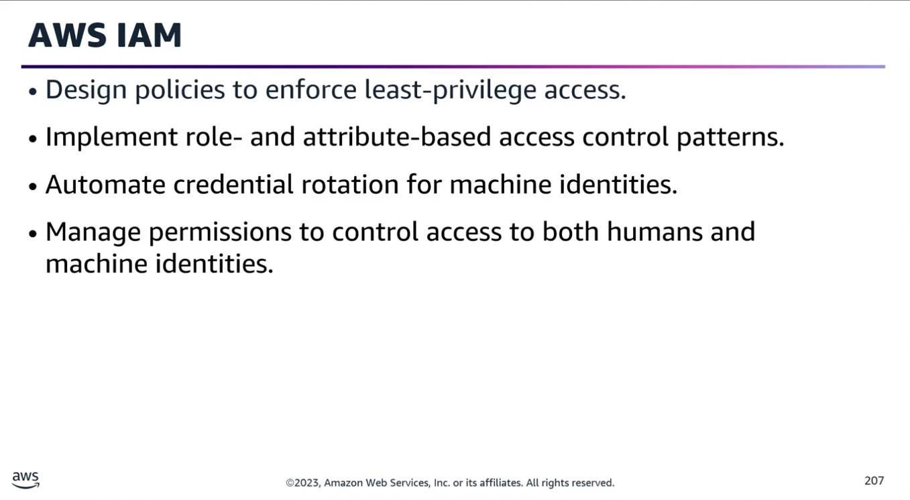
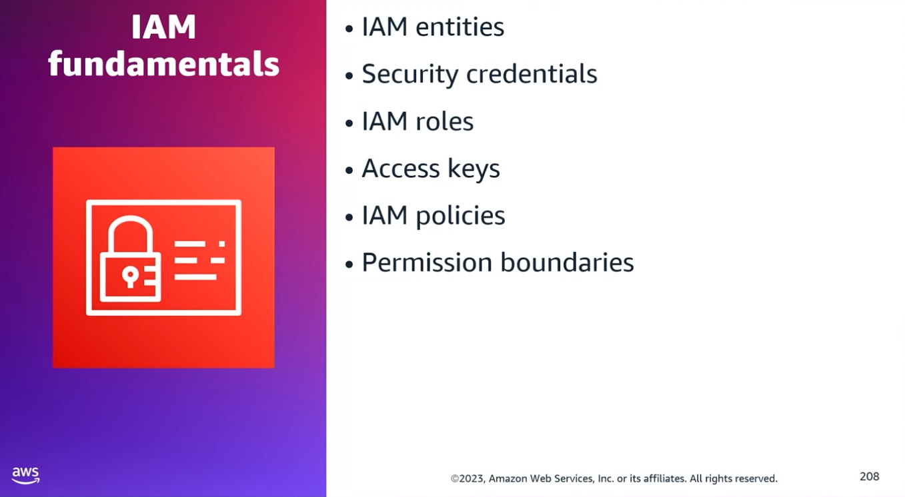
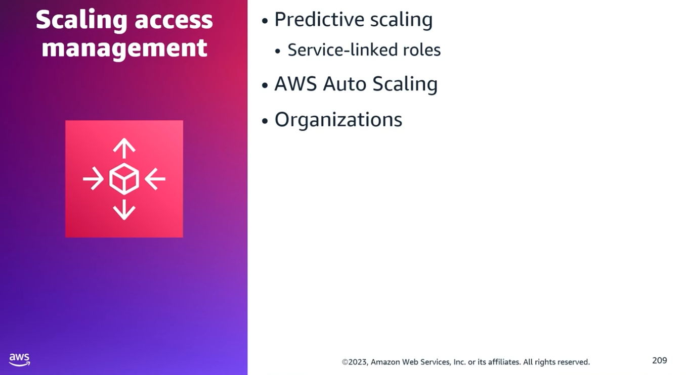
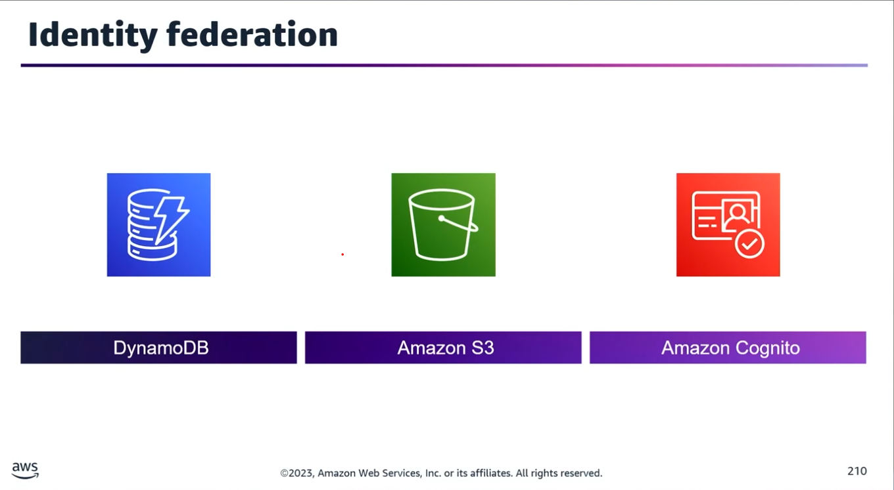
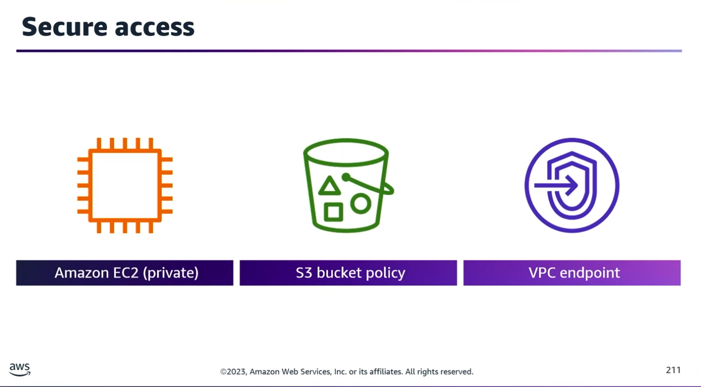

## Task Statement 1: Implement techniques for identity and access management at scale.

### 1. Fundamentals of IAM Entities & Authentication

AWS requires specific credentials based on how you connect and who you are.
- **Human vs. Machine Identities:**
	- Console Access: Requires a username and password.
	- Programmatic Access (SDKs/CLI): Requires access keys (Access Key ID and Secret Access Key) or temporary security credentials via AWS STS (Security Token Service).
- **Identity Categories:** Account root user, IAM user, AWS IAM Identity Center, and Federated identities.

### 2. On-Premises to AWS Programmatic Access

- **In-AWS Resources:** Always use IAM Roles for applications running inside AWS to avoid hardcoding credentials.
- **Outside-AWS (On-Premises):** If an on-premises application uses AWS SDKs for a specific task, you must use Access Keys for programmatic authentication.

### 3. Deep Dive: IAM Policies & Least Privilege

- **AWS Managed Policies (Example: AWSCodeCommitPowerUser):**
	- What it allows: Full functionality of CodeCommit and repository-related resources, including the ability to directly push code to the main branch without a pull request.
	- What it blocks: Deleting repositories or creating/deleting unrelated resources.
	- Security Flaw: Allowing direct pushes to the main branch fails the principle of least privilege.
	- Modification: You cannot modify an AWS Managed Policy. To restrict it, you must attach a separate policy with a Deny rule to the IAM entity.
- **Permissions Boundaries:** An advanced feature using a managed policy to set the maximum allowable permissions that an identity-based policy can grant to an IAM entity.

### 4. Scaling Access Management & Governance

- **Predictive Scaling & Service-Linked Roles:** Use service-linked roles to grant automatic permissions to call other AWS services when managing scaling plans.
- **Infrastructure Security:** API calls to AWS Auto Scaling travel through the AWS global network and must be signed using either permanent access keys or temporary credentials via AWS STS.
- **AWS Organizations:** Used for consolidated billing, resource sharing, compliance, and security governance across multiple accounts.
	- To enforce structural permission guardrails across accounts, use Service Control Policies (SCPs).
- **Secure Build Pipelines:** Never include hardcoded IAM access keys or database passwords in a buildspec.yml file. Expect to audit and catch these security flaws in build specifications.

### 5. Identity Federation Scenarios

**Scenario A:** Mobile App using S3 & DynamoDB with User Authentication

- **The Secure Architecture:**
	1. Create an Amazon Cognito Identity Pool to store end-user identities. Cognito automatically creates required IAM roles for both authenticated and unauthenticated (guest) users.
	2. Leverage the AWS STS AssumeRoleWithWebIdentity API to establish Web Identity Federation.
	3. Register with public identity providers (Google, Facebook, or any OpenID Connect-compatible provider).
	4. Create an IAM role granting specific access to Amazon S3 and DynamoDB.
	5. Configure the mobile app to use temporary security credentials returned by STS to upload objects to S3 and persist data to DynamoDB.
	6. Note: Only Cognito can automatically generate these distinct guest and authenticated IAM roles for web identities; standard IAM cannot do this automatically.
- **SAML Authentication:** The AssumeRoleWithSAML API is used specifically for parsing SAML authentication responses (e.g., enterprise single sign-on) rather than public web identity authentication.

### 6. Private Architecture Permissions

**Scenario B:** Private EC2 Instance Uploading to a Private S3 Bucket

To securely implement only the required access without exposing data to the public internet:
1. Configure an S3 Bucket Policy restricting access to the specific resources.
2. Create and configure an Amazon VPC Endpoint Policy to govern traffic passing through the private network layer.
