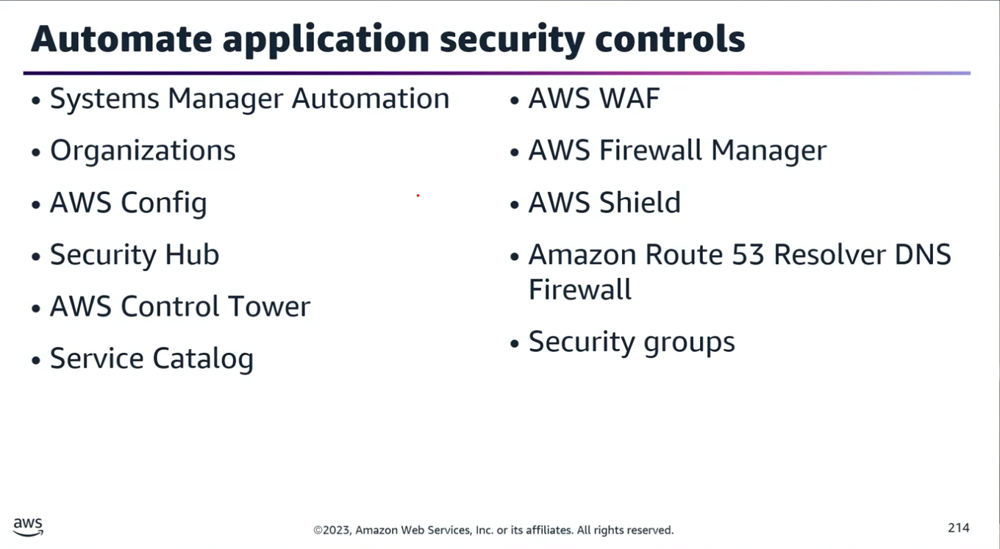
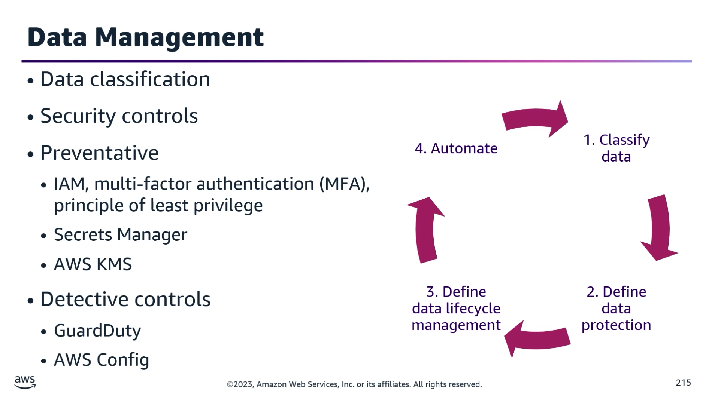
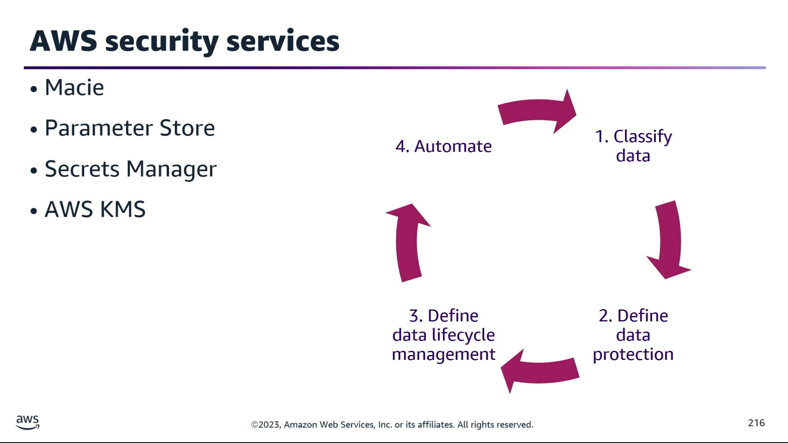
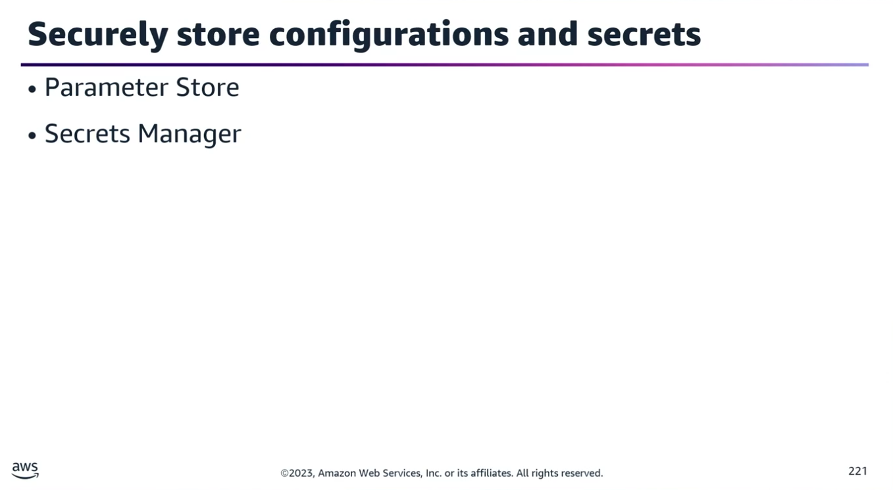
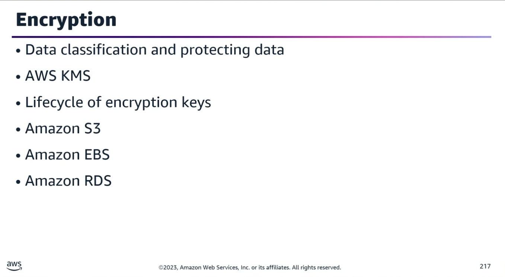
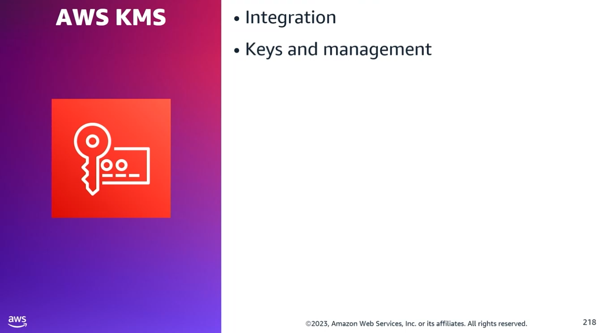
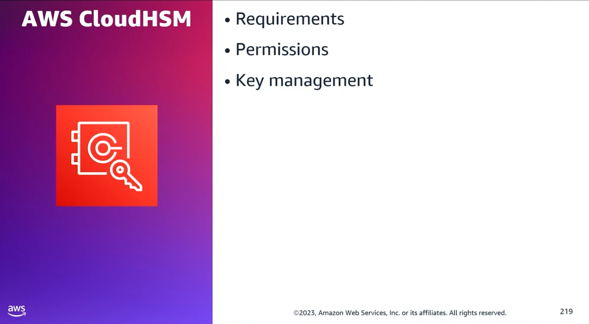
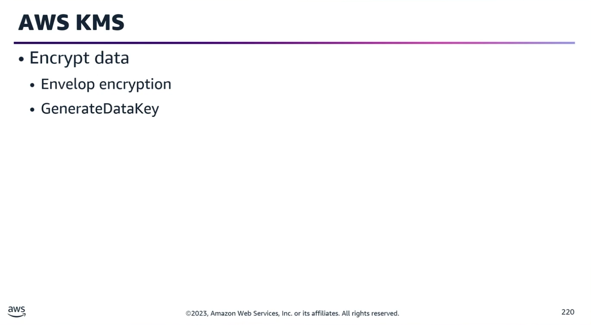
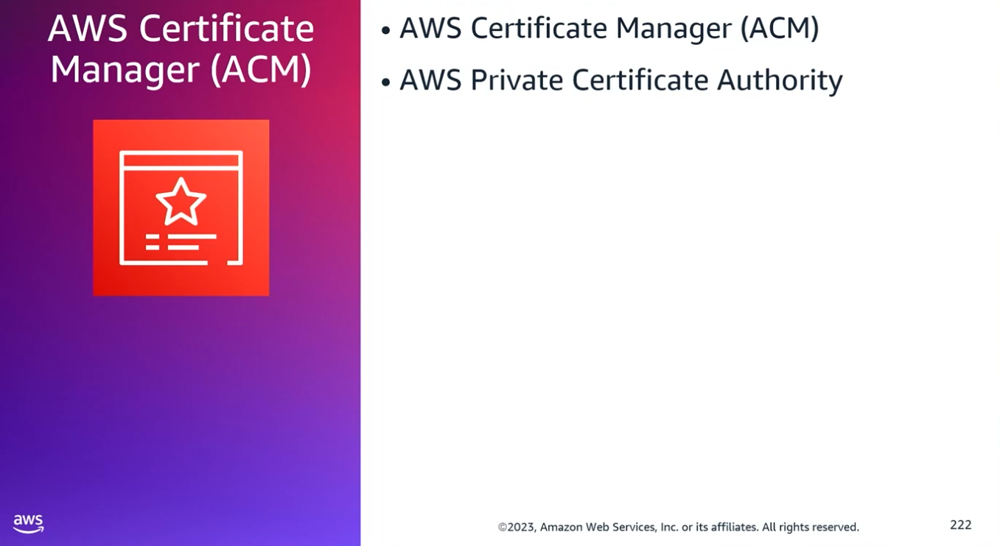
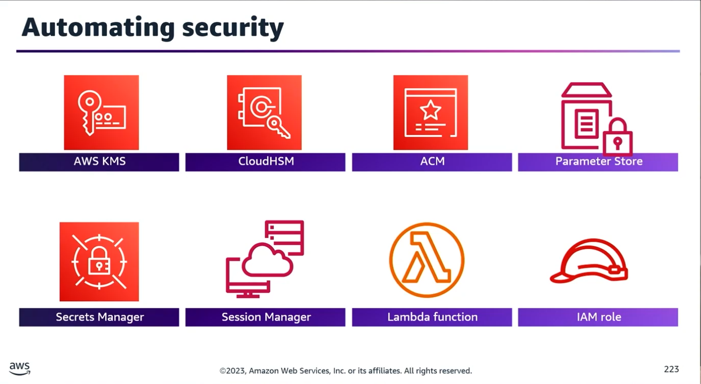

## Task Statement 2: Apply automation for security controls and data protection.

### 1. Automating Application Security Controls

Automating processes (builds, tests, deployments) reduces security gaps and accelerates remediations.
- **AWS Systems Manager (SSM) Automation:**
	- Can run runbooks across multiple accounts, Regions, or AWS Organizations OUs from a central account.
	- Used to centrally implement patching, remediate compliance drift (e.g., VPC configurations, S3 bucket policies), and manage resources at scale.
- **AWS Config:**
	- Monitors resource compliance and applies automated remediations using SSM Automation runbooks.
	- Scenario: To monitor and ensure all S3 buckets remain private, the best solution is combining AWS Config with an Amazon EventBridge rule to alert the security team upon policy violations (SCPs alone do not track compliance drift).
- **AWS Security Hub:**
	- Aggregates findings and sends them to EventBridge as events. Supports custom actions for specific insights, allowing integration with AWS Lambda for automated remediation.
- **AWS Control Tower:**
	- The easiest way to set up and govern a secure, compliant, multi-account environment based on best practices (Landing Zone).
	- Orchestrates AWS Organizations, AWS Service Catalog, and IAM Identity Center.
	- Extends AWS Organizations' capabilities to prevent drift and enforce guardrails (e.g., ensuring security logs and cross-account access permissions cannot be altered).
- **AWS Firewall Manager:**
	- Used for centralized security management across an entire organization rather than a few specific accounts.
	- Provides centralized monitoring of DDoS attacks and automatically applies protections to new accounts/resources.
	- Integrates with: AWS WAF (Managed & Custom Rules), AWS Shield Advanced, Security Groups, AWS Network Firewall, and Route 53 Resolver DNS Firewall.

### 2. Sensitive Data Discovery & Classification

Security must always be approached from a data perspective (understanding data type, classification, owner, legal requirements, and storage location).
- **Data Classification:** Critical for defining security zones, adjusting network flow controls, and applying proper access policy controls.
- **Defense in Depth:** Layering multiple security controls (Preventative & Detective) to provide redundancy.
	- **Preventative Controls:** IAM, MFA, Least Privilege, dedicated network zones for management traffic (separating application and management flows), Database Firewalls, AWS Secrets Manager, and AWS KMS.
	- **Detective Controls:** VPC Flow Logs (identifying unauthorized traffic), Amazon GuardDuty (threat intelligence), CloudWatch alarms, and EventBridge for automated responses.
	- **Configuration Drift:** AWS Config can detect table-level drift in Amazon DynamoDB, as well as drift in Amazon RDS instances, security groups, snapshots, subnet groups, and event subscriptions.
- **Amazon Macie:** Automatically discovers, classifies, and continuously monitors sensitive data at scale (e.g., adding Macie to an S3-based data pipeline to check for redacted/tokenized unstructured data like transcripts or emails prior to ingestion).
- **AWS Glue Data Catalog & Amazon SageMaker:** Used to inventory data types, track compliance, and handle data labeling.

### 3. Securing Sensitive Data & Credentials

- **Container Security Best Practice:** Pass sensitive information as environment variables or log configurations by referencing AWS Systems Manager Parameter Store or AWS Secrets Manager values directly inside the Amazon ECS task definition or AWS Batch job definition.
- **AWS Lambda:** Use the AWS Parameters and Secrets Lambda Extension to retrieve and cache secrets directly inside Lambda functions.
- **VPC Endpoints:** Use an Interface VPC Endpoint (AWS PrivateLink) to access Secrets Manager APIs privately without an internet gateway or NAT device.
- **Parameter Store vs. Secrets Manager:**
    
	- Parameter Store requires a forward slash (/) before the name-string when referencing a Secrets Manager secret ID.
	- Secrets Manager is preferred over Parameter Store when you require automatic credential rotation and resource-level access policies. (Note: Secrets Manager data is always encrypted).
- **Data Protection Framework (AWS Well-Architected):**
	1. Classify data into sensitivity levels; use encryption, tokenization, and access control.
	2. Define data protection controls (tags, KMS, SCPs) to eliminate manual data processing.
	3. Define a lifecycle strategy (retention, destruction, sharing).
	4. Automate identification and classification (Macie, Lambda, EventBridge).

### 4. Encryption (At Rest & In Transit)

Using AWS KMS provides a consistent lifecycle and access control mechanism for encryption keys across all services.

#### Amazon S3 Encryption

- Buckets are not encrypted; objects are. Encryption is applied at the object level.
- To enforce SSE-KMS for all objects in a bucket, use a Bucket Policy with a condition requiring the x-amz-server-side-encryption header in the upload request.
- **Client-Side Encryption:** Encrypting data within your own application environment using KMS before sending it to AWS removes AWS services from your trust boundary (ideal for hybrid architectures).

#### Amazon EBS Encryption

- Encrypts the underlying storage volume, disk I/O, snapshots, and derivative volumes.
- Key EC2/KMS behavior depends on whether the source snapshot is encrypted or unencrypted.

#### Amazon RDS Encryption

- Protects the underlying database storage, automated backups, read replicas, and snapshots.
- **Crucial Exam Concepts to Review:**
	- Can you encrypt an RDS instance after creation? (No, you must encrypt a snapshot and restore a new instance from it)
	- Can you turn off encryption once enabled? (No)
	- Can you create an encrypted snapshot of an unencrypted database instance? (Yes)
	- What KMS key is used for cross-Region or same-Region read replicas?
	- How do you copy an encrypted snapshot across Regions? (You must copy and re-encrypt it using a KMS key valid in the destination Region)

### 5. Key Management: KMS vs. CloudHSM

Both services support symmetric and asymmetric encryption, but have key operational differences:

| Feature |	AWS KMS |	AWS CloudHSM |
|---------|---------|--------------|
|**Images**| |  |
|**Tenancy**|Multi-tenant public service (AWS Public Zone)	|Dedicated single-tenant hardware appliance
|**Compliance**	|Managed by AWS	|FIPS 140-2 Level 3 Compliance
|**Key Management**	|Managed via IAM & Key Policies	|Managed via CloudHSM software clients (IAM only controls the cluster lifecycle, not the keys)
|**High Availability**	|Handled natively by AWS	|Must manually deploy modules across multiple Availability Zones

- **Envelope Encryption**: The practice of encrypting plaintext data with a Data Encryption Key (DEK), and then encrypting the DEK under a root Key Encryption Key (KEK).
- **To encrypt data locally**, use the KMS GenerateDataKey API operation, use the plaintext key to encrypt the data, erase the plaintext key from memory, and store the encrypted DEK alongside the encrypted data.

### 6. Certificate & Access Management

- **AWS Certificate Manager (ACM)**: Handles creating, storing, and renewing public/private SSL/TLS X.509 certificates. Used for enterprise customers needing a secure web presence over TLS.
- **AWS Private CA**: Used for building a private public key infrastructure (PKI) inside the AWS cloud for internal organization use.
- **EC2 Access Credentials**:
	- **Key Pairs**: Composed of a public key (stored on the instance) and a private key (stored securely by the user).
	- **Alternative**: AWS Systems Manager Session Manager replaces the need for key pairs, managing open inbound ports, and bastion hosts by providing secure, one-click, browser-based CLI shell access.

### 🧠 Exam-Style Sample Questions Analyzed

**Question 1:** You need to ensure all database credentials, secrets, and API keys for a multi-AZ RDS deployment with read replicas are encrypted and regularly rotated. What is the best solution?
- **Correct Answer:** AWS Secrets Manager, because it natively supports automatic rotation for Amazon RDS credentials and handles encryption.

**Question 2:** You are developing a serverless application with multiple Lambda functions that need to share an encrypted database connection string. What is the most secure and shareable solution?
- **Correct Answer:** Create a Secure String Parameter using SSM Parameter Store.
- Why others are incorrect: Lambda environment variables encrypted with KMS/CloudHSM cannot be shared globally across distinct functions out-of-the-box, and IAM execution roles grant permissions but do not store or encrypt connection strings.