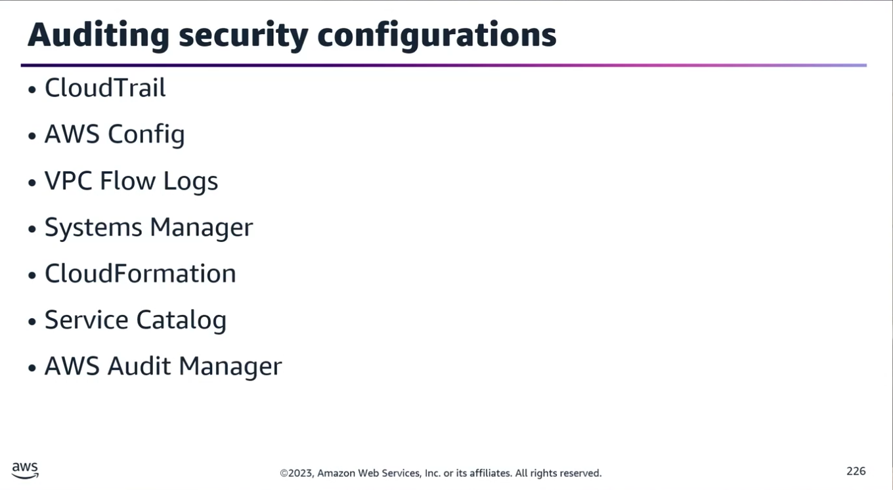
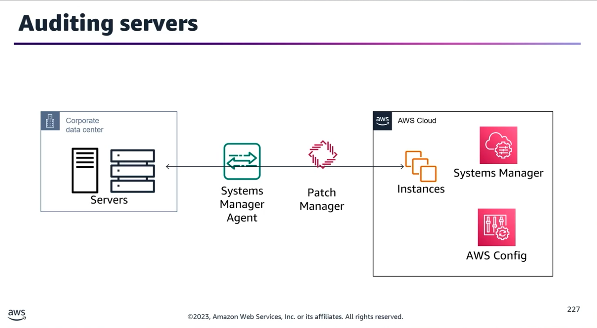
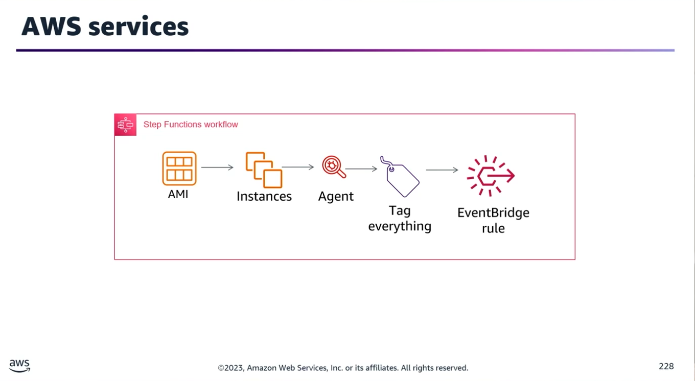
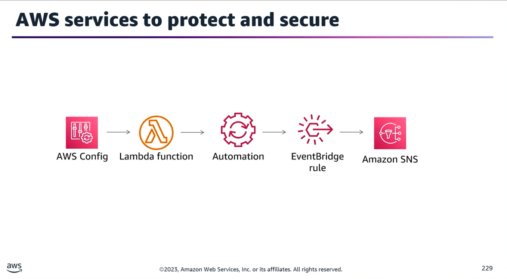

## Task Statement 3: Implement security monitoring and auditing solutions.

### 1. Core Auditing & Monitoring Framework

Periodically auditing security configurations ensures they meet current business needs. Audits provide opportunities to enforce the Principle of Least Privilege by removing unneeded IAM users, roles, groups, and policies.

#### Essential AWS Auditing Services

- **AWS CloudTrail:** Tracks user activity and API usage.
- **AWS Config:** Evaluates, audits, and assesses resource configurations.
- **VPC Flow Logs:** Captures IP traffic flow entering and leaving network interfaces.
- **AWS Systems Manager (SSM):** Configures and manages on-premises and EC2 systems.
- **AWS CloudFormation Drift Detection:** Identifies unmanaged configuration changes outside of templates.
- **AWS Service Catalog:** Manages approved catalogs of IT services.
- **AWS Audit Manager:** Continuously audits AWS usage to simplify risk and compliance assessment.

#### Monitoring Prerequisites

Before deploying solutions, you must define what application behavioral data, metrics, logs, and traces to track. For every single metric, you must explicitly identify:
1. The Target: What specific resource or component is being measured.
2. The Measurement Approach: How data is gathered, aggregated, and calculated.
3. The Priority: The urgency level assigned to the metric.
```
🚨 Action Item: Once metrics are defined, build proactive alarms and notifications (e.g., via Amazon CloudWatch and SNS) to automatically handle issues and security incidents.
```
### 2. Walkthrough Scenarios & Architecture Solutions

#### Scenario A: Hybrid & Automated Patch Management

**Problem:** How do you audit servers on-premises alongside EC2 instances, synchronise patch baselines, and automate the patching schedule?
- **Solution Strategy:**
	- Deploy AWS Config to track, record, and continuously audit overall resource compliance.
	- Install the AWS Systems Manager (SSM) Agent on both your Amazon EC2 instances and your on-premises servers.
	- Utilize SSM Patch Manager to manage, record, and deploy operating system security patches based on defined organizational baselines.
	- Configure SSM Maintenance Windows to automate and govern the exact deployment schedules for these security updates.

#### Scenario B: Enforcing Approved AMIs & Vulnerability Monitoring

**Problem:** How do you audit and ensure your team only uses approved AMIs while continuously checking for vulnerabilities and exposures?

- **Solution Option 1:** Step Functions + Amazon Inspector (Daily Scan Pipeline)

1. Use AWS Step Functions to orchestrate the deployment workflow.
2. Launch a test EC2 instance from the targeted AMI.
3. Install the Amazon Inspector Agent on the instance and apply a specific deployment tracking tag.
4. Configure the Step Function to run an Inspector assessment across all instances bearing that specific tag.
5. Trigger this Step Function execution daily using an Amazon EventBridge Rule.

- **Solution Option 2:** AWS Config + Lambda (Automated Guardrail Enforcement)

1. Create an AWS Config Custom Rule backed by an AWS Lambda function to evaluate if any live EC2 instance was launched using a non-approved AMI.
2. If evaluated as non-compliant, trigger a Systems Manager Automation Runbook as a remediation action.
3. The SSM automation automatically terminates the non-compliant EC2 instance.
4. Route the compliance event changes through an Amazon EventBridge Rule to an Amazon SNS Topic to notify the security team immediately.

### 3. DevOps Security (DevSecOps) Best Practices

Because the DevOps lifecycle accelerates software delivery, security must be integrated fundamentally throughout the architecture.
- **Continuous Integration:** Security can no longer be a final checkbox at the end of the deployment pipeline. It must be built into the entire lifecycle from day one.
- **Pervasive Security:** Secure automatically at all levels, tiers, infrastructures, and directly inside CI/CD pipelines.
- **Secrets Management:** DevOps necessitates cross-team collaboration and the programmatic exchange of privileged information. Secure, centralized secrets management tools are vital.
- **Compliance-Driven Policies:** Build organizational security policies dynamically around strict compliance requirements.
- **Pipeline Visualization:** Map out and visualize the entire deployment pipeline to locate security blind spots, implement target controls, and remediate gaps immediately.
- **Tagging Strategy:** Tag everything. Robust metadata tagging is highly critical for tracking, cost allocation, automation boundaries, and targeted security auditing.